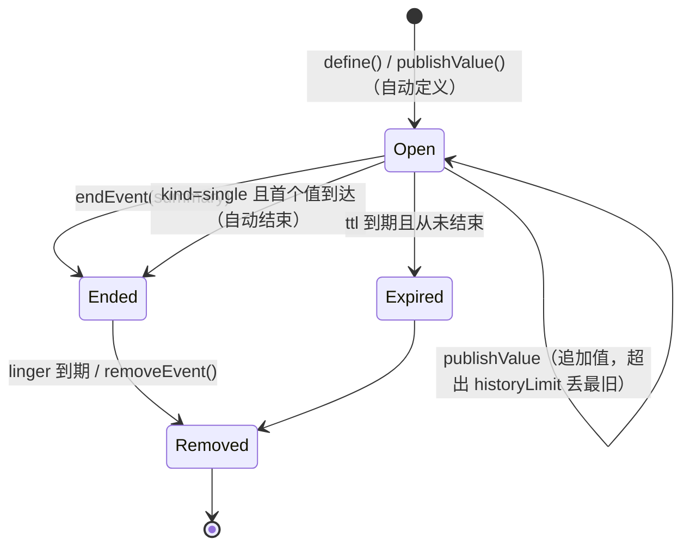
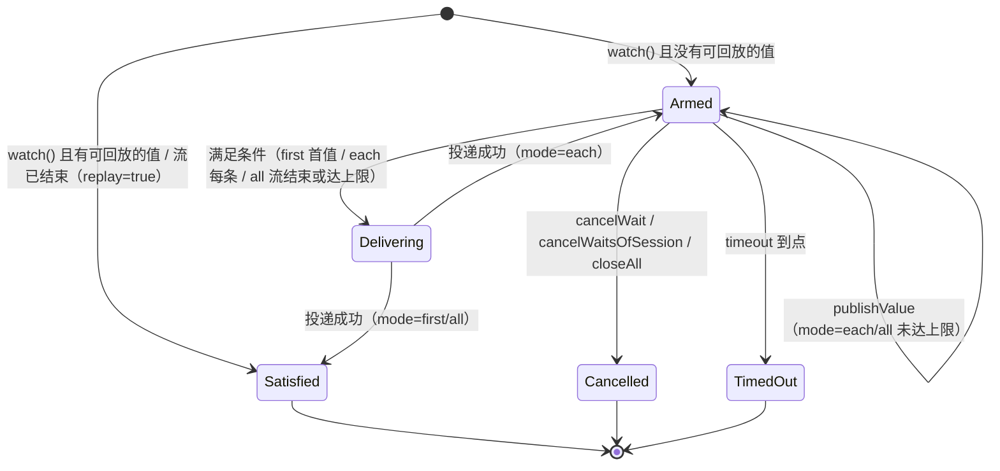

# 事件中枢与异步挂起

> 相关文档: [index.md](index.md)（整体架构）· [plugins.md](plugins.md)（插件面与总线）·
> [config-keys.md](config-keys.md)（`event.*` 配置键，生成物）·
> [test-modules.md](test-modules.md)（`event_hub` / `event_tools` / `event_delivery` /
> `event_subagent` / `async_work`）

## 1. 要解决的问题

一次工具调用在架构上必须**同步**：工具的返回值就是 `tool` 消息的内容，模型下一步要读它。
于是"现在还没有结果，等有了再继续"这件事在没有额外机制时只能靠模型反复查询，或者靠人盯着。

事件中枢把这件事拆开：

- **等待**：模型登记"我要 `X` 的值"后立刻拿到回执，本轮继续做别的事或直接结束；
- **投递**：值到达时由主程序把它变成一条会话输入（空闲就开新一轮，在跑就插到下一次
  模型调用之前）；
- **发布**：任何来源（模型、插件、轮次/工具生命周期、子代理、定时器）都能往里放值。

与 [EventBus](index.md) 的分工（两者不是替代关系）：

| | `EventBus` | `EventHub`（本文） |
|---|---|---|
| 语义 | 通知（发了就完） | **有状态**：每个名字有一份记录（历史值、是否已结束、等待数） |
| 名字 | 主题字符串，多方约定 | 事件名（与总线主题**同一个字符串**），有三族前缀与保留子段校验 |
| 订阅 | 类型化模板订阅 / 前缀订阅 | 等待句柄（`w-3`），可查询、可取消、可回放 |
| 结果去处 | 订阅者自己处理 | 统一翻译成**会话输入**（`[Event] ...`） |
| 生命周期 | 无 | 记录可结束、可过期、可移除；等待可超时 |

hub 通过组合使用总线：它**只订阅 `plugin.` 前缀**，因此**插件往总线发一个
`plugin.<插件名>.<名字>` 就等于往中枢发值**，不需要新接口表也能用（见第 12 节）；
内置源不走总线，直接调 `publishValue`（避免被强类型主题的高频发布拖慢）。

命名规则只有一份实现（`agentxx/event/naming.h`），事件名与总线主题、功能埋点 id 共用：

| 族 | 形式 | 谁能写 |
|---|---|---|
| 内置 agent 端 | `agentxx.agent.<域>...` | 主程序 |
| 内置 client 端 | `agentxx.client.<域>...` | 客户端主程序 |
| 插件 | `plugin.<插件名>.<自由部分>` | 该插件自己 |

值事件（带值、可等待、可回放的那些）用两段：内置在 `agentxx.agent.event.` 段
（与 `agentxx.agent.turn.start` 这类强类型主题分开，避免同一主题两种载荷），
后台任务的完成事件是唯一例外，固定在 `agentxx.agent.async.done`（见第 8 节），
插件直接用自己那一族。**框架只校验不补前缀**：名字不在自己那一族里就报错。

## 2. 三个对象

```text
生产者：模型 agentxx_async_emit │ 插件（总线 plugin.<插件名>.*）│ 轮次/工具生命周期
        │ 子代理完成 │ 定时器
        ▼
EventHub（每个根一份，跑在该 agent 的 io 线程）
  ├── EventRecord  名字 → {kind: single|stream, state, 历史值[<=N], summary}
  └── EventWait    等待句柄 → {waitId=w-N, event, mode, originSession, delivery, values}
        │ 值到达 → 匹配等待 → 满足条件（first / each / all）
        ▼
EventDelivery（渲染好的文本 + 目标会话 + 投递模式）
        ▼
SessionInputSink（当前驱动这个会话的端点实现）
  ├── 轮次在跑：Session::enqueuePendingInput（下一次模型调用前插入上下文）
  └── 轮次空闲：会话队列 + 唤醒驱动循环（等同一次用户输入，开新一轮）
```

职责边界：

- **生产者**只管"有个事件叫 X，现在有一个值 v"（以及"这条流结束了"），不知道谁在等；
- **等待者**只管"要 name=X 的值，要几个，到了送到哪个会话"，拿 `waitId` 可查可取消；
- **投递者（hub）**是唯一知道"会话现在忙不忙"的地方，投递决策只在它这一处。

`SessionInputSink` 保证 **一个会话同一时刻只有一个驱动者**：hub 不自己
`co_spawn` 一轮 `runTurnAsync`（那样会和端点的驱动循环同时改同一个 `Session`），
而是把输入交回给驱动者排队。当前实现是服务端会话端点 `SessionServerAgentIO`，
它把弱引用登记在 `Session::inputSink` 上，停止时清空。

## 3. 状态机

事件记录：



等待句柄：



要点：

- `single` 事件收到第二个值会覆盖并计 `overwritten`（单值语义明确，不静默丢）；
- 同名事件被定义成不同 `kind` 时保留先定义者，后到的 `define` 返回错误；
- 已 `end` 的事件再收到值会重新打开（流式事件允许"续上"）；
- 终态等待保留一段时间供诊断查询，之后回收。

## 4. 投递决策

投递模式由等待的 `delivery` 决定（后台任务结果默认 `next-step`，来自 `agentxx_async_run` 的
`notify`；插件的等待可用 `event.delivery` 作默认）：

| 会话状态 | `next-step` | `inject` | `next-turn` | `none` |
|---|---|---|---|---|
| 空闲（有驱动端） | 直接开新一轮 | 直接开新一轮 | 直接开新一轮 | 只留在中枢 |
| 轮次在跑 | 写入待注入输入，下一次模型调用前插入上下文 | 写入待注入输入，只进下一次请求（不改写上下文） | 入会话队列，本轮结束后再跑一轮 | 只留在中枢 |
| 空闲（无驱动端） | 写入待注入输入，记 `deferred`，不开轮 | 同左 | 同左 | 只留在中枢 |
| 关停中 / 中枢已关闭 | 丢弃 + 计数 | 同左 | 同左 | 只留在中枢 |

补充规则：

- **暂停态**（上一轮失败/中断留下的暂停）默认不自动解除：事件输入照常入队但不唤醒；等待
  显式要求 `unpause=true` 才解除（与"积压消息不自动继续执行"同一语义）；
- **后台任务结果例外**：`agentxx.agent.async.*` 的投递一律按"结果必须进上下文"处理 ——
  空闲时即使队列停在暂停态也解除暂停开新一轮；轮次在跑时（结果落在最后一次模型调用之后、
  轮末才被提升为下一轮输入）该条目带 `resumeRequested` 标记，轮末按"失败/中断"收尾时
  因此不置暂停。否则这类结果只能等用户下次发消息才被顺带执行（表现为"异步结果总是要等
  会话在跑或者发消息才进上下文"）；
- **`dropIfBusy`**（插件触发器的 `DROP_IF_BUSY` 语义）在轮次在跑时直接丢弃并计数；
- **轮末兜底**：待注入输入只在模型调用开头被取用，落在最后一次模型调用之后的输入会在
  轮次结束时提升为下一轮输入（`BaseAgent::runTurnAsync` 的 `rolloverLeftoverNextStepInputs`），
  只在有驱动端时提升 —— 否则没人接，留在原处；
- **无驱动端 + `event.allow_headless_turn=true`**：由 agent 自己起一轮（嵌入方自己调
  `runTurnAsync` 的场景），默认关闭，避免没人看结果时白烧额度。
- **`inject` 的来源标记**：注入内容只在本请求可见、不进权威上下文，所以其他非 `user` 来源的
  注入消息正文前会加一层 `[<来源>]` 前缀（让模型知道这段一次性内容的来历）；事件投递的
  正文首行已经是 `[Event] <名字>` + `[Info]`，自带来源，**不再额外加前缀**
  （`drainPendingSessionInputs` 按 `eventNameOfInputSource` 判定）。

## 5. 投递文本（给模型看的稳定格式）

```text
[Event] build.done
[Info]
mode: first
wait: w-3
status: value
ref: call_1
note: ...
label: ...
[Content]
{"ok":true,"url":"https://example.com/out.zip"}
```

三段结构（`renderEventText`, 实现见 `agent/lib/src/event/hub_text.cpp`）:

- `[Event] <名字>`: 首行只放事件名, 模型据此识别“这是事件而不是用户说话”; 折叠预览与日志也靠它认事件
- `[Info]`: `mode` / `wait` / `status` 恒输出, `ref` / `label` / `note` 有值才写;
  `status` 取值 `value` / `values` / `stream-ended` / `stream-open` / `ended-empty` / `timeout`
- `[Content]`: **值本身**, 不做任何字段解释（`renderEventValuesText`）:
  - 值可能是别人自定义的 JSON（插件 / 模型 `agentxx_async_emit`）: 对象 / 数组一律给紧凑
    JSON（`dump()`，键序 / 转义 / 数字格式与发布时一致），**不改字段、不改转义** ——
    否则 `"step":1` 会变成 `step: 1`、字符串 `"1"` 与数字 `1` 混为一谈
  - 字符串值给原文（它本身就是文本，不是 JSON 结构；多行就是多行）
  - 多个值（`mode=all` 等）给 JSON 数组（`[1,2]`）
  - 本次投递没有值时, 段标记写 `[Content: empty]` (不再留一个空的 `[Content]` 与 `(no value)` 占位;
    标记常量见 `agentxx/event/text_sections.h`, 展示端也按它跳过预览。与命令工具的空段
    `[StdOut: empty]` / `[StdErr: empty]` 是同一种写法, 一眼看出“这一段没有东西”)
  - **唯一例外**: 框架自己的后台任务结果事件（`agentxx.agent.async.*`）把产物正文放在
    `content` 字段里（工具输出 / 子代理回答，本身可能就是 JSON 文本）：该字段按原文单独
    给出（`content:` 一行 + 原文），其余字段仍是同一个 JSON。原文即原文，不经 JSON 转义，
    也不会把正文里的 JSON 重新排版（见 [eventTextPayloadField]）；
    其他事件一律不解释字段
- 末尾换行去掉（投递文本作为一条 `user` 消息）;
- 内容过长时**整段**转会话 share store（不再逐值转存, 否则默认阈值下会卸载两次）:
  判定与提示与工具输出压缩共用 `agentxx::util::offloadShareStoreIfOversized`,
  阈值 = `toolcallSummaryLimitOutputLength`（utf8 字符数, 默认 2 K）与
  `event.value_max_bytes`（字节, 默认 32 K）取较小者（`AgentConfig::eventContentLimitLength`）;
  文本里留 `[Content offloaded. ...]` 与开头片段, 模型用 `agentxx_share_store` 按行取回;
  超过 1 MB 硬上限直接拒绝发布。
- **唯一不卸载的一段**：后台**工具**任务的结果（`kind=tool`）—— 它的正文在工具执行层就按
  工具自己的声明裁剪过（`autoSummaryOutput` + 同一阈值，前台 `ToolcallWrapNode` 与后台
  `runToolWork` 共用 `agentxx::util::offloadToolResultIfOversized`）；事件侧再整段卸载等于
  给同一段输出套第二层取回提示（工具层的 id + 事件层的 id），模型要多取一次才能看到内容。
  子代理回答（`kind=agent`）与插件/模型发布的自定义值不受这条影响，照常按长度卸载。

后台任务完成时的回执文本（`async_start` 返回的是受理信息，结果由它自己投递）:

```text
[Event] agentxx.agent.async.done
[Info]
mode: first
wait: -
ref: async-7
status: value
[Content]
{"asyncId":"async-7","kind":"tool","name":"agentxx_filesystem_grep","hasError":false,...}
content:
<工具输出原样, 多行就是多行; 本身是 JSON 就还是那段 JSON>
```

这条文本由 `AsyncWorkManager::finishEntry` 直接交给会话（不再是事件等待的投递），
所以 `[Info]` 的 `wait` 行是 `-`；`[Event]` 首行与分段标记保持旧形态，界面与 wire 不变。

`agentxx_async_await` 的返回值是任务表的条目文本（`renderEntryDetail`），不再复用事件渲染：
正文、错误、取消状态都只有任务表一份来源，任务没结束时它登记一次等待，而不是订阅事件。

两种文本的终态都是成功: 工具返回 `ToolResult::ok(...)`, 成败只看状态, 不看正文里有什么字样。
以前的实现靠首行前缀判定 (`[Error` / `[Permission denied` / `[Repeated call denied` /
`[Plugin tool timeout`), 那套清单与实现已经删除 (见 5.1)。

### 5.1 状态与正文的分工

工具结果是一个 `{text, status}` 对 (`agentxx/util/tool_result.h`):

- **成败只看 `status`** (`ok` / `failed` / `interrupted` / `canceled`), 由工具自己给 (或由
  执行层把异常 / 工具不存在 / 参数非法 / 权限拒绝 / 插件失败终态换算成 `failed`);
- **`text` 只给模型读**: 执行层 `util::toolResultTextForModel` 是唯一的排版处 —— 只有 `failed`
  会被套上 `[Error: ...]`, `canceled` / `interrupted` 无正文时补占位, `ok` 原样透传;
- 所以工具正文里出现 `[Error` 这类字样**不代表失败** (`event_tools` 专门断言过: 正文含
  `[Error: ...]` 但状态是 `ok` 时, 执行层不会再加一层包裹, 也不当成失败)。

限制只落在“工具的成败”上。事件投递产生的输入是一条 `user` 消息 (`[Event] ...`), 不经过
这套判定; 提示、日志、Wire 消息同样不涉及。

### 5.2 来源标记与展示角色（给界面看的，不参与判定）

事件投递的输入进入 LLM 上下文时仍是 `user` 消息（模型只认 user/assistant/tool），但
展示历史里有专属角色，界面因此能把它折叠起来，不占满屏幕：

- `ViewMessage::Role::Event`：事件投递的输入的展示角色；普通用户输入仍为 `Role::User`。
  角色由来源推导（`ViewMessage::roleOfInputSource`），服务端两处写入点
  （`BaseAgent::runTurnAsync`、`nodes/session_context.cpp` 的 `appendUserViewMessage`）
  与客户端 TurnStart 回显共用这一份判定；事件消息默认折叠（`makeText`）
- `ViewMessage::source` 与 `WireDelta::source`（TurnStart 用）取值 `event:<事件名>`；
  用户自己输入时为空字符串
- 写入口：`BaseAgent::runTurnAsync(..., inputSource)` → 展示消息 + TurnStart 增量；
  常量与前缀解析在 `conversation_types.h`（`kInputSourceEventPrefix` / `eventNameOfInputSource`），
  投递方与展示方共用一份，不各记一套字符串
- 客户端只拿它做展示（折叠头 `+ [事件] <事件名> · <内容预览>`，i18n 键 `msg.eventPrefix`），
  **不解析正文**（唯一例外是折叠预览按固定分段标记 `[Content]` 取一行）；空值不写进 JSON
- 只认 `Role::Event`：`fromJson` 按 JSON 里的角色原样解析，不做角色归一化 —— 早期把事件
  输入记成 `role=user` + `source=event:*` 的历史消息就按普通用户消息展示
  （User 行不画事件头，折叠默认值也走用户消息规则）
- 历史消息经 Sync（`ViewMessage` JSON）与会话库重载后角色与来源都保留；
  界面细节见 [tui.md](tui.md) §2.17

## 6. 模型侧工具

后台任务与事件用一组小工具，各管一件事（`opt` 参数已删除：发布侧用 `end` 布尔值）：

| 工具 | 参数 | 作用 |
|---|---|---|
| `agentxx_async_run` | `tool`, `args`, `notify`（默认 `true`）, `label`, `delayMs`, `queueTimeoutMs`, `runTimeoutMs` | 把一次工具调用（或一条 `agentxx_subagent` 子代理任务）放到后台；`notify=true` 时结果自动插回会话；`queueTimeoutMs`/`runTimeoutMs` 是排队与运行的时限（默认 0 = 不限） |
| `agentxx_async_query` | `group`（`all`/`queued`/`running`/`done`/`failed`/`canceled`, 默认 `all`）, `id` | 按分组列本会话的后台任务；给 `id` 查单条（含结果正文）；还在延时里的排队项列表项开头带 `*` |
| `agentxx_async_await` | `id`, `timeoutMs`（默认 30000，上限 300000） | 等该任务结束并返回结果：`timeoutMs` 是整段等待的超时（延时+排队+运行全算）；已结束的直接读任务表返回。运行中等待时自动通知那一份不再插入会话，见下方“结果怎么回到会话” |
| `agentxx_async_manager` | `opt`（`cancel` / `delay`）, `id`（**数组**）, `delayMs` | 对已存在的任务动手：`cancel` 取消、`delay` 改起跑延时（`delayMs:0` = 去掉延时）；`group` 批量入口已删除，模型给单个 id 时由执行层按 schema 转成数组 |
| `agentxx_async_emit` | `event`, `value`, `end`, `public_publish`, `label` | 发布值 / 结束事件流（只管写侧，见 6.1） |

`id` 是后台任务的 `asyncId`（`async-7`）。

**结果怎么回到会话**：只有一条路径 —— 任务收尾时由 `AsyncWorkManager::finishEntry`
直接交给会话（复用中枢的投递决策段 `EventHub::deliver`）；事件 `agentxx.agent.async.done`
仍然发布，但只是广播（给插件与外部订阅者），不再负责投递。

- `notify`（默认 `true`）：收尾时直接投递一条 `[Event] ... / [Content] ...` 输入，
  与旧行为同一形态（界面、协议、轮末提升的 source 前缀判断都不变）；
- `agentxx_async_await` 在任务还没结束时先在条目上做一次**等待登记**
  （`AsyncResultTicket`，见 `AsyncWorkManager::waitTerminal`）等终态，醒来后读任务表；
  任务收尾时看到有等待登记，就**把正文交给等待方、本次不再自动投递** ——
  等待登记只在内存里，终态即清空，不是持久状态；
- await 是“读”不是“消费”：任务已结束时再 await 会再返回一份正文（工具语义，
  与模型重复调用其他读取类工具一致）；`notify:false` 的任务没有自动投递，await 照常给；
- 投递失败（会话关停 / 背压丢弃 / 无驱动端）只记 WARN 与 `dropped` 计数，不重试；
  正文仍在任务表，`agentxx_async_query` / `agentxx_async_await` 都能取回；
- 正文只有任务表一份：等待登记不带正文，事件值里的 `content` 只用于广播与旧文本渲染。

工具开关：事件中枢**常驻**（删了早期版本的 `event.enable`），`agentxx_async_emit` 总是注册；
`agentxx_async_*` 需要 `async_work.enable`（容器在 init 之后才挂上也可以，工具内部取不到时
给明确错误）。`repeatCallCheck` 全为 false，`agentxx_async_query` 声明 `supportsParallel=true`
（只读），其余独占（`supportsParallel=false`）。

模型侧不再提供“等任意事件”与定时器（早期版本的 `watch` / `await` / `status` /
`list` / `works` / `cancel` 与 `after_ms` / `every_ms` 已删除）：等结果用 `agentxx_async_await`，
后台任务默认会把结果主动送回来。

### 6.1 `agentxx_async_emit`：发布值、收尾、发布权限

一次调用做两件事（可以只做一件）：

- 给了 `value` → 发布一个值；
- `end: true` → 收尾这条流；两个都没给是参数错误。

事件不存在时，只有**有创建资格**的调用方才能顺手建出来（按流式事件建，归属 `tool`）：
模型只能在 `agentxx.agent.event.<名字>` 里建，且不能占框架保留子段；插件只能在 `plugin.*` 里建。

发布权限由**创建它的那一方**决定（参数就一个布尔值）：

| 创建时的参数 | 谁能发 |
|---|---|
| 不写（默认） | 只有创建者能发、能收尾 |
| `public_publish: true` | 任何人（插件、内置源、其它模型调用）都能发 |

补充规则：框架自己的事件段（`agentxx.agent.event.*` / `agentxx.agent.async.*`）内置源始终可以发
（同一段被轮次、工具结束、定时器、后台任务共用）；插件族记录不受这条照顾。
`public_publish` 与 `label` 只在**创建**那一次生效，事件已存在时按它自己的定义来。

结果文本只给这次调用带来的新信息，不回显参数：`created a new stream (publishing allowed to: …)` /
`N value(s) published so far` / `delivered to M waiter(s): w-3 next-step, …` /
`K waiter(s) still attached` / `stream closed after N value(s); K waiter(s) finished without a value`。

## 7. 内置事件源

| 事件名 | 何时有值 | 值 |
|---|---|---|
| `agentxx.agent.event.turn.start` | 轮次开始 | `sessionId` |
| `agentxx.agent.event.turn.end` | 轮次结束 | `sessionId`, `hasError`, `interrupted`, `durationMs`, `reason` |
| `agentxx.agent.event.tool.end.<工具名>` | 一次工具调用结束 | 工具名、是否有错、结果字节数 |
| `agentxx.agent.async.done` | 一条后台任务结束（成功/失败/取消） | `asyncId`, `kind`, `name`, `content`, `hasError`, `canceled`, `errorMessage`, `creatorSessionId`, `startedAtMs`, `finishedAtMs` |
| `agentxx.agent.event.timer.<名字>` | 定时源（插件 `register_timer` / 内部安排） | `timer` 与触发时间 |

这些子段（`turn.` / `tool.` / `async.` / `timer.` / `host.`）归框架占用：
模型与插件建自己的事件时不能占（订阅侧不受限）。

内置源**只在有人等时**才发布（先问 `hub->wants(名字)`），因此没人用时不产生记录与开销。
生命周期事件同时仍按原样发布到类型化总线（`Topic::AgentTurnStart/End`、`ToolCallStart/End`），
两条路互不影响。

## 8. 后台任务（async work）

模型侧“开始即提交”：任何工具调用（含 `agentxx_subagent`）都可以通过
`agentxx_async_run {tool, args, notify, delayMs, queueTimeoutMs, runTimeoutMs}` 放到后台跑
（唯一不允许的是 `agentxx_async_run` 自己）；`notify` 默认 `true`，结果完成时
**主动插回上下文**（轮次在跑就插到下一次 `ModelCallNode` 之前，轮次已结束就入队开新一轮）。
到点没跑上、跑得太久、或者不要了，都用一个入口 `agentxx_async_manager` 处理（见 8.2）。
`agentxx_subagent` 自己不再隐式异步（隐式异步已删除）：直接调用就是同步等结果，
后台跑只是把同一组参数交给 `agentxx_async_run`。

一次后台执行叫一个 async work，`kind` 区分 `agent`（启动一个 agent 跑任务）与
`tool`（把一次工具调用放到后台跑）。
```text
父会话 toolcall: agentxx_async_run {tool:"agentxx_subagent", args:{subagent:"task", message:"..."}}
  或:          agentxx_async_run {tool:"agentxx_execute_bash_command", args:{command:"...", timeout:0}}
  -> AgentHost::submitAsyncWork 立即受理: 入队, 返回 {started:true, asyncId:"async-7"}
  -> 工具结果文本: [Async started] id=async-7 ... (结果默认自己回来, 也可 query/await/manager)
  -> 队列 (默认按创建者) 有名额时后台跑; 失败/取消同样发布
  -> 结果值发到固定事件名 agentxx.agent.async.done, 值里用 asyncId 区分是哪一条
  -> 提交时就替会话登记了一条 next-step 定向等待: 轮次在跑 -> 下一次模型调用前插入;
     轮次已结束 -> 入队并开新一轮
```

要点：

- **单一事件名**：结果统一发 `agentxx.agent.async.done`（值事件族新增
  `agentxx.agent.async.`），不再按任务名/序号生成事件名。等待靠
  `EventWaitSpec::match`（`{"asyncId":"async-7"}`）过滤：不匹配的值**不消耗**等待，
  带过滤的等待也不随事件结束收尾（别人的任务结束不代表我那条有结果）；
- **结果值形状**：`{asyncId, kind, name, content, hasError, canceled, errorMessage,
  creatorSessionId, startedAtMs, finishedAtMs}`（单一标识 `asyncId`）；
- **排队与额度**：每队列（默认 = 创建者 agentId）一条 FIFO，额度
  `async_work.max_concurrent`（默认 3）；不设排队条数上限、不设嵌套深度上限、
  也没有全局并发上限；
- **起跑延时**（`agentxx_async_run` 的 `delayMs`，> 0 才生效）：延时未到的条目
  **状态仍是 `queued`**，`pump` 扫队列时跳过它 —— 它留在队里、不占名额，也不挡住
  后面能跑的任务；到期由管理器的一条共享 `asio::steady_timer` 唤醒后重新 `pump`
  （拿不到就绪名额时继续排队）。任务表额外字段：`delayMs`（提交时的原值）与
  `delayRemainingMs`（还在延时中才带）。`agentxx_async_query` 的列表项用开头字符区分：
  `-` 是普通排队、`*` 是还在延时里（后面再跟 `delay=<剩余> left`），一眼看出“为什么它还没跑”。
  `agentxx_async_manager {opt:"delay", id:["async-7"], delayMs}` 改延时（`0` = 去掉），
  `AgentHost::startAsyncWorkNow`（内部 API，模型侧不暴露）直接抹掉剩余延时让它即时起跑；
  排队中取消仍直接出队；
- **`asyncId` 就是任务 agent 的 sessionId**（一个值，不另造；`kind=tool` 的任务没有 agent，
  `asyncId` 仍然是它自己的会话 id，只是不派生 agent）；
- **取消与改延时**：`agentxx_async_manager {opt:"cancel", id}` 与
  `{opt:"delay", id, delayMs}`，`id` 是 **id 数组**（去重后逐条处理、逐条一行结果；模型给单个
  id 时由执行层按 schema 转成数组），只能动本会话启动的任务；`group` 批量入口已删除。
  插件侧另有 `agentxx.agent.runtime` 的 `cancel_async_work`，agent 关停走
  `AgentHost::cancelAsyncWorks(ctx)`：排队中的直接出队并立即发终态，运行中的置取消令牌；
  被取消同样发终态，等待方不会挂到超时（机制见 8.2）；
- **查询**：`agentxx_async_query {group}` / `{id}`；没开 `notify` 或错过投递时靠它拿结果；
- **结果怎么回到会话**：`agentxx_async_run` 的 `notify`（默认 `true`）在任务收尾时
  由 `AsyncWorkManager::finishEntry` 直接交给会话（不经过事件等待）：轮次在跑 → 插到
  下一次模型调用前；轮次已结束 → 入队并开新一轮；会话没有驱动端 → 落待注入输入
  （计数 `deferred`）。`notify:false` 只落任务表。
  **有人等着就不重复投**：`agentxx_async_await` 在任务未结束时登记了等待，收尾时正文直接
  交给等待方，本次不再插入会话；任务早就结束（已经投过）时再 await 会再给一份，
  这是工具语义。规则与并发边界见 §6 的“结果怎么回到会话”。
  **插件提交的任务不能用这条路**：投递用的是创建者会话的驱动端点，插件自己开的会话
  不属于创建者时报 `session not found` —— 那种场景由插件在 `on_event` 里自己投
  （参考 `agent/plugins/agentxx_chatbot/chatbot_task.cpp`）。
- 子代理上下文**继承父事件中枢**（嵌套沿用最外层），所以子代理 emit 的事件父会话能等；
- **中断策略**（`async_work.interrupt_policy`，单次提交可覆盖）：`bubble`（默认）把
  权限询问与 HIL 冒泡到创建者会话；创建者会话已销毁时按拒绝。`deny` / `allow` 不冒泡，
  改为在任务自己的会话总线上注册固定应答器 —— 权限询问一律拒绝/允许（不记住选择、
  不切完全授权），其他 HIL 中断 `allow` 用空结果恢复、`deny` 按取消收尾；
- **会话落盘**（可选，`async_work.session_store`）：目录
  `{创建者会话目录}/agent/{asyncId}`，提交时按（存储根, asyncId）独占登记、任务结束释放；
  只服务事后回看，不做重启续跑；创建者没有 `dataDir` / `sessionStoreDirectory` 时
  明确拒绝，不默默不落盘；`async_work.session_store_keep_days`（默认 0 = 不清理）开启后，
  提交带落盘的任务时顺手清掉超过该天数的旧任务会话目录；
- 任务表（entry）是纯内存记录：运行中一直在，结束后保留 `async_work.linger_ms`
  （默认 5 分钟）供查询，到期自动清除。
- **界面可见**：TUI Info 侧边栏的「后台任务」段经 `WireContextStats.asyncWorks`
  （追加字段，最多 10 条，为空不带）展示本会话创建的运行/排队/最近完成项；
  任务表状态变化（提交 / 起跑 / 终态 / 排队中被取消）经
  `SessionInputSink::onAsyncWorksChanged` 通知创建者会话的驱动端点，端点合并后重推一次统计
  （还有排队/运行中的条目时按秒续推，已跑时长跟着走；**只有延时中的排队项不续推** ——
  它的已跑时长不走，一个 1 小时的延时不该每秒推一次，到期时由管理器主动通知一次）；
  只展示不给取消入口（取消走 `agentxx_async_manager`），详见 [tui.md](tui.md) §2.7。
- **`kind=tool`（异步工具）**：`agentxx_async_run` 把**一次工具调用**放到后台
  （`AsyncWorkSpec{toolName, toolArgs}`）。工具在**创建者**身上按名字查，两个来源都算：
  内置/中间件工具（`share_store` / 事件发布 / 后台任务族 / `agentxx_subagent` 之外那些
  中间件贡献的工具）由执行图引擎持有，经 `AgentContext::builtinToolIndex` 拿到（工具对象
  归引擎所有，任务期间先锁住 `AgentContext::engine` 再解引用，引擎没了按失败收尾）；
  插件与动态注册的工具在 `AgentContext::toolRegistry` 里（shared_ptr 保活）。两处都没有时
  运行期按失败收尾。参数原样转交，执行层补 `sessionId` / `tool_call_id`（与前台调用一致，
  下游工具会读这两个字段）。**权限在提交时按目标工具问一次**（`Topic::ToolPermissionCheck`，
  与前台同一套中间件）—— 否则模型只要拿到 `agentxx_async_run` 的调用权就能绕过目标工具
  自己的限制；后台执行期间不再问人。取消是尽力而为：等待方收到通知立即按取消收尾，
  但工具本体拿不到任务令牌，它可能继续跑到自己的超时，结果被丢弃（见 8.2）。
  执行体是发起方 `co_spawn` 出去的一具**独立后台协程**（发起方返回后它还在跑），
  `co_spawn` 必须传**可调用对象**而不是内联调用的临时闭包 —— lambda 协程帧只存闭包
  指针，临时闭包在语句结束即析构，后台协程恢复后访问它捕获的 `args` / `tool` 就是
  use-after-free（测试 `async_tools` 的 `test_tool_closure_lifetime` 覆盖这条路径）。
  **唯一不给异步启动的工具是 `agentxx_async_run` 自己**（套自己只是递归地再提交一条
  同样的任务）；`agentxx_async_query` / `_await` / `_manager` / `_emit` 等其余后台任务工具
  都允许，等同于"在后台跑一次这个工具调用"。
  插件侧同一能力走 `submit_async_work` 的追加字段 `tool_name` / `tool_args_json`
  （旧布局填不出来时按 `ERR_ARG` 拒）。
- **`kind=agent`（子代理）**：`agentxx_async_run {tool:"agentxx_subagent", args:{...}}`
  与直接调用 `agentxx_subagent` 的参数完全一致（`subagent` / `message` 或 `messages` /
  `system_prompt` / `tools` / `enable_summarization`），内部转成 `kind=agent` 的提交快照。

自动压缩这类内部委派没有 `tool_call_id`，一律同步等结果（不受开关影响）。

### 8.1 三个时限各管一段

默认都是 0 = 不限，三者互不代替：

| 时限 | 从什么时候算 | 到什么时候为止 | 到点后 |
|---|---|---|---|
| `agentxx_async_run` 的 `queueTimeoutMs` | 延时结束那一刻（无延时 = 受理时） | 真正起跑前一刻 | 出队，终态 `failed`，`error` 写 `queue timeout: ... after N ms` |
| `agentxx_async_run` 的 `runTimeoutMs` | 真正起跑那一刻 | 任务结束 | 终态 `failed`，`error` 写 `run timeout: ... after N ms`；`kind=agent` 置取消令牌由引擎在检查点停下，`kind=tool` 只结束等待（工具本体可能继续跑、结果丢弃） |
| `agentxx_async_await` 的 `timeoutMs` | 开始等那一刻 | 拿到结果 | 只结束这次等待（返回 `timeout` 文本），**不改任务状态**，任务照旧在后台跑 |

- **延时不算排队时间**：`delayMs` 只是让条目留在队里等，排队计时从**延时结束那一刻**才开始
  （无延时就从受理时开始）。所以“延时 5 分钟 + 排队时限 1 分钟”不会因为延时而失败，
  只有延时结束后 1 分钟还没拿到名额才算超时；
- **改延时会重算排队起点**：`agentxx_async_manager {opt:"delay"}` 把排队计时改成
  “新延时结束 + `queueTimeoutMs`”。延时与排队时限的起点始终是同一个，不会出现
  “还在延时里就被判排队超时”；
- 任务表里 `queueRemainingMs`（还没起跑才带）与 `delayRemainingMs`（还在延时中才带）分别
  是排队与延时的剩余，两者都不带时说明正在跑或已经结束；
- 两条超时走同一个收尾函数（发结果事件、通知界面、释放会话存储占用、队列补位），
  所以 `notify` 的自动投递与 `agentxx_async_await` 都能立刻拿到终态，不会挂到自己的超时；
- **`runTimeoutMs` 两种任务都算数，但能停到哪一步不同**：`kind=agent` 置取消令牌，
  引擎在检查点真的停下来；`kind=tool` 只能结束等待（工具本体不认识任务令牌，见 8.2），
  它的结果被丢弃。要真正把工具停下来，用工具自己的超时参数（如 `execute_command` 的
  `timeout`）更可靠。

### 8.2 取消是怎么做的

**排队中**（含延时中）：锁内把条目从队列里摘掉，然后立刻按终态收尾 —— 状态 `canceled`、
发 `agentxx.agent.async.done`、通知界面、释放会话存储占用、给队列补位。等待方立即拿到结果，
不会有“取消了但 `await` 还在等”的空窗。

**运行中**：置这个任务的 `neograph::graph::CancelToken`。之后分成两条路：

- `kind=agent`（子代理）：令牌经 `RunConfig::cancel_token` 交给图引擎，引擎在每个节点边界
  与模型请求处检查它 —— 这是**真的停下来**，协程从检查点返回；
- `kind=tool`（异步工具）：工具是从创建者身上取出来、独立 `co_spawn` 出去跑的一具协程，
  它的入口是 `neograph::Tool::execute_async(const Json&)` —— **没有取消参数**。工具能拿到的
  只有 `getSessionCancelToken(args)`（按 `sessionId` 取**会话轮次**的令牌），与本任务的令牌
  不是同一个对象。所以任务层能做的是：不再等它的结果（立即按取消收尾、丢弃后续产物），
  并把 `Canceled` 传给发起方。工具本体可能继续跑到自己的超时，它的输出没人接收。

**等待本身不再轮询**：`kind=tool` 的执行方要同时等“工具跑完”“令牌置位”“运行超时”三件事，
以前是每 50 ms 醒一次看两个标志（`asio` 没有等待普通条件的原语，只能用定时器轮询）。
现在改成一个 `AsyncWake`（共享 `asio::steady_timer` + 原子计数）：完成、取消、超时三条路径
都调 `signal()` —— 它在定时器还睡着时就 `cancel()` 掉，让 `wait()` 立刻返回并重新判断。
于是取消息是零延迟（以前最坏 50 ms）、空闲时不产生 wakeup（以前每个在跑的工具任务
每秒 20 次空转），同一个原语顺手把 `runTimeoutMs` 做到了毫秒级精度。

还剩下的限制（**未做**，需要动引擎与工具的公共接口）：

1. `neograph::Tool::execute_async` 没有“带取消令牌”的重载 —— 要让它协作取消，得加一个
   接受令牌的入口，并让内置工具在长循环里检查它（这是能一次解决 `kind=tool` 取消问题的改法）；
2. `getSessionCancelToken` 只按 `sessionId` 查会话令牌，可以改成返回“会话令牌 + 任务令牌”
   的组合（置任一个即取消），这样现有工具不改签名也能响应任务取消；
3. 取消目前是“立即终态”，没有中间的 `canceling` 状态 —— 需要工具真的停下并回报时才有意义。

## 9. 预算与背压

| 项 | 默认 | 配置键 |
|---|---|---|
| 事件记录数 | 256 | — |
| 等待数 | 256 | — |
| 单会话等待数 | 32 | `event.max_waits_session` |
| 单会话"待运行的事件输入" | 64 | — |
| 内容段转 share store 阈值 | 2 K 字符（与工具输出同阈值） | `toolcallSummaryLimitOutputLength` |
| 内容段字节上限 | 32 KB | `event.value_max_bytes` |
| 单值硬上限 | 1 MB | — |
| `await` 默认超时 | 30 s（硬上限 5 min） | — |
| 插件/内部等待默认投递模式 | `next-step` | `event.delivery` |
| 无驱动端自驱一轮 | 关闭 | `event.allow_headless_turn` |

超预算的处理一律是"明确报错或丢弃 + 计数"，不静默排队：事件/等待超限时 `define`/`watch`
（内部入口）返回错误文本；丢弃按原因分桶记在 `statsJson()` 的 `droppedByReason` 里。

## 10. 线程与生命周期

- 每个**根**一份 hub（内置根与每个外部挂载根各一份），事件名在根内唯一；
- hub 状态只在它自己的 executor 线程上改；其他线程用 `postValue` / `postEnd`；
- 投递时会话不在 io 线程时 post 回中枢线程再投（防御路径）；
- `BaseAgent` 关停：先取消本 agent 上的后台任务（`AgentHost::cancelAsyncWorks`），再 `hub.closeAll("shutdown")`
  （取消全部等待与定时源，之后的投递一律丢弃并计数）；
- 事件与等待**不持久化**（生产者都绑在进程上）；排队输入按"待确认"恢复的规则不变。

相关代码：`agent/lib/include/agentxx/event/{naming,hub}.h`、
`agent/lib/src/event/{hub,hub_text}.cpp`、`agent/lib/include/agentxx/tools/event.h`、
`agent/lib/include/agentxx/agent/session_input_sink.h`。

## 11. 诊断

- `KeyMetrics`：`events.delivered` / `events.dropped` / `events.wait_timeouts`
  （只看总体趋势；按原因分桶在中枢自己的统计里）；
- 加载快照（`agentxx_test assembly_snapshot` / `--dump-diagnostics`）：新增 `event_hub` 段
  （事件数/等待数/投递/丢弃/按原因分桶，不含值正文）；
- `--dump-diagnostics` 另有 `## event hub` 段直接给整份 JSON；
- 日志前缀统一 `[event_hub]`，丢帧原因（`no-session` / `busy` / `backlog` / `shutting-down` …）
  原样写在日志里。

## 12. 插件侧

插件面**没有**事件中枢的接口表（`agentxx.agent.event` 已删除）。中枢是主程序内部机制，
插件与它打交道的只有两处：

| 需求 | 用法 |
|---|---|
| 只把一条消息塞进会话（不需要值/状态） | `agentxx.agent.runtime` 的 `register_trigger` / `register_timer` |
| 通知别人"某频道的值变了" / 拿别人的当前值 | 广播表 `agentxx.broadcasts`（声明 / 发布 / 订阅 / 读 / 结束） |

### 12.1 插件发值：广播

```text
插件 publish_broadcast("plugin.chat.group42.progress", payload)   // 或 SDK publishPluginBroadcast
  -> 插件管理器按实例名补全属主 (短名 `progress` -> `plugin.<本实例>.<名字>`)
  -> BroadcastRegistry 写缓存并通知全部订阅者
  -> 事件中枢若正为某个名字登记等待, 它的按名订阅同时收到这份值 (内部机制, 插件不参与)
```

写侧只能落在 `plugin.*` 里（`plugin.<名>.*`；框架**不补前缀**），读侧（订阅 / 读当前值 /
触发器）可以用全名指向主程序频道，如 `agentxx.agent.round.start`。

插件族只校验 `plugin.` 根，不限定后面的名字是不是本实例的：同一组织的多个插件可能复用
代码、同一功能由不同插件包提供实现，共用一段是正当需求。建议仍用自己的插件名
（`plugin.<本实例插件名>.xxx`），这样频道属主记录（按属主回收）与禁用/卸载时的整批回收
都清楚，但框架不强制。

### 12.2 事件中枢的值事件与模型侧

- 中枢自己发布的内置值事件仍在 `agentxx.agent.event.*`（轮次 / 工具结束 / 定时器）与
  `agentxx.agent.async.done`（后台任务结果）两段，插件可以订阅同名的广播频道观察它们；
- 模型侧发布（`agentxx_async_emit`）：可以指向任意合法事件名（`agentxx.agent.event.*`、
  `agentxx.agent.async.*`、`plugin.<名>.*`），能不能发由该事件的 `publishMask` 决定（见 6.1）；
  模型**自建**事件仍限在 `agentxx.agent.event.*` 且不占框架保留子段
  （`turn.` / `tool.` / `subagent.` / `timer.` / `host.`）；
- 模型不再自己挂等待：后台任务结果由 `agentxx_async_run` 主动送回，要单拿一条用
  `agentxx_async_await {id}`；
- 一段时间内仍保留的能力：`register_wait` 这类"把值投递成会话输入"的动作只由主程序内部
  使用（触发器/定时器、后台任务通知）；插件要影响会话就让会话自己说（工具）或用触发器。

尚未做的部分见第 13 节。

## 13. 已知取舍与未做的事项

- **触发器/定时器还没有收敛到中枢**：`agentxx.agent.runtime` 的 `register_trigger` /
  `register_timer` 仍然自带一份合并、忙时丢弃与输入拼装，与中枢的投递规则并存；
  原计划把它们改成"spec → `EventWaitSpec`"的参数转换，本轮没做（C ABI 与插件写法不变，
  纯内部收敛，需要单独一轮改动 + 回归）；
- **后台任务的人工介入只在任务上**：`kind=agent` 的 `InterruptPolicy`
  （`bubble` / `deny` / `allow`）接入会话总线应答器；`kind=tool` 没有自己的会话，
  中断不回弹，权限只在**提交时**按目标工具判定一次；
- **模型侧不再能等任意事件/建定时器**（早期 `watch` 与 `after_ms`/`every_ms` 已删）：
  插件订阅走接口表，模型只需要 `agentxx_async_await {id}`；以后需要“事件订阅”类异步内容时，
  在 `agentxx_async_run` 上扩展目标（工具名 —— 子代理/事件订阅/…）；
- **事件不持久化**：刷新/重启后事件记录与等待都清空（生产者都绑在进程上）。

## 14. 测试

| 模块 | 覆盖 |
|---|---|
| `event_hub` | 记录状态机、回放、三种 `mode`、预算、名字校验、取消、`awaitOnce` 三种退出、定时源、ttl/linger |
| `event_tools` | `agentxx_async_emit`：定义字段（`event`/`value`/`end`/`public_publish`/`label`）、创建与计数、投递统计、收尾与幂等、发布权限（默认只有创建者、`public_publish` 后公开、插件族拒绝内置源）、失败形态 |
| `event_delivery` | 空闲/在跑/无驱动端/暂停态四种投递路径、轮末兜底、端点停止后解绑、关停丢弃、展示消息的来源标记 |
| `event_subagent` | 后台任务立即受理、单一事件名与值里的 `asyncId`、经 `agentxx_async_run` 的受理文本、结果自动投递（驱动端或待注入）、非法事件名拒绝、取消后仍发终态 |
| `async_work` | 任务表与状态机、每队列 FIFO 与额度、排队/运行的取消、linger 清扫、指标计数、`listJson` 的 `queueAhead`、`kind=tool` 的执行/失败/取消 |
| `async_tools` | `agentxx_async_run`（工具/子代理两种目标、notify 默认与关闭、权限与参数）、`_query`（六档 group、单条 id、归属隔离）、`_await`（已完成/运行中/超时、运行中等待时自动通知不再插一份、结束后再 await 再给一份、`notify:false` 仍给正文）、`_manager`（cancel / delay、id 数组、排队与运行超时、`*` 延时标记、终态与归属） |
| `plugin_broadcast` | 插件通知面（广播表 + 示例插件 `example_event`）：声明与发布、发布权限、订阅与读当前值、结束流、禁用/启用/卸载的可逆性 |

`event_delivery` / `event_subagent` 每个用例都起一次本地模拟 LLM 服务，单模块耗时十几秒，
属预期。
