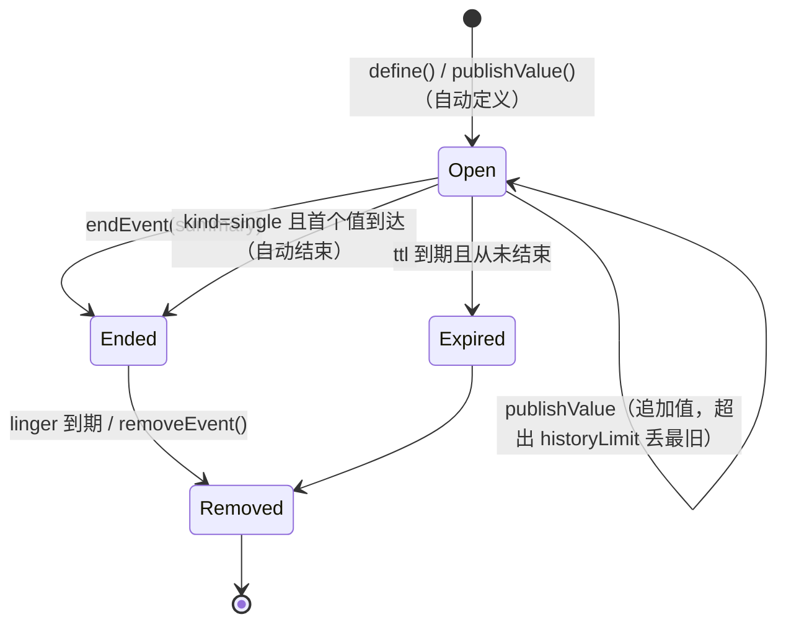
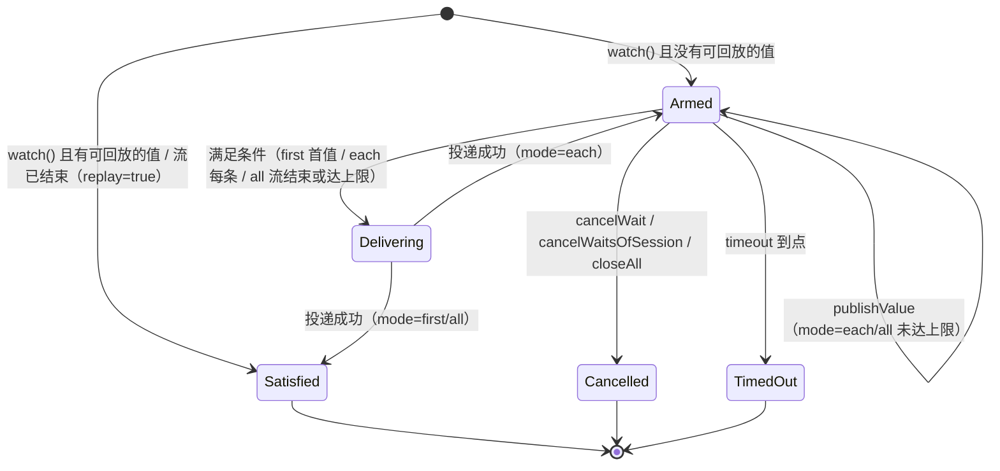

# 事件中枢与异步挂起

> 相关文档: [index.md](index.md)（整体架构）· [plugins.md](plugins.md)（插件面与总线）·
> [config-keys.md](config-keys.md)（`event.*` 配置键，生成物）·
> [test-modules.md](test-modules.md)（`event_hub` / `event_tools` / `event_delivery` /
> `event_subagent`）

## 1. 要解决的问题

一次工具调用在架构上必须**同步**：工具的返回值就是 `tool` 消息的内容，模型下一步要读它。
于是"现在还没有结果，等有了再继续"这件事在没有额外机制时只能靠模型反复查询，或者靠人盯着。

事件中枢把这件事拆开：

- **等待**：模型登记"我要 `X` 的值"后立刻拿到回执，本轮继续做别的事或直接结束；
- **投递**：值到达时由主程序把它变成一条会话输入（空闲就开新一轮，在跑就插到下一次
  模型调用之前）；
- **发布**：任何来源（模型、插件、轮次/工具生命周期、子代理、定时器）都能往里放值。

与 [EventBus](index.md) 的分工（两者不是替代关系）：

| | `EventBus` | `EventHub`（本文） |
|---|---|---|
| 语义 | 通知（发了就完） | **有状态**：每个名字有一份记录（历史值、是否已结束、等待数） |
| 名字 | 主题字符串，多方约定 | 事件名（`域.用途`），有字符集与保留前缀校验 |
| 订阅 | 类型化模板订阅 / 前缀订阅 | 等待句柄（`w-3`），可查询、可取消、可回放 |
| 结果去处 | 订阅者自己处理 | 统一翻译成**会话输入**（`[Event] ...`） |
| 生命周期 | 无 | 记录可结束、可过期、可移除；等待可超时 |

hub 通过组合使用总线：它订阅 `evt.` 与 `plugin.evt.` 两个前缀，因此**插件往总线发一个
`evt.<名字>` 就等于往中枢发值**，不需要新接口表也能用（见第 12 节）。

## 2. 三个对象

```text
生产者：模型 agentxx_event emit/end │ 插件（总线 evt.*）│ 轮次/工具生命周期
        │ 子代理完成 │ 定时器
        ▼
EventHub（每个根一份，跑在该 agent 的 io 线程）
  ├── EventRecord  名字 → {kind: single|stream, state, 历史值[<=N], summary}
  └── EventWait    等待句柄 → {waitId=w-N, event, mode, originSession, delivery, values}
        │ 值到达 → 匹配等待 → 满足条件（first / each / all）
        ▼
EventDelivery（渲染好的文本 + 目标会话 + 投递模式）
        ▼
SessionInputSink（当前驱动这个会话的端点实现）
  ├── 轮次在跑：Session::enqueuePendingInput（下一次模型调用前插入上下文）
  └── 轮次空闲：会话队列 + 唤醒驱动循环（等同一次用户输入，开新一轮）
```

职责边界：

- **生产者**只管"有个事件叫 X，现在有一个值 v"（以及"这条流结束了"），不知道谁在等；
- **等待者**只管"要 name=X 的值，要几个，到了送到哪个会话"，拿 `waitId` 可查可取消；
- **投递者（hub）**是唯一知道"会话现在忙不忙"的地方，投递决策只在它这一处。

`SessionInputSink` 保证 **一个会话同一时刻只有一个驱动者**：hub 不自己
`co_spawn` 一轮 `runTurnAsync`（那样会和端点的驱动循环同时改同一个 `Session`），
而是把输入交回给驱动者排队。当前实现是服务端会话端点 `SessionServerAgentIO`，
它把弱引用登记在 `Session::inputSink` 上，停止时清空。

## 3. 状态机

事件记录：



等待句柄：



要点：

- `single` 事件收到第二个值会覆盖并计 `overwritten`（单值语义明确，不静默丢）；
- 同名事件被定义成不同 `kind` 时保留先定义者，后到的 `define` 返回错误；
- 已 `end` 的事件再收到值会重新打开（流式事件允许"续上"）；
- 终态等待保留一段时间供 `opt=status` 查询，之后回收。

## 4. 投递决策

投递模式由等待的 `delivery` 决定（`watch` 的默认值来自 `event.delivery`，缺省 `next-step`）：

| 会话状态 | `next-step` | `inject` | `next-turn` | `none` |
|---|---|---|---|---|
| 空闲（有驱动端） | 直接开新一轮 | 直接开新一轮 | 直接开新一轮 | 只留在中枢 |
| 轮次在跑 | 写入待注入输入，下一次模型调用前插入上下文 | 写入待注入输入，只进下一次请求（不改写上下文） | 入会话队列，本轮结束后再跑一轮 | 只留在中枢 |
| 空闲（无驱动端） | 写入待注入输入，记 `deferred`，不开轮 | 同左 | 同左 | 只留在中枢 |
| 关停中 / 中枢已关闭 | 丢弃 + 计数 | 同左 | 同左 | 只留在中枢 |

补充规则：

- **暂停态**（上一轮失败/中断留下的暂停）不自动解除：事件输入照常入队但不唤醒；等待
  显式要求 `unpause=true` 才解除（与"积压消息不自动继续执行"同一语义）；
- **`dropIfBusy`**（插件触发器的 `DROP_IF_BUSY` 语义）在轮次在跑时直接丢弃并计数；
- **轮末兜底**：待注入输入只在模型调用开头被取用，落在最后一次模型调用之后的输入会在
  轮次结束时提升为下一轮输入（`BaseAgent::runTurnAsync` 的 `rolloverLeftoverNextStepInputs`），
  只在有驱动端时提升 —— 否则没人接，留在原处；
- **无驱动端 + `event.allow_headless_turn=true`**：由 agent 自己起一轮（嵌入方自己调
  `runTurnAsync` 的场景），默认关闭，避免没人看结果时白烧额度。

## 5. 投递文本（给模型看的稳定格式）

```text
[Event] build.done (first)
wait: w-3 ref: call_1
status: value
value: {"ok":true,"url":"https://example.com/out.zip"}
note: ...
label: ...
```

- 首行 `[Event] <名字> (<mode>)` 固定，模型据此识别"这是事件而不是用户说话"；
- `status` 取值：`value` / `values` / `stream-ended` / `ended-empty` / `timeout`；
- 单值写 `value:`，多值写 `values:` 加逐条编号；
- 末尾换行去掉（投递文本作为一条 `user` 消息）；
- 超长值（超过 `event.value_max_bytes`）转会话 share store，文本里留 `agentxx_share_store`
  的取回提示；超过 1 MB 硬上限直接拒绝发布。

`agentxx_event opt=watch` 未立即满足时的回执：

```text
[Event wait armed] wait=w-3 event=build.done mode=first delivery=next-step
The value will arrive later as an input starting with "[Event] build.done".
Keep working, or end the turn — you do not need to poll. Use opt=status wait=w-3 to check.
```

两种文本的终态都是成功: 工具返回 `ToolResult::ok(...)`, 成败只看状态, 不看正文里有什么字样。
以前的实现靠首行前缀判定 (`[Error` / `[Permission denied` / `[Repeated call denied` /
`[Plugin tool timeout`), 那套清单与实现已经删除 (见 5.1)。

### 5.1 状态与正文的分工

工具结果是一个 `{text, status}` 对 (`agentxx/util/tool_result.h`):

- **成败只看 `status`** (`ok` / `failed` / `interrupted` / `canceled`), 由工具自己给 (或由
  执行层把异常 / 工具不存在 / 参数非法 / 权限拒绝 / 插件失败终态换算成 `failed`);
- **`text` 只给模型读**: 执行层 `util::toolResultTextForModel` 是唯一的排版处 —— 只有 `failed`
  会被套上 `[Error: ...]`, `canceled` / `interrupted` 无正文时补占位, `ok` 原样透传;
- 所以工具正文里出现 `[Error` 这类字样**不代表失败** (`event_tools` 专门断言过: 正文含
  `[Error: ...]` 但状态是 `ok` 时, 执行层不会再加一层包裹, 也不当成失败)。

限制只落在“工具的成败”上。事件投递产生的输入是一条 `user` 消息 (`[Event] ...`), 不经过
这套判定; 提示、日志、Wire 消息同样不涉及。

### 5.2 来源标记（给界面看的，不参与判定）

事件投递的输入在会话里就是一条 `user` 消息，角色与用户自己敲进去的一样。为了在界面上区分，
服务端额外带上结构化来源：

- `ViewMessage::source` 与 `WireDelta::source`（TurnStart 用）取值 `event:<事件名>`；
  用户自己输入时为空字符串
- 写入口：`BaseAgent::runTurnAsync(..., inputSource)` → 展示消息 + TurnStart 增量；
  常量与前缀解析在 `conversation_types.h`（`kInputSourceEventPrefix` / `eventNameOfInputSource`），
  投递方与展示方共用一份，不各记一套字符串
- 客户端只拿它做展示（用户消息头部加一行 `| [事件] <事件名>`，i18n 键 `msg.eventSource`），
  **不解析正文**；空值不写进 JSON，老客户端与老会话库照旧
- 历史消息经 Sync（`ViewMessage` JSON）与会话库重载后仍带该字段

## 6. 工具 `agentxx_event`

`opt` 七个取值：

| `opt` | 作用 | 关键参数 |
|---|---|---|
| `watch` | 登记等待立即返回（默认选择） | `event`, `mode`, `delivery`, `timeout_ms`, `label`, `ref`, `replay`, `coalesce_ms`, `unpause`, `drop_if_busy` |
| `await` | 阻塞本轮直到值到达或超时（`timeout_ms` 上限 300000） | 同 `watch` |
| `status` | 查一个等待（`wait`）或一个事件（`event`） | `wait` / `event` |
| `list` | 列事件/本会话的等待 | `scope`（`events`/`waits`/`all`）、`prefix`、`limit` |
| `cancel` | 取消一个等待或本会话全部等待 | `wait` / `all` |
| `emit` | 发布一个值（不存在则自动定义） | `event`, `value`, `summary`, `single`, `remove` |
| `end` | 结束一条事件流 | `event`, `summary`, `remove` |

工具有两个开关：`event.enable=false` 时既不注册工具、也不建中枢；工具本身
`repeatCallCheck=false`（模型反复 `watch` 同一事件是合法用法），
`supportsParallel=false`（中枢状态在单线程上改）。

## 7. 内置事件源

| 事件名 | 何时有值 | 值 |
|---|---|---|
| `turn.start` | 轮次开始 | `sessionId` |
| `turn.end` | 轮次结束 | `sessionId`, `hasError`, `interrupted`, `durationMs`, `reason` |
| `tool.end.<工具名>` | 一次工具调用结束 | 工具名、是否有错、结果字节数 |
| `subagent.done.<result_id>` | 异步子代理结束 | `resultId`, `subagent`, `agentId`, `content`, `hasError`, `Canceled`, `errorMessage` |
| `timer.<名字>` | `agentxx_event` 的 `after_ms` / `every_ms` | `timer` 与触发时间 |

内置源**只在有人等时**才发布（先问 `hub->wants(名字)`），因此没人用时不产生记录与开销。
生命周期事件同时仍按原样发布到类型化总线（`Topic::AgentTurnStart/End`、`ToolCallStart/End`），
两条路互不影响。

## 8. 异步子代理

`agentxx_subagent` 的 `async:true` 让父轮次不必等子代理跑完：

```text
父会话 toolcall: agentxx_subagent {tasks:[{subagent:"task", message:"...", async:true, result_id:"job1"}]}
  -> AgentHost 立即受理: 返回 {started:true, event:"subagent.done.job1"}
  -> 工具结果文本: [Subagent started] ... 结果将以 [Event] subagent.done.job1 到达
  -> 子代理在后台跑完（失败/取消同样发布）
  -> 父会话收到 [Event] subagent.done.job1 {content, hasError, Canceled, ...}
```

要点：

- **同一批里同步任务照旧等结果**，纯异步的一批立即返回（`service.subagent` 只有一条路径）；
- 事件名：`event_name` 优先，其次 `subagent.done.<result_id>`（非法字符换成 `_`），
  都没有时用任务序号；同一批里重名直接报错（否则后到的值会把前一个等待提前满足）；
- 取消令牌独立于轮次：轮次结束/取消不带走后台任务，由
  `AgentHost::cancelAsyncJobs(父上下文)`（agent 关停）与 `cancelAsyncJobsOfSession` 驱动；
  被取消也发布 `{Canceled:true}`，父会话的等待不会挂到超时；
- 仍受子代理并发数与嵌套深度预算限制（`runningSubagentCount_` / `sessionDepth_`）；
- 子代理上下文**继承父事件中枢**（`subCtx->eventHub = parentCtx->eventHub`，嵌套沿用最外层），
  所以子代理 `emit` 的事件父会话能等；
- `event.enable=false`（没有中枢）时异步派发直接报错，不退化成同步。

自动压缩这类内部委派没有 `tool_call_id`，用 `async` 会报参数错误（受理文本没人读）。

## 9. 预算与背压

| 项 | 默认 | 配置键 |
|---|---|---|
| 事件记录数 | 256 | — |
| 等待数 | 256 | — |
| 单会话等待数 | 32 | `event.max_waits_session` |
| 单会话"待运行的事件输入" | 64 | — |
| 单值进入上下文的阈值 | 32 KB | `event.value_max_bytes` |
| 单值硬上限 | 1 MB | — |
| `watch` 默认超时 | 0（不限） | `event.wait_timeout_ms` |
| `watch` 默认投递模式 | `next-step` | `event.delivery` |
| 无驱动端自驱一轮 | 关闭 | `event.allow_headless_turn` |
| 中枢总开关 | 开 | `event.enable` |

超预算的处理一律是"明确报错或丢弃 + 计数"，不静默排队：事件/等待超限时 `define`/`watch`
返回错误文本；丢弃按原因分桶记在 `statsJson()` 的 `droppedByReason` 里。

## 10. 线程与生命周期

- 每个**根**一份 hub（内置根与每个外部挂载根各一份），事件名在根内唯一；
- hub 状态只在它自己的 executor 线程上改；其他线程用 `postValue` / `postEnd`；
- 投递时会话不在 io 线程时 post 回中枢线程再投（防御路径）；
- `BaseAgent` 关停：先取消本 agent 上的异步子代理作业，再 `hub.closeAll("shutdown")`
  （取消全部等待与定时源，之后的投递一律丢弃并计数）；
- 事件与等待**不持久化**（生产者都绑在进程上）；排队输入按"待确认"恢复的规则不变。

相关代码：`agent/lib/include/agentxx/event/{naming,hub}.h`、
`agent/lib/src/event/{hub,hub_text}.cpp`、`agent/lib/include/agentxx/tools/event.h`、
`agent/lib/include/agentxx/agent/session_input_sink.h`。

## 11. 诊断

- `KeyMetrics`：`events.delivered` / `events.dropped` / `events.wait_timeouts`
  （只看总体趋势；按原因分桶在中枢自己的统计里）；
- 加载快照（`agentxx_test assembly_snapshot` / `--dump-diagnostics`）：新增 `event_hub` 段
  （事件数/等待数/投递/丢弃/按原因分桶，不含值正文）；
- `--dump-diagnostics` 另有 `## event hub` 段直接给整份 JSON；
- 日志前缀统一 `[event_hub]`，丢帧原因（`no-session` / `busy` / `backlog` / `shutting-down` …）
  原样写在日志里。

## 12. 插件侧

插件有两条可用的路，选哪条看"要不要值/状态"：

| 需求 | 用法 |
|---|---|
| 只把一条消息塞进会话（不需要值/状态） | `agentxx.agent.runtime` 的 `register_trigger` / `register_timer` |
| 有一个**带值的事件**：谁等谁拿、要查状态、要回放、要结束流 | `agentxx.agent.event` 表（见下） |

### 12.1 经总线发值（不改接口表）

插件把值发到总线即可，中枢订阅了 `evt.` 与 `plugin.evt.` 两个前缀：

```text
插件 emitEvent("evt.chat.group42", payload)        // agentxx.agent.runtime 表 / SDK kit
  -> 插件管理器把主题原样发到该 agent 的总线 (`evt.chat.group42`)
  -> 中枢前缀订阅收到, 记为事件 chat.group42
模型  agentxx_event {opt:"watch", event:"chat.group42"}
```

### 12.2 事件中枢表 `agentxx.agent.event`

带值事件的正规入口（`plugin_api.h` 的表 + `plugin_kit.h` 的便捷函数），成员、返回码、
归属回收与 SDK 函数见 [plugins.md](plugins.md) §20。要点：

- `define_event` 声明事件源：说明文字会出现在模型 `agentxx_event opt=list` 的结果里，
  模型据此知道该等什么；
- `emit_value` 发布 JSON 值（任意线程；值排队写入中枢，调用方不等投递结果），
  `end_event` / `remove_event` 收尾；
- `register_wait` 替某个会话登记等待：`first` / `each` / `all` 三档 + `delivery`
  （`next-step` / `inject` / `next-turn` / `none`）+ `replay`（是否消费注册前已有的值）；
- 归属记成 `plugin:<实例名>`：插件禁用/卸载时主程序先取消它的等待、再删它的记录
  （`PluginMount::revokeEntry` 最后一步），加载快照的 `eventRecords` / `eventWaits` 给出
  当前生效条数；
- 关闭 `event.enable` 时中枢不存在：写入口返回 `AGENTXX_PLUGIN_EVENT_ERR_UNSUPPORTED`，
  插件应按"功能不可用"降级（示例插件 `example_event` 就是这么写的）。

尚未做的部分见第 13 节。

## 13. 已知取舍与未做的事项

- **触发器/定时器还没有收敛到中枢**：`agentxx.agent.runtime` 的 `register_trigger` /
  `register_timer` 仍然自带一份合并、忙时丢弃与输入拼装，与中枢的投递规则并存；
  原计划把它们改成"spec → `EventWaitSpec`"的参数转换，本轮没做（C ABI 与插件写法不变，
  纯内部收敛，需要单独一轮改动 + 回归）；
- **后台命令**（`agentxx_execute_command` 的 `background:true`）未实现：命令长时间运行时
  仍占一轮；
- **事件不持久化**：刷新/重启后事件记录与等待都清空（生产者都绑在进程上）。

## 14. 测试

| 模块 | 覆盖 |
|---|---|
| `event_hub` | 记录状态机、回放、三种 `mode`、预算、名字校验、取消、`awaitOnce` 三种退出、定时源、ttl/linger |
| `event_tools` | 七个 `opt` 的参数校验与返回文本（逐字段断言，作为对外约定）、返回文本不命中工具失败前缀、工具注册与 `event.enable` 开关、schema |
| `event_delivery` | 空闲/在跑/无驱动端/暂停态四种投递路径、轮末兜底、端点停止后解绑、关停丢弃、展示消息的来源标记 |
| `event_subagent` | 异步派发立即受理、结果事件叫醒会话、工具返回文本、事件名冲突与非法名、无中枢时报错、取消后仍发终态 |
| `plugin_event` | 插件面全流程（示例插件 `example_event`）：声明事件源与自查、发布/结束/移除/查询、替会话登记等待与投递、失败路径、禁用/启用/卸载的可逆性 |

`event_delivery` / `event_subagent` 每个用例都起一次本地模拟 LLM 服务，单模块耗时十几秒，
属预期。
