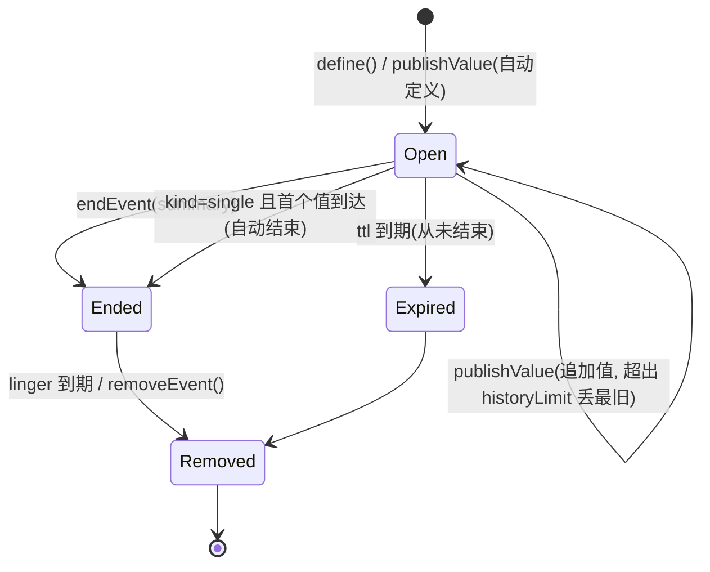
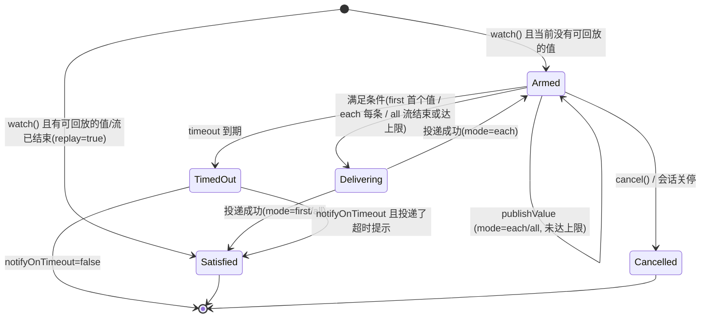
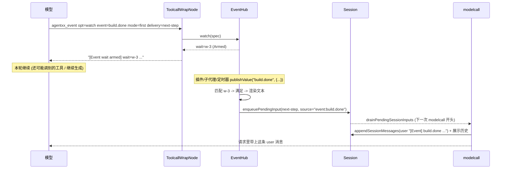
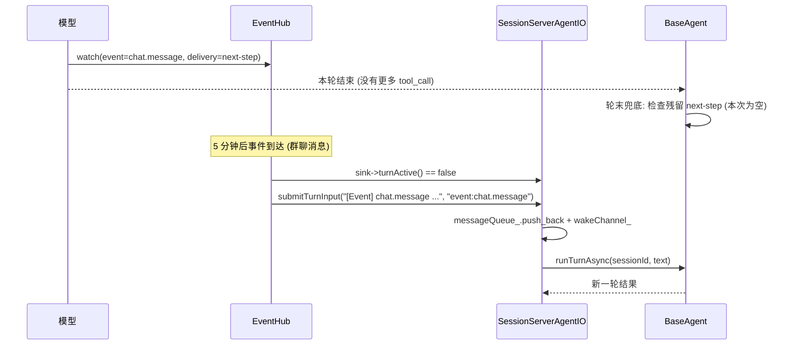

# 方案: toolcall 异步挂起与事件中枢 (事件注册/触发 → 会话输入)

- 难度: B+ (跨 lib 的节点/会话驱动/事件总线/工具/子代理, P1 不改插件 ABI)
- 类型: 架构扩展 (本文仅为设计方案, **未实施**)
- 时间: 2026-11-01
- 状态: 设计完成, 待确认 (§11 列出需要先回答的问题), 未实施
- 代码依据: 主仓当前工作树 (行号均指本次核对时的位置)
- 相关文档:
    - [index.md §4 EventBus](../../../docs/zh-cn/design/index.md): 事件流现状与主题表
    - [index.md §3 Subagent 执行流程](../../../docs/zh-cn/design/index.md): 中断 → 总线派发 → 派生 agent
    - [plugins.md](../../../docs/zh-cn/design/plugins.md) §19: 插件运行时 (挂根/通道/触发器/定时器)
    - [tui.md](../../../docs/zh-cn/design/tui.md) §2.2 / §2.7: 消息渲染与信息面板
    - [configuration.md](../../../docs/zh-cn/design/configuration.md) 第 5 节: 配置归属

阅读路径: 只想知道"做什么/怎么落地"看 §0 / §3.1 / §3.5 / §4.2 / §8;
关注与现有机制的关系看 §2 / §3.3 / §10; 评审关注点集中在 §10.1~§10.4 与 §11。

目录: [§0 结论摘要](#0-结论摘要) · [§1 目标](#1-目标与非目标) · [§2 现状核对](#2-现状核对) ·
[§3 设计](#3-设计) · [§4 接口](#4-接口设计) · [§5 流程](#5-关键流程) · [§6 边界](#6-边界与失败模式) ·
[§7 影响面](#7-影响面与兼容性) · [§8 实施计划](#8-实施计划) · [§9 测试](#9-测试计划) ·
[§10 风险/与 EventBus 的关系](#10-风险与备选方案) · [§11 待确认](#11-待确认问题) · [§12 文档清单](#12-文档更新清单-落地时一起改)

## 0. 结论摘要

需求可以拆成两件事, 它们缺的东西各自不同:

1. **"工具结果异步挂起"** 缺的不是并发能力, 而是**"值还没有的时候先返回, 值到了再告诉模型"** 这条路。
   现在一个 tool 的 `execute_async` 不返回, 整轮 (以及整条 `assistant(tool_calls) → tool` 消息链)
   就停在那里 (`agent/lib/src/nodes/toolcall.cpp` 的 prepare → run → finalize 全链 await)。
   因此异步挂起**不能**靠"让 tool 一直挂着等", 只能是:
   tool 立即返回一句"已挂起, 结果稍后作为输入送达", 值到达后再变成一条输入。
2. **"事件触发会话"** 缺的是一条**agent 侧的输入入口**: 现在能驱动一轮的只有会话端点
   (`SessionServerAgentIO` 的消息队列), 主程序内部 (节点/中间件/工具/事件) 没有"往会话里塞一轮输入"的
   公共入口; 而"轮次进行中插一条输入"其实**已经有了** (`Session::pendingInputs_` 的
   `next-step` / `inject`, 在 `modelcall` 开头被 `drainPendingSessionInputs` 取用)。

所以方案是把三件事拼起来, 每件都尽量复用现有机制:

| 拼图 | 做法 | 复用 |
|---|---|---|
| 事件注册 + 状态 + 值 (单值/多值/流结束) | 新增 **`EventHub`** (agent 级), 建在现有 `EventBus` 之上 | `EventBus::listenPrefix` (插件事件已经在用)、`Topic` 命名 |
| 等待 + 投递 | 新增 **`EventWait`** (等待句柄) + **`SessionInputSink`** (会话输入入口抽象) | `Session::enqueuePendingInput` / `drainPendingSessionInputs` (边界注入)、会话端点消息队列 (空闲开轮) |
| 给模型的工具 | 新增内置工具 **`agentxx_event`** (`watch` / `await` / `status` / `list` / `cancel` / `emit` / `end`) | `XXToolBase`、`AgentPrompt::toolPrompt`、`share_store` 的 `opt` 风格 |

关键判断 (三条, 也是本方案最容易被做错的地方):

- **tool 必须立即返回**。任何"tool 内部挂着等事件"的形态都会把这一轮锁住, 那就等于没有异步。
  `agentxx_event await` 是例外 (有上限的阻塞), 它的语义是"我要在这里等最多 N 秒", 不是主力形态。
- **值到达后的投递必须走"会话"而不是"节点"**。轮次在跑 → 写进 `Session` 的待注入输入, 下一个
  `modelcall` 前插入; 轮次结束 → 变成新一轮的输入。两条路都不需要改图执行器。
- **一轮会话只能有一个驱动者**。事件投递不能自己 `co_spawn` 一个 `runTurnAsync` 与会话端点抢同一份
  会话状态, 必须经 `SessionInputSink` 交回给当前驱动者排队。

分四期落地 (§8): P1 = 事件中枢 + 等待 + 投递 + 工具 (不改 ABI); P2 = 子代理异步派发与后台工具;
P3 = 插件面接口表 (`agentxx.agent.event`, 新增一张表); P4 = 展示与诊断。

## 1. 目标与非目标

目标:

1. 模型可以**挂起一个等待**并立即继续: `agentxx_event opt=watch` 注册后马上返回, 轮次不停止;
2. 值到达时按位置投递: 轮次在跑 → 在下一次 `modelcall` 之前作为输入插入 (不打断正在进行的
   provider 流式输出); 轮次已结束 → 作为新一轮的输入把会话唤醒;
3. 事件支持**单值**与**流式多值**, 等待支持"要一个值"、"每条都要"、"等整条流结束再一起给我";
4. 模型能查状态: 等待列表/事件列表/单条等待状态/事件当前状态, 以及主动取消;
5. 主会话与子代理之间多一种协作方式: 子代理可以异步派发, 结果以事件形式回到父会话;
6. 插件可以注册事件源 (定时/群聊/通知/控制/数据变化) 并触发 agent 会话, 且**不需要**为每个事件源
   写一份"往会话塞输入"的代码;
7. 所有新行为都可关闭 (配置), 有预算上限与丢弃计数, 不会因为事件洪水把上下文与额度打满。

非目标 (明确不做, 避免方案膨胀):

- 不做**跨进程/跨设备**的事件传递 (那是 `agent.host` 总线与 A2A 的职责, 本设计的 hub 是进程内 agent 级);
- 不做事件值的持久化 (生产者都绑在进程上: 定时器、插件、子代理; 重启后事件记录清空。**已投递**的输入
  照旧按现有会话库机制落盘);
- 不改 wire 协议 (`WireUserInput` / `WireDelta` 等保持原样); 事件投递在服务端内部完成, 展示上就是一条
  用户消息;
- 不把现有 `service.interrupt` / `service.permission` / `service.subagent` 这些 RR 流改成事件 hub;
  它们是"必须等一个应答"的场景, hub 是"值什么时候来都行"的场景, 两者并存;
- 不做"事件历史回放给新会话"(事件不是消息, 没有语义化重放的需要)。

## 2. 现状核对

> 本节把方案要碰到的现有机制逐条核对一遍, 后面所有设计都以这里的结论为准。

### 2.1 一轮对话是怎么跑起来的 (谁在驱动, 队列在哪)

```
客户端 WireUserInput
   └─▶ SessionServerAgentIO::handleUserInput (io/session_server_agent_io.cpp:604)
         └─▶ pushMessageQueueItem (:458)  -> messageQueue_ (std::deque, 无上限)
驱动循环 SessionServerAgentIO::run() (:2161, 独立于连接存在)
   └─ 取队首 -> BaseAgent::runTurnAsync (:2227)
         └─ AgentRunner::run -> engine->run_stream_async (agent_runner.cpp:99)
```

要点:

- **会话级串行**: 同一会话的轮次由这一个 `while` 循环串行执行, 天然不会有两次 `runTurnAsync` 并发;
- **独立于连接**: 客户端断开也继续跑 (`run()` 的生命周期跟着端点, 不跟连接);
- **暂停态**: 上一轮出错/取消/中断后 `setQueueState(Paused)`, 积压消息不会自动继续; 只有"用户新输入"
  会解除暂停 (`handleUserInput` 里的 `isIdle && wasHalted` 分支);
- **`turnActive_`**: 端点内表示"正在跑轮次"的标志 (供 UI 与背压判断, `session_server_agent_io.h:166`);
- **队列没有把来源记下来**: `MessageQueueItem` 的字段是 `id/text/model/attachments/delivery/
  createdAtMs/recovered`, 没有"这条是谁投的" (只有"是否重启恢复"一个布尔)。事件投递需要这个信息
  (§3.4 的 `source` 参数)。

### 2.2 toolcall 为什么必须同步等

`ToolcallWrapNode::baseRun` (`agent/lib/src/nodes/toolcall.cpp:1380`) 的流程是
prepare (串行) → run (受限并发) → finalize (串行), 全部 `co_await` 完成后, 才把
`tool` 结果消息 `appendSessionMessages` 写进会话上下文:

- 消息契约要求: 一条 `assistant(tool_calls)` 里的**每个** `tool_call_id` 都必须有一条对应 `tool`
  结果消息, 才允许出现下一条 `assistant`。挂着一个不返回的 tool = 这一轮永远停在"半条消息链"上;
- 所以"异步挂起"只能表现为**tool 立即返回一个占位结果**, 真值以后以**新的输入**进来
  (与"工具结果"在消息角色上不同, 但对模型是等价的可用信息)。

顺带确认: 工具结果文本里的失败前缀判定集中在 `toolcall.cpp` 的 `toolResultTextIsFailure`
(只认 `[Error` / `[Permission denied` / `[Repeated call denied` / `[Plugin tool timeout` 四种开头)。
新增工具与事件投递的文本只要不以这四种前缀开头, 就不会被当作失败 —— 所以约定事件投递以 `[Event]` 开头。

### 2.3 已有的"边界注入"通道 (本方案的主要落点)

`Session` 里已经有一套"待注入输入", 与"消息队列"分开 (`SessionPendingInput` 定义在
`conversation_types.h:552`; `Session::enqueuePendingInput` / `takePendingInputs` 见
`context.h:498 / :502`, 实现 `context.cpp:545 / :553`):

| 投递模式 | 取值 | 取用时机 | 效果 |
|---|---|---|---|
| `next-turn` | `InputDelivery::NextTurn` | 下一轮 | 就是普通排队消息 |
| `next-step` | `NextStep` | **下一次 `modelcall` 之前** | 作为 `user` 消息**写入权威上下文与展示历史** |
| `inject` | `Inject` | 同一次 `modelcall` 之前 | 只拼进本次请求, 不改写上下文 |
| `collect` | `Collect` | 端点侧合并窗口 | 与事件无关, 忽略 |

取用点唯一: `ModelCallWrapNode::callLLM` 开头的
`drainPendingSessionInputs(...)` (`nodes/modelcall.cpp:641`, 实现
`nodes/session_context.cpp:247`): `next-step` 走 `appendSessionMessages` + `appendUserViewMessage`
(展示历史也有), `inject` 只进 `params.messages`。

**这就是"在 modelcall 之前插入输入"的现成实现**, 事件投递只需往里塞 `SessionPendingInput`
(`source = "event:<name>"`, 会写进消息 `extra.input_source`)。

已经暴露给外部的入口是 wire 的 `delivery` 字段 (客户端可以指定 `next-step`/`inject`),
说明这条通路本来就是给"不打断会话的插入"用的, 本方案只是给**主程序内部**也开一个入口。

### 2.4 EventBus 的能力与边界

`agent/lib/include/agentxx/event/event_stream.h`:

| 能力 | 现状 | 对本方案的含义 |
|---|---|---|
| 强类型单向流 | `EventStream<T>::subscribe/publish`, 订阅者按登记顺序被 `co_await` 派发 | 适合"内部状态通知", 不适合"值 + 状态 + 谁来取" |
| 请求-响应 | `RequestResponseStream<Req,Resp>::request` (带超时) | 适合 HIL/权限/子代理委派 (必须等应答), 与 hub 并存 |
| 定时器 | `TimerEventStream::once` | 只有"到点通知一下", 没有值/状态/取消 |
| 前缀订阅 | `EventBus::listenPrefix` (:497), 回调 `void(topic, const std::any&)`, 在**发布方线程同步**调用 | **hub 接插件事件的入口** (插件事件都是 `std::string` 载荷) |
| 空流短路 | `hasListeners<T>(topic)` | 高频事件先判断再构造载荷 |
| 类型安全 | 同 topic 换类型: Debug 断言 + Release 返回占位空流 | hub 用 `std::string` 一种载荷类型, 不碰这个坑 |
| 状态/回放/结束 | **都没有** | 这正是 hub 要补的三件事 |
| 锁 | 单 io 线程协作式, 无锁 | hub 采用同一约束 |

总线实例有两级: `AgentContext::bus` (agent 级, 构造时创建) 与 `Session::bus` (会话级, `runTurnAsync`
里建)。现有发布事实:

- `agentcall.cpp:26` 在每轮开始 (`__start__`) 往 **agent 级** 总线发布 `plugin.agentxx.round_start`;
- `EventBridge` 只发 `agent.model.token` / `agent.error` (且先 `hasListeners` 判断,
  `event/event_stream.cpp:711`);
- `Topic::AgentTurnStart` / `AgentTurnEnd` / `ToolCallStart` / `ToolCallEnd` **声明了但没人发布**
  (`event/events.h:20` 起的那几张表里, 只有一部分真的在用)。

→ 本方案顺手补上 turn/tool 的四个事件 (有监听者才发), 既给 hub 用, 也让现有插件/UI 能订阅。

### 2.5 已有的事件→输入 (插件触发器与定时器) 能复用多少

`agent/lib/src/plugins/plugin_manager_runtime_trigger.cpp` 已经有"事件 → 会话输入"的完整一套:
`register_trigger(topic, channel, policy=QUEUE|COALESCE|DROP_IF_BUSY, delivery)` 与
`register_timer`, 投递经 `runtimeSendInput` (`plugin_manager_runtime.cpp:745`) → 通道的 wire 输入。

它已经解决的问题 (可以直接照搬的规则):

- **三种投递策略** (立即投 / 窗口合并 / 忙时丢弃) 与背压常量 (`kCoalesceMaxItems = 64`,
  `kCoalesceMaxTextSize = 8 KB`, 每实例 256 个触发器+定时器);
- **主题规范化** (`qualifyEventTopic`: 不以 `plugin.` / `client.` 开头就补 `plugin.`);
- **归属回收** (插件禁用/卸载按 `owner` 整批撤销)。

它没解决、也正是本方案要解决的:

| 差异点 | 触发器 | 本方案需要 |
|---|---|---|
| 谁在等 | 插件 (进程侧) | **模型自己** (会话侧), 且要能查到"我登记的那个等待怎么样了" |
| 载荷 | 一条文本输入 | **结构化的值** (JSON) + 多值流 + 流结束 |
| 只关心一次还是全部 | 每条都投 | 要一个值 / 每条都投 / 攒到流结束 |
| 有没有"迟到者" | 无 | 事件已经出过值, 后注册的等待也能拿到 (replay) |
| 谁发布 | 插件 | 插件 + 模型 + 节点 + 子代理 + 定时器 |

结论: **P1/P2 阶段两者并存, P3 起收敛成一处**。并存期间触发器继续服务"插件要把一条消息塞进会话",
hub 服务"有一个带值的事件, 谁需要谁来等"; 两者共用同一套投递规则与预算口径 (§3.8)。
P3 的收敛方式是把触发器/定时器实现改成 hub 的参数转换 (C ABI 不变), 见 §10.3 —— 届时
"把事件变成会话输入"的代码只剩 hub 一处, 这才是真正消掉重复的地方。

### 2.6 子代理委派为什么阻塞

`AgentRunner` 的中断循环里, `subagent` 中断是**同步等结果**的
(`agent_runner.cpp:150` → `ctx->bus->request<ReqSubagentBatch, RespSubagentBatch>` 不限超时),
`AgentHost::spawnOneTask` (`agent_host.cpp:752`) 派生独立 agent 并跑完才返回。

也就是说: 现在"派一个子代理"= 父会话停下来等它跑完。这正是需求里"扩展主会话和 subagent 之间的
协作交互方式"要改的地方 —— 让它能"派出去就继续", 结果以事件回到父会话 (§5.3)。

### 2.7 缺口清单 (方案要补的五件)

| # | 缺什么 | 在哪补 |
|---|---|---|
| 1 | 有状态、有值、能结束、能回放的事件记录 | 新增 `EventHub` |
| 2 | "等待句柄" (谁的、等什么、到哪一步了、怎么取消) | 新增 `EventWait` |
| 3 | agent 侧"往会话投一轮输入"的公共入口 (空闲开轮) | 新增 `SessionInputSink` + 端点实现 |
| 4 | 轮次内"值到了就插进去"的公共入口 | 复用 `Session::pendingInputs_` (`next-step`/`inject`) |
| 5 | 模型可用的工具 (挂起/查询/取消/发布) | 新增内置工具 `agentxx_event` |

## 3. 设计

### 3.1 概念: 三个对象 + 三个角色

```
生产者 (谁把值放进来)
  模型 agentxx_event emit/end  |  插件 emit_event / 新表 emit_event_value
  节点 turn.*/tool.*           |  子代理完成  |  内置定时源 timer.*
        │
        ▼
EventHub (agent 级, 单 io 线程)
  ├── EventRecord  按名字键控: {kind: single|stream, state, history[<=N], summary}
  └── EventWait    等待句柄:   {waitId=w-N, event, mode, originSession, delivery, values}
        │  值到达 -> 匹配等待 -> 满足条件 (first / each / all)
        ▼
EventDelivery (渲染好的文本 + 目标会话 + 投递模式)
        │
        ▼
SessionInputSink (由当前驱动这个会话的端点实现, 保证"一轮只有一个驱动者")
  ├── 轮次在跑: Session::enqueuePendingInput  (next-step 在下一次 modelcall 前插入上下文)
  └── 轮次空闲: 消息队列 + 唤醒驱动循环        (等同一次用户输入, 开新的一轮)
```

三个角色, 边界清楚:

- **生产者 (publisher)**: 只关心"有个事件叫 X, 现在有一个值 v" (和"这条流结束了")。不需要知道谁在等;
- **等待者 (waiter)**: 只关心"我要 name=X 的值, 要几个, 到了之后送到哪个会话",
  拿一个 `waitId` 随时可查/可取消;
- **投递者 (hub)**: 把"值的到达"翻译成"会话输入", 并按轮次状态选路 (§3.5)。这一层是唯一知道
  "会话现在忙不忙"的地方。

**粒度**: 每个**根**一份 hub (内置根与每个外部挂载根各一份, 与"根之间会话互不影响"一致);
子代理不新建 —— `spawnOneTask` 把父上下文的 hub 指给它 (`subCtx->eventHub = parentCtx->eventHub`),
于是主↔子看同一张事件表。**不是整个 AgentHost 共享一份**: 那会让插件挂载的根与内置根串号,
也与 `PluginManager` 按挂载取总线的现行边界冲突 (详见 §4.1)。

### 3.2 状态机

事件记录:



等待句柄:



"满足条件的定义" (与 §4.2 的 `mode` 对应):

| mode | 满足条件 | 之后 |
|---|---|---|
| `first` | 收到第 1 个值 | 投递并结束等待 |
| `each` | 每收到 1 个值 | 逐个投递, 等待保持挂起, 直到 `end` / 取消 / 超时 |
| `all` | 事件结束 (`end`) 或累计达到 `maxItems`/`maxBytes` | 一次投递全部已收值并结束等待 |

### 3.3 与 EventBus 怎么配合 (本次需求明确要求分析的部分)

分工一句话: **EventBus 负责"通知", EventHub 负责"值、状态与领取"**。hub 是 bus 的一个订阅者,
不是替代品。

```mermaid
flowchart LR
    subgraph producers[生产者]
      P1[插件 emit_event<br/>topic=evt.&lt;name&gt;]
      P2[模型工具 agentxx_event emit]
      P3[节点: turn.start/end, tool.start/end]
      P4[子代理完成]
      P5[定时器]
    end
    P1 -->|EventBus::publish std::string| BUS[EventBus (agent 级)]
    BUS -->|listenPrefix evt. / plugin.evt.| HUB[EventHub]
    P2 --> HUB
    P3 --> BUS
    BUS -->|typed 订阅 turn.* / tool.*| HUB
    P4 --> HUB
    P5 --> HUB
    HUB -->|EventStream&lt;EventHubValue&gt;<br/>topic agent.hub.value| BUS2[同一条 EventBus]
    BUS2 --> OBS[插件 / UI / 诊断]
    HUB --> DELIVER[SessionInputSink → 会话输入]
```

四条协作规则:

1. **值走前缀订阅**: hub 在 agent 总线上 `listenPrefix("evt.")` 与 `listenPrefix("plugin.evt.")`,
   把 `std::string` 载荷按 JSON 解析成值。插件用现有 `emit_event(topic, payload)` 就能发布,
   **P1 阶段插件零改动**(`qualifyEventTopic` 会把 `evt.x` 变成 `plugin.evt.x`, 所以两个前缀都要挂);
   载荷不是 JSON 时按"纯文本值"处理 (等价 `{"text": "<payload>"}`)。
2. **不反向污染**: hub 自己的生命周期事件 (值/结束/投递) 发布在 `agent.hub.value` /
   `agent.hub.ended` 两个**不带 `evt.` 前缀**的主题上, 因此不会被自己的前缀订阅再吃回去
   (避免自激循环); 想观测 hub 的插件订阅这两个主题即可。
3. **typed 内部事件照旧**: `agent.turn.start/end`、`agent.tool.start/end` 这类我们还是用
   `EventStream<T>` 发布 (`hasListeners` 先行), hub 直接订阅 typed 流后转成 hub 事件
   (`turn.end`、`tool.end.<toolName>`), 不再多走一次字符串序列化。
4. **不抢 RR 流**: `service.interrupt` / `service.permission` / `service.subagent` 这类"必须拿到应答"
   的场景继续用 `RequestResponseStream`; 新增的 `service.event` (可选, P3) 只用于插件问 hub 要状态。
5. **词表只有一份**: 事件名/主题的字符集、长度、保留前缀 (`agent.`/`io.`/`service.`/`hub.`)、
   以及 `evt.*` 前缀的补全规则, 统一放在 `agent/lib/include/agentxx/event/naming.h`,
   bus 的前缀订阅与 hub 的 `define/watch` 都调它 —— 以后改命名规则只改一处。

为什么**不**直接把 `EventStream<T>` 当等待用 (重要, 否则会用错):

- `subscribe` 是回调, 没有"取到值"这种返回形态, 模型拿不到值, 只能靠回调里再往会话塞东西 ——
  那就是把投递逻辑写进每一个订阅者;
- 没有历史 (后订阅者错过之前的值), 没有"流结束", 没有超时, 没有取消;
- `publish` 是 `co_await` 顺序派发订阅者, 订阅者里做投递会拖慢发布方; hub 的投递是
  "记下来, 该投的时候投", 发布方只做一次内存写入 (P1 实现里投递也是同步的, 但只有一次
  `enqueue` , 不 `co_await` 别的东西)。

性能核对 (已有代码路径): `EventBus::publish` 的前缀分派在**匹配到前缀时才**构造 `std::any`
(`event_stream.h` 的 `publish` 实现), 所以 hub 多挂 2 个前缀监听只给每次 `publish` 增加两次
字符串比较; 高频的 `agent.model.token` 也不会因此多一次拷贝。

为什么不让 hub 直接改造/继承 `EventBus`, 以及真正该合并的是哪两个东西,
见 §10.1~§10.4 (含实测数字: 36 个编译单元 include `event_stream.h`, 44 个文件引用 `EventBus`)。

### 3.4 `SessionInputSink`: 一轮只能有一个驱动者

新增一个极小的抽象 (放在 `agent/lib/include/agentxx/agent/session_input_sink.h`):

```cpp
namespace agentxx::agent {

/// 会话输入入口 (由"当前正在驱动这个会话的端点"实现)
///
/// 不变式: 一个会话在同一时刻只有一个驱动者 —— 事件投递不能自己 co_spawn 一轮
/// `runTurnAsync`, 否则两次轮次会同时改同一个 Session 的上下文。
class SessionInputSink {
public:
    virtual ~SessionInputSink() = default;

    /// 会话是否正在跑一轮 (含"轮次已结束但队列还没取到下一条"的窗口)
    virtual bool turnActive() const = 0;

    /// 作为新一轮输入入队; 会话空闲时由驱动循环立即执行
    /// - `unpausePaused`: 上一轮失败/中断造成的暂停态是否解除 (默认不解除)
    /// - `source`: 来源标记 ("event:<name>"), 供诊断与消息来源显示
    /// - `return` false = 拒绝 (关停中 / 队列上限 / 参数为空)
    virtual bool submitTurnInput(
        std::string_view text,
        std::string_view source,
        bool             unpausePaused
    ) = 0;
};
}
```

接线:

- `Session` 增加 `std::weak_ptr<SessionInputSink> inputSink` (`context.h` 的 `Session`, 仅 io 线程读写);
- `SessionServerAgentIO` 实现该接口并覆写:
    - `turnActive()` → `turnActive_.load() || !messageQueue_.empty()`
      (队列里还有待跑的轮次也算"忙": 否则事件值会被插到队列末尾, 白等一轮);
    - `submitTurnInput()` → 现有 `pushMessageQueueItem(...)` (`session_server_agent_io.cpp:458`)
      加一个 `source` 参数, 并按 `unpausePaused` 决定是否解暂停;
    - `run()` 开始与 `switchSession()` 后登记 `session->inputSink = weak_from_this()`; `stop()` 里清空;
- 端点不存在 (headless 嵌入方自己调 `runTurnAsync`) 时 `inputSink` 为空, 投递按 §3.5 的"无驱动端"处理。

> 备选方案 (不采用): 把消息队列整体搬进 `Session`。这会让 `SessionServerAgentIO` 的
> "队列状态/收件箱持久化/多客户端同步"全部要重写, 与本次需求无关, 风险与收益不成比例。

### 3.5 投递决策表 (核心逻辑)

`EventHub::deliver(d)` 的判定顺序 (实现即按这个顺序写, 便于测试逐条覆盖):

| 会话状态 | `delivery=next-step` / `inject` | `delivery=next-turn` | `delivery=none` |
|---|---|---|---|
| 轮次在跑 (`sink && sink->turnActive()`) | **插入 `Session::pendingInputs_`**, 下一次 `modelcall` 前插入上下文 (`inject` 只进本次请求) | 入会话队列 (等这一轮跑完) | 只留在 hub, 供 `status`/`list` 查 |
| 空闲且有驱动端 (`sink` 存在) | **提升为新一轮输入入队** (没有"下一次 modelcall"可言) | 入会话队列并唤醒驱动循环 | 同上 |
| 空闲且无驱动端 (headless) | 仍写 `pendingInputs_`, 等下一次轮次开始时取用 (记 `deferred`) | `allowHeadlessTurn=true` 时由 agent 自驱一轮, 否则记 `deferred` | 同上 |
| 暂停态 (上一轮失败/中断) | 同"轮次在跑/空闲"判定, 但**不解除暂停** (积压不自动跑) | 入队但不解除暂停 | 同上 |
| 关闭中 (`ctx->isShuttingDown()`) | 丢弃 (reason=`shutting-down`) | 丢弃 | 丢弃 |
| 会话不存在 | 丢弃 (reason=`no-session`; **不**新建会话) | 丢弃 | 丢弃 |

三条补充规则:

1. **`inject` 在空闲时退化为 `next-turn`**: `inject` 的语义依赖"某次请求", 空闲时没有请求可拼,
   与其让它永远挂着, 不如照"开一轮"处理 —— 事件已经发生了, 模型需要知道。
2. **不自动新建会话**: 一个乱发事件的插件不应该能凭空造出成百上千个会话; 需要自动开会话的场景
   由插件自己先 `open_channel` (现有运行时接口) 或由主程序显式创建。
3. **`unpausePaused` 默认 false**: 与现有"暂停态阻止积压消息自动继续"的语义保持一致;
   需要"事件必须立刻唤醒"的插件可以在自己的 spec 里显式打开。

### 3.6 轮末兜底: 边界注入不能永远挂着

`next-step` 只在 `modelcall` 开头被取用。如果值刚好在"最后一次 `modelcall` 之后、轮次结束之前"到达,
它就会一直躺在 `pendingInputs_` 里, 直到下一次有人开一轮 —— 而事件触发的场景里可能永远不会有人开轮。

兜底 (加在 `BaseAgent::runTurnAsync` 的轮末, `persistNow("turn-end")` 之前):

```
runner 返回 (无论成功/中断/取消)
  -> takePendingInputs(NextStep)    // 只取 next-step
  -> 若非空: 拼成一条输入经 SessionInputSink 入队 (来源标记 "event:pending-rollover"),
     让它成为下一轮的输入; 不新建 pendingInputs (避免自己又留在原地)
  -> inject 不动 (语义就是"下一次请求", 允许继续等)
```

这条兜底同时解决一个已有隐患: 客户端用 `delivery=next-step` 发来的输入, 如果恰好落在轮末,
现在也会卡在 `pendingInputs_` 里直到下一次用户输入。补上之后, "边界注入" 与 "排队输入" 之间
就没有丢东西的缝了。

### 3.7 投递文本格式 (给模型看的东西, 必须稳定)

模型看不到"事件"这个抽象, 它只看到一条 `user` 消息。格式固定成下面这样, 便于模型解析,
也便于测试断言:

```
[Event] <name> (<mode>)
wait: <waitId>[ ref: <ref>]
status: value | values | stream-ended | stream-open | timeout | ended-empty
value: <单值: JSON 或纯文本, 超过 event.value_max_bytes 时转 share store 并给 id>
values:                              ← mode=all 时逐条列出 (最多 maxItems 条)
  1. {...}
  2. {...}
note: stream ended with N value(s)   ← 只在流结束时出现
note: N more value(s) dropped        ← 只在背压丢弃时出现
label: <spec.label>                  ← 有话说明时出现
```

- 单值 (`mode=first`) 用 `value:` 一行; `mode=all` 用 `values:` 列表;
- 超长值: 复用 `agentxx::util::offloadShareStoreIfOversized` 存进会话 share store,
  文本里给 id 与取回提示 (与工具输出压缩同一套, 模型已经会用 `agentxx_share_store`);
- **不以 `[Error` 开头**: 它不是工具错误, 不要触发失败判定 (`toolResultTextIsFailure`);
- 同时把同样的文本写进展示历史 (作为 user 消息), 用户能看见"事件把什么塞进了会话";
- `source = "event:<name>"` 写进消息 `extra.input_source` (现有 `makeInjectedUserMessage` 已支持)。

### 3.8 背压与预算

沿用触发器那一套口径 (常量集中在 `hub.h`, 与 `runtime_state.h` 的 `kMax*` 风格一致):

| 预算 | 默认值 | 超限行为 |
|---|---|---|
| 每个 agent (根) 的事件记录数 | 256 | 拒绝新 `define`, 返回明确错误; 已结束的记录优先回收 |
| 每条事件的历史值条数 (`historyLimit`) | 8 (单值事件恒为 1) | 丢最旧, 计数 `droppedForHistory` |
| 单值大小 | 32 KB 文本 | 超出时按 §3.7 转 share store; 仍超硬上限 (1 MB) 则拒绝并记 WARN |
| 每个会话的等待数 | 32 | 拒绝新 `watch`, 返回明确错误 |
| 每个 agent 的等待总数 | 256 | 同上 |
| `each`/`all` 累计上限 | `maxItems=16` / `maxBytes=8 KB` | 达到即投递一次 (随后继续累积), 与 `COALESCE` 的"先投已累积再开新窗口"一致 |
| 单会话待运行的事件输入 | 64 条 | 丢弃并计数 `droppedForBacklog` (会话端点队列本身**无上限**, 必须自己拦) |
| 等待超时 | 工具默认 0 (不限) | 到期 `TimedOut`, 默认投递一条超时提示 (`notifyOnTimeout=true`) |
| 唤醒轮次的空闲存活 | `allowHeadlessTurn=false` | 无驱动端时只做 `deferred`, 不自动跑轮次 (**防止没人看结果却烧额度**) |

所有丢弃都计数并进 `statsJson()`, 出现在 `--dump-diagnostics` 与加载快照里 (与 `KeyMetrics` 同一风格)。

### 3.9 生命周期与取消

| 场景 | 行为 |
|---|---|
| 等待被 `cancel` / 被工具 `cancel` | `Cancelled`, 不投递; 值留在事件记录里 (下次 `watch` 还能 replay) |
| 一次轮次被取消 | **等待继续有效** (它属于会话, 不属于某一次轮次) —— 这是本方案的重点之一 |
| 会话被移除 (`SessionsManager::remove`) | 该会话的等待全部 `Cancelled` |
| agent 关停 (`shutdownAsync` ① 阶段) | `hub->closeAll("shutdown")`: 取消全部等待与定时器, 未投递的值丢弃并计数 |
| 会话存储/持久化 | hub 不持久化; 已投递的输入照现有机制落库 (`persistNow` / 收件箱) |
| 进程重启 | 事件记录与等待清空; 排队中的事件输入按现有"待确认输入"恢复 (不自动重放) |
| 子代理回收 | 子代理与其父共用一个 hub: 子代理注册的等待按会话归属处理, 不随子代理节点回收而消失 |

### 3.10 线程模型

- `EventHub` 的所有状态**只在它自己的 executor 线程读写** (由 `BaseAgent` 用
  `co_await asio::this_coro::executor` 注入, 即 agent io 线程), 不加锁 —— 与 `EventBus` / `Session`
  的约束一致;
- 跨线程入口只保留两个显式方法: `postValue()` / `postEnd()` (`asio::post` 到 hub 线程),
  插件 (C ABI, 任意线程调用) 用它们;
- hub 投递前检查 `session->isIoThread()`, 不在该线程时 `post` 到 hub 线程再投 (防御性, 正常路径不会触发);
- `agentxx_event` 工具本身在 io 线程上被调用 (toolcall 节点在该线程), 直接调同步 API 即可。

## 4. 接口设计

### 4.1 C++: 类型与 API (草案)

新增 `agent/lib/include/agentxx/event/hub.h` + `agent/lib/src/event/hub.cpp`:

```cpp
namespace agentxx::events {

/// 事件种类: 单值 = publish 首个值即结束; 流式 = 多次 publish, 由 end 结束
enum class EventKind { Single, Stream };
enum class EventState { Open, Ended, Expired, Removed };
enum class WaitState { Armed, Delivering, Satisfied, Cancelled, TimedOut };
/// 投递结果 (日志/诊断/测试用)
/// - Queued:   已受理 (入会话队列或写入待注入输入)
/// - Deferred: 当前没人取, 已写入待注入输入, 等下一次轮次开始时被取用
/// - Dropped:  丢弃 (无会话/关停中/背压上限), 一定带 reason 并计数
enum class DeliverResult { Queued, Deferred, Dropped };

struct EventDefineSpec {
    std::string  name;                 ///< 事件名 (hub 内唯一; 建议 `域.用途`, 如 `build.done`)
    EventKind    kind = EventKind::Stream;
    std::string  owner;                ///< 来源: "tool" / "plugin:<名>" / "core:turn" / "subagent"
    std::string  description;          ///< 一行说明 (list/诊断展示)
    std::string  originSession;        ///< 首次登记它的会话 (诊断)
    size_t       historyLimit = 8;     ///< 保留多少个历史值供后来者 replay (0 = 不保留)
    std::chrono::milliseconds ttl{0};    ///< 0 = 不限; 到期未结束 -> Expired
    std::chrono::milliseconds linger{60000}; ///< 结束后保留多久 (供查状态/回放)
};

struct EventRecord {
    std::string  name;
    EventKind    kind   = EventKind::Stream;
    EventState   state  = EventState::Open;
    std::string  owner, description, originSession;
    std::deque<utilxx_base::Json> history;   ///< 最近的值 (受 historyLimit 限制)
    uint64_t     published = 0, droppedForHistory = 0;
    int64_t      createdAtMs = 0, updatedAtMs = 0, endedAtMs = 0;
    utilxx_base::Json summary;               ///< end 时附带的值 (可为空)
};

struct EventWaitSpec {
    std::string       event;                    ///< 事件名
    std::string       mode     = "first";       ///< first | each | all
    std::string       delivery = "next-step";   ///< next-step | inject | next-turn | none
    std::string       originSession;            ///< 投递目标会话 (必填)
    std::string       owner;                    ///< "tool" / "plugin:<名>" / "runtime"
    std::string       label, ref;               ///< 投递文本里的说明 / 关联 id (如 tool_call_id)
    std::chrono::milliseconds timeout{0};
    size_t            maxItems  = 16;
    size_t            maxBytes  = 8 * 1024;
    /// 合并窗口 (毫秒): >0 时窗口内到达的多个值合成一次投递 (与触发器 COALESCE 同一做法)
    std::chrono::milliseconds coalesce{0};
    bool              replay    = true;         ///< 是否消费注册前的历史值
    bool              notifyOnTimeout = true;   ///< 超时是否投递一条提示
    bool              unpausePaused   = false;  ///< 暂停态是否解除暂停
    /// 会话在跑一轮时直接丢弃这次投递 (P3 插件触发器的 DROP_IF_BUSY 语义)
    bool              dropIfBusy      = false;
    /// 监听的总线主题 (空 = `evt.<event>`; 插件触发器直接用 `plugin.<topic>`)
    std::string       busTopic;
};

struct EventWait {
    std::string    waitId;            ///< w-<n> (agent 内自增)
    EventWaitSpec  spec;
    WaitState      state = WaitState::Armed;
    std::vector<utilxx_base::Json> values;
    size_t         bytes = 0;
    uint64_t       deliveries = 0;
    int64_t        armedAtMs = 0, lastValueAtMs = 0, closedAtMs = 0;
    std::string    closeReason;
};

/// 一次投递的完整描述 (渲染完再交给会话, 便于测试直接断言文本)
struct EventDelivery {
    std::string sessionId, text, source, delivery;
    std::string waitId, eventName, mode, ref;
    bool        unpausePaused = false;
};

class EventHub {
public:
    struct Config {
        size_t maxEvents = 256, maxWaits = 256, maxWaitsPerSession = 32;
        size_t valueBytes = 32 * 1024, valueHardBytes = 1024 * 1024;
        size_t deliveryBacklogPerSession = 64;
        bool   allowHeadlessTurn = false;
    };

    EventHub(asio::any_io_executor ex, std::weak_ptr<agentxx::agent::AgentContext> ctx, Config cfg = {});
    ~EventHub();

    // ---- 定义 / 发布 (hub 线程) ----
    bool define(const EventDefineSpec& spec, std::string* err = nullptr);
    bool publishValue(std::string_view name, utilxx_base::Json value, std::string* err = nullptr);
    bool endEvent(std::string_view name, utilxx_base::Json summary = {}, std::string* err = nullptr);
    bool removeEvent(std::string_view name);

    // ---- 任意线程 (插件/外部) ----
    void postValue(std::string_view name, utilxx_base::Json value);
    void postEnd(std::string_view name, utilxx_base::Json summary = {});

    // ---- 等待 ----
    /// 注册等待; 已可满足 (replay) 时直接返回 Satisfied 并已投递
    std::expected<EventWait, std::string> watch(EventWaitSpec spec);
    std::optional<EventWait> queryWait(std::string_view waitId) const;
    std::vector<EventWait>   listWaits(std::string_view sessionId = {}, std::string_view event = {}) const;
    bool   cancelWait(std::string_view waitId, std::string_view reason = "cancelled");
    size_t cancelWaitsOfSession(std::string_view sessionId, std::string_view reason);

    // ---- 查询 ----
    std::optional<EventRecord> queryEvent(std::string_view name) const;
    utilxx_base::Json listEventsJson(std::string_view prefix = {}) const;
    utilxx_base::Json listWaitsJson(std::string_view sessionId = {}) const;
    utilxx_base::Json statsJson() const;

    // ---- 生命周期 ----
    void closeAll(std::string_view reason);
    asio::any_io_executor executor() const;

    /// 阻塞等待 (供 `agentxx_event await` 使用): 内部注册一个 delivery=none 的临时等待,
    /// 由定时器与取消令牌共同兜底; 返回满足时的等待 (可能带多个值)
    asio::awaitable<EventWait> awaitOnce(EventWaitSpec spec, std::shared_ptr<neograph::graph::CancelToken> ct);
};
}
```

挂到上下文: `AgentContext::eventHub` (`std::shared_ptr<events::EventHub>`, 由 `BaseAgent::init`
新加的 `event_hub` 步骤创建, 放在 `event_bus` 与 `middleware_context` 之后 —— 投递时要用
share store 做超长值转存, 晚于中间件上下文更稳当), 回滚里 `reset()`。

hub 不单独维护"会话 → 入口"的映射: 入口就挂在 `Session::inputSink` 上 (§3.4), hub 投递时
`ctx->sessions->get(sessionId)->inputSink.lock()` 取一次。好处是只有一个事实来源, 端点重启/切换
会话时只需改 `Session` 那一个字段; 测试也只需给 `Session` 挂个假 sink, 不用碰 hub 内部。

hub 的归属与共享规则 (必须明确, 否则主↔子协作会找不到事件):

- **每个根一份**: 内置根与每个外部挂载根各建自己的 hub (事件名在根内唯一), 与"根之间会话互不影响"一致;
- **子代理继承父 hub**: `AgentHost::spawnOneTask` 里 `subCtx->eventHub = parentCtx->eventHub`
  (与 `usageAccountSessions` 同一处注入), 于是父会话与它派生的子代理看同一张事件表 ——
  子代理 `emit` 父会话 `watch` 才成立; 嵌套委派沿最外层继续沿用 (只注入一次, 不层层覆盖);
- **插件发布会落到它挂的那个 agent 的总线** (`PluginManager::eventSource` →
  `agentContextOf(scope)->bus`), hub 只收自己那条总线上的 `evt.*`, 边界清楚;
- 没有父上下文的场景 (测试 / 单 agent 直跑) 由 agent 自己 lazy 建, 行为与根一致。

### 4.2 工具 `agentxx_event`

注册位置: `BaseAgent::initTools()` (`base_agent.cpp:1142`) 追加
`std::make_unique<agentxx::tools::EventTool>(agentContext)`; 提示词写进 `AgentPrompt::toolPrompt`
(`agent/prompt.cpp`, 与 `agentxx_share_store` 同处)。

构造参数: `XXToolBase("agentxx_event", ctx, /*autoSummaryOutput=*/true, /*canDelayLoad=*/false,
/*maxRetry=*/0, /*repeatCallCheck=*/false, /*supportsParallel=*/false)`
—— 必须**独占** (它会改 hub 状态), 不能声明并行安全。

`opt` 全表:

| opt | 作用 | 关键参数 | 返回 |
|---|---|---|---|
| `watch` | **挂起一个等待并立即返回** (核心) | `event`(必填), `mode`, `delivery`, `timeout_ms`, `max_items`, `coalesce_ms`, `replay`, `label`, `ref`, `notify_on_timeout`, `unpause`, `after_ms`/`every_ms` (仅 `event` 为 `timer.*` 时有效: 顺手建/重设该定时源) | 已满足时直接给值; 否则 `[Event wait armed] wait=w-3 ...` |
| `await` | **有上限的阻塞等待** (会让本轮停在这里, 谨慎使用) | `event`, `mode`, `timeout_ms` (默认 30000, 上限 300000) | 值文本 / `[Event await timeout]` |
| `status` | 查一个等待或一个事件 | `wait` 或 `event` (二选一) | 状态、已有值条数、最后更新时间 |
| `list` | 列当前 agent 的事件 / 本会话的等待 | `scope` = `events`\|`waits`\|`all` (默认 all), `prefix`, `limit` | 紧凑列表 (名字/状态/条数/等待数) |
| `cancel` | 取消等待 | `wait` (id) 或 `all` (本会话全部) | 取消条数 |
| `emit` | 发布一个值 (与子代理/插件协作) | `event`, `value` (任意 JSON), `single` (bool, 建单值事件), `end` (bool), `create` (默认 true) | 发布结果与该事件状态 |
| `end` | 结束一条流 | `event`, `summary`, `remove` (bool) | 结束结果 |

`watch` 返回文本 (成功挂起):

```
[Event wait armed] wait=w-3 event=build.done mode=first delivery=next-step
The value will arrive later as an input starting with "[Event] build.done".
Keep working, or end the turn — you do not need to poll. Use opt=status wait=w-3 to check.
```

`await` 返回文本 (拿到值):

```
[Event] build.done (first)
wait: w-4
status: value
value: {"ok":true,"artifact":"dist/app.exe"}
```

失败/边界一律按工具约定抛 `std::invalid_argument` (参数问题) 或 `std::runtime_error` (运行期),
由 `ToolcallWrapNode` 统一格式化为 `[Error: ...]`:

- `event` 为空 / 事件名非法 (长度、字符集、保留前缀 `agent.`/`io.`/`service.`/`hub.`) → 参数错误;
- 超预算 (事件/等待/单会话等待数) → 运行期错误, 文本里写清上限与当前值;
- `await` 超时不算错误, 返回 `[Event await timeout] event=... waited=30s` 让模型自己决定下一步;
- 取消 (`CancelledException`) 照现有语义向外抛。

提示词 (`depict` + `args`) 要点 (按 `toolPrompt` 的写法逐条给, 这里只列内容要求):

1. 什么时候用: 结果"现在还没有"(后台任务 / 另一个 agent / 外部消息 / 定时), 而你有别的事可以先做;
2. `watch` 与 `await` 的取舍: 默认 `watch` (不占轮次); `await` 只在"下一步必须有这个值"且能接受
   最多停 N 秒时用;
3. 值的到达形态: 以后会收到一条以 `[Event] <名字>` 开头的输入; 不要轮询 `status`;
4. 一个值 / 每条 / 整条流: `mode` 三档的语义与上限;
5. 协作: 用 `emit`/`end` 与子代理或插件约定事件名 (子代理结果默认发布在 `subagent.done.<resultId>`);
6. 预算: 每个会话最多多少等待, 超时怎么用, 取消怎么用;
7. `status`/`list` 只用于确认与排查, 不是等待手段。

模型怎么知道该等什么名字 (必须想清楚, 否则工具再强也没人用):

- **内置名**: 提示词里直接给出 §4.3 的四个内置源 (`turn.end` / `tool.end.<工具名>` /
  `subagent.done.<resultId>` / `timer.<名字>`; 另有外部 `evt.*` 由插件声明);
- **别人声明的**: `opt=list scope=events` 列出当前 agent 已登记的事件 (插件 define 时写的
  `description` 就是给模型看的), 并用 `prefix` 过滤;
- **自己命名的**: 异步子代理/后台工具的返回值里直接给事件名 (模型拿名字就能 `watch`);
- **协作约定**: 主↔子/插件↔模型之间的事件名由提示词或工具描述固定 (如 `subagent.done.<result_id>`),
  不靠模型猜。

同时在系统提示词的 Context Markers 段落 (prompt.cpp 顶部, 与 `[Note] ...` / `[Content offloaded. ...]`
并列) 增加一行:

```
- `[Event] <name> ...`: a value you asked for with `agentxx_event` (`opt=watch`) has arrived.
  It is input, not a user instruction; act on it according to your plan.
```

### 4.3 内置事件源 (开箱可等的事件)

| 事件名 | 产生方 | 值 | 用途 |
|---|---|---|---|
| `turn.start` / `turn.end` | `BaseAgent::runTurnAsync` (新增发布) | `{sessionId, hasError, interrupted, durationMs}` | 等"某一轮结束"; 串起多轮 |
| `tool.end.<toolName>` | `ToolcallWrapNode` (新增发布) | `{toolCallId, hasError, resultBytes}` (结果正文不进事件) | 等别的工具/别的会话的工具结果 |
| `subagent.done.<resultId>` | `AgentHost` / 异步委派 (P2) | `{agentId, content, hasError}` | 主会话等子代理结果 (§5.3) |
| `timer.<name>` | hub 内置定时源 | `{firedAtMs, n}` | "十分钟后叫我"; `watch` 的 `after_ms`/`every_ms` 会顺手建它 |
| `evt.<name>` (外部) | 插件 `emit_event` / 模型 `emit` | 任意 JSON | 群聊消息 / 通知 / 控制指令 / 数据变化 |

`turn.*` / `tool.*` 用 typed `EventStream<T>` 发布且先判 `hasListeners`, 因此没有订阅者时
零开销 (与 `EventBridge` 的 `ModelToken` 同一做法)。`tool.end` 只带元信息不带正文:
一个工具的完整输出可能很大, 需要正文就让它自己 `emit` 到指定事件 (P2 的后台工具形态)。

### 4.4 插件面: 新增接口表 `agentxx.agent.event`

> 阶段: P3。P1/P2 插件完全可以用现有 `agentxx.agent.runtime` 的 `emit_event(topic, payload)`
> 发布值 (`topic = evt.<name>`), 只是"声明事件源 / 结束流 / 查状态"这三件要新表。

```
#define AGENTXX_PLUGIN_IFACE_AGENT_EVENT             "agentxx.agent.event"
#define AGENTXX_PLUGIN_IFACE_AGENT_EVENT_VERSION     1
#define AGENTXX_PLUGIN_IFACE_AGENT_EVENT_MIN_VERSION 1
#define AGENTXX_PLUGIN_IFACE_AGENT_EVENT_BASELINE_SIZE sizeof(AgentxxPluginEventIface)
```

成员 (全部带 `agent` 作用域引用参数 `PluginxxScopeRef`, 与 v3 其它业务表一致):

| 成员 | 作用 |
|---|---|
| `define_event(agent, spec)` | 声明事件源 (名字/种类/说明/historyLimit/ttl/linger), 归属 = 插件实例 |
| `emit_event_value(agent, name, value_json)` | 发布一个值 (与 runtime `emit_event` 的区别: 结构化值 + 无需 `evt.` 前缀) |
| `end_event(agent, name, summary_json)` | 结束一条流 |
| `remove_event(agent, name)` | 立即移除 (停止服务时用, 不等 linger) |
| `query_event(agent, name, out_json)` | 查事件状态与最近值 |
| `list_events(agent, out_json)` | 列本 agent 的事件 (含等待数/条数, 供插件自检) |
| `register_wait(agent, spec, out_wait_id)` | **插件替某个会话登记等待** (例如"插件自己想被事件叫醒后再往会话投一条") |
| `cancel_wait(agent, wait_id)` | 取消等待 |

规则与现有表同一套 (`plugins.md` §17):

- 表尾追加才升 `VERSION`, 基线不变; 本次是**新表**, 基线与版本都从 1 起;
- `boundaries` 测试要加一条四件套 + 成员顺序台账;
- 归属: 所有事件/等待记录都带 `owner = plugin:<实例名>`, 插件禁用/卸载时按 owner 整批回收
  (与触发器同一做法);
- SDK (`plugin_kit.h`): `defineEvent/emitEventValue/endEvent/queryEvent/listEvents/registerWait/cancelWait`,
  失败一律返回 `int32_t` 错误码 + 明确文本。

与 `agentxx.agent.runtime::register_trigger` 的边界 (写进文档, 避免插件作者选错):

| 需求 | 用哪个 |
|---|---|
| 收到一条消息就把它当输入塞进会话 (不需要值/状态) | `runtime::register_trigger` (已有) |
| 定时往会话投一条固定输入 | `runtime::register_timer` (已有) |
| 有一个"带值的事件", 需要谁等谁拿 / 要状态 / 要流结束 | `agentxx.agent.event` (本方案) |
| 事件要唤醒的是**模型**(让模型看值再决定) | 本方案 (`watch` + 投递) |

P3 起触发器/定时器改成 hub 的参数转换 (§10.3): C ABI 与插件写法不变, 实现上只剩
"spec → `EventWaitSpec`"与 "spec.topic → `busTopic`"两步, 不再自己实现合并/丢弃/输入拼装。

### 4.5 配置项

两类参数分开存放, 不把预算常量也做成 yaml 键 (否则每加一个上限就要动三条地方):

- **进 `AgentConfig`** (可配、需进快照与文档):

```
event.enable                bool   默认 true       关闭后不注册 agentxx_event 工具、hub 不接值
event.value_max_bytes       int    默认 32768      单值进入上下文的阈值 (超出转 share store)
event.wait_timeout_ms       int    默认 0          watch 默认超时 (0 = 不限)
event.max_waits_session     int    默认 32         每会话等待数上限
event.allow_headless_turn   bool   默认 false      无驱动端时是否允许事件自驱一轮
event.delivery              string 默认 next-step  watch 默认投递模式
```

- **固定在 `hub.h` 的常量** (`EventHub::Config` 默认值, 与 `runtime_state.h` 的 `kMax*` 同风格):
  `maxEvents=256` / `maxWaits=256` / `valueHardBytes=1 MB` / `deliveryBacklogPerSession=64`。

落地注意 (容易漏):

- yaml 键要同时改 `agent/client/src/config_loader.cpp` 与
  `agent/test/core/test_config_keys.cpp` 的 `keyOwnerOf` (新键都是 `server` 侧, 默认分支即可命中,
  但**必须**进 `docs/zh-cn/design/config-keys.md` 的表格, 否则 `config_keys` 模块会失败);
- `AgentConfig` 新增字段要进加载快照 (`assembly_snapshot.cpp`) 与 `--dump-config`。

## 5. 关键流程

### 5.1 模型挂起等待 → 值到达 → 轮次内插入



### 5.2 挂起后轮次结束 → 事件触发新轮次



### 5.3 子代理异步派发 (P2) → 结果事件回到父会话

```
父会话 toolcall: agentxx_subagent { subagent:"coder", message:"...", async:true, result_id:"job1" }
  -> SubagentBatchItem.async = true
  -> AgentRunner 不再等 spawnBatch: 立即 resume, 返回值:
     {"started": true, "event": "subagent.done.job1", "agentId": "agent_7"}
  -> AgentHost 在容器 io 上 co_spawn 真正的 spawnBatch:
       完成 -> hub.publishValue("subagent.done.job1",
                                  {"agentId": "agent_7", "content": "...", "hasError": false})
            -> hub.endEvent("subagent.done.job1")
  -> 父会话此前已 watch 该事件 (或由 prompt 引导在派发后立刻 watch)
     -> 结果按 §5.1 / §5.2 注入
```

三个必须一起做的配套:

1. **取消语义**: 异步任务的取消令牌不能是"本轮"的令牌 (轮次结束就没了), 用会话级令牌或一个
   专门的"任务令牌", 由 `hub` 的等待取消 / 会话取消 / agent 关停三处驱动;
2. **预算**: 异步子代理仍然计入 `maxConcurrentSubagents` 与 `maxDepth`, 只是不再占父会话的轮次;
3. **失败可见**: 子代理失败/取消也要 `publishValue` + `endEvent` (值为 `{hasError:true,...}`),
   否则父会话的等待会一直挂到超时。

### 5.4 插件群聊消息 → 事件 → 自动回复

```
插件 (chatbot) 收到群消息
  -> emit_event_value(agent, "chat.group42", {from, text, at})   // P3; P1 可用 runtime emit_event("evt.chat.group42", ...)
  -> hub 记录值, 匹配等待:
       某会话已 watch "chat.group42" (mode=each, delivery=next-step)
         - 会话空闲 -> 新轮次 ("有人 @ 你, 内容如下…")
         - 会话在跑 -> 插入下一次 modelcall 前
  -> 模型回完 -> 调插件工具发消息
```

### 5.5 阻塞等待 (`await`) 与取消

```
agentxx_event opt=await event=x timeout_ms=30000
  -> hub.awaitOnce(): 注册一个临时等待 (delivery=none) + 一个 steady_timer
  -> 谁先到: 值满足 -> 返回; 定时器到期 -> 返回超时; 取消令牌被置位 -> 抛 CancelledException
  -> 结束时一定撤销临时等待 (RAII), 不留悬挂记录
```

取消来源有三处, 都要覆盖: 会话取消 (`CancelToken`, 由 asio 取消信号传播到挂起的 `async_receive`)、
`timeout_ms` 上限 (默认 30s, 硬上限 5min)、agent 关停 (`hub.closeAll`)。

## 6. 边界与失败模式

| 场景 | 行为 | 理由 |
|---|---|---|
| 值在 `watch` 注册之前就到了 | `replay=true` (默认) 时立即满足并直接返回 | 减少一次往返, 避免"我明明发了它却没收到" |
| 值在 `watch` 注册瞬间到达 | 同一个 io 线程内顺序执行, 不会丢: `watch` 先入表再检查历史 | 单线程协作式调度 |
| `endEvent` 时还有 `first` 等待没拿到值 | 投递 `status: ended-empty` 并结束等待 | 否则永远挂着 |
| 同一条流被两次 `endEvent` | 第二次是 no-op, 返回当前状态 | 幂等, 便于清理路径调用 |
| 同名事件被两个 owner 定义成不同 `kind` | 保留先定义者, 记 WARN, 返回错误给后定义者 | 名字冲突必须暴露 |
| `single` 事件收到第二个值 | 覆盖并计数 `overwritten`, 记 WARN | 单值语义明确, 不静默丢 |
| 一个等待在 `Delivering` 时被取消 | 取消生效, 已渲染的文本不投递; 值仍在事件历史里 | 取消优先 |
| 投递时会话正在关停 | 丢弃 + 计数 | 关停后没有消费者 |
| 投递时端点队列已满 (事件输入 ≥ 64) | 丢弃 + 计数 (`droppedForBacklog`) | 队列本身无上限, 必须自己拦 |
| 事件值里含超大二进制/长日志 | 超过 `event.value_max_bytes` 转 share store; 超过 1 MB 硬上限拒绝 | 与工具输出压缩同一套 |
| 模型反复 `watch` 同一个事件 | 允许 (不触发重复调用检查), 每个等待独立; 预算会兜住 | 不同 `mode` 是合法用法 |
| 模型 `emit` 到别人正在等的事件 | 正常投递 (扇出), 值也进历史 | 事件是广播语义 |
| 子代理 `emit` 到父 hub | 共享同一个 hub (`subCtx->eventHub = parentCtx->eventHub`), 事件名全局唯一 | 主↔子协作靠这个名字约定 |
| 事件名与内部保留前缀冲突 (`agent.`/`io.`/`service.`/`hub.`) | 拒绝 | 避免与 bus 主题混淆 |
| 无驱动端且 `allowHeadlessTurn=false` | 边界注入照常入 `pendingInputs_`, 不开轮次, 记 `deferred` | 没人看结果时不应烧额度 |
| 暂停态 (上一轮失败/中断) 遇到事件 | 入队但不解除暂停 | 与现有"积压不自动继续"一致 |
| 同一个窗口到达多条 (`each` 模式) | 默认各成一条 `user` 消息, 按到达顺序插入; `coalesce_ms > 0` 时窗口内合并成一条 | 与现有输入注入一致; 刷屏场景用合并 |
| 一次轮次被取消, 但等待还有效 | 等待保留 | 等待属于会话, 不属于轮次 |
| 进程重启 | 事件与等待清空; 排队输入按"待确认"恢复 | 生产者都绑进程 |

## 7. 影响面与兼容性

会变的现有行为 (都要写进文档与变更说明):

1. `Topic::AgentTurnStart/End`、`Topic::ToolCallStart/End` **开始真的有事件** (以前只有声明)。
   订阅方如果原本以为收不到, 现在会收到 —— 但要先 `hasListeners` 才发布, 没人订阅时无开销;
2. `Session` 新增 `inputSink` 字段 (不参与序列化), `SessionServerAgentIO` 新增实现接口,
   `pushMessageQueueItem` 加一个 `source` 参数 (默认空, 现有调用点行为不变);
3. `runTurnAsync` 轮末多一步"残留 `next-step` 提升为下一轮输入" —— 这是行为修正
   (以前会一直躺在 `pendingInputs_` 里);
4. 新增内置工具 `agentxx_event`, 模型可见的工具列表 +1 (schema 约 1.5 KB);
   工具白名单/子代理 `tools=["*"]` 会自动带上它, 需要时可在配置里排除;
5. `AgentConfig` 新增 `event.*` 配置 + 加载快照/诊断多一段;
6. (P3) 插件触发器/定时器的**实现**改成 hub 的参数转换: C ABI、`spec` 字段与插件写法都不变,
   变化只在主程序内部 (合并/丢弃/输入拼装那份代码被 hub 取代)。诊断里触发器的 `dropped`/`merged`
   计数改为由 hub 的 stats 汇总 (字段名与口径不变)。

兼容性:

- **P1/P2 不改插件 ABI** (新表是 P3, 追加式, 老主程序对老插件无影响);
- wire 协议不动: 事件投递在服务端内部完成, 客户端看到的还是一条普通消息 (带 `[Event]` 前缀);
- 不做事件的持久化, 因此不涉及会话库 schema 变更。

## 8. 实施计划

### P1 事件中枢 + 等待 + 投递 + 工具 (不改 ABI)

| 文件 | 改动 |
|---|---|
| `agent/lib/include/agentxx/event/hub.h` (新) | 类型/状态机/API 声明 (§4.1) |
| `agent/lib/src/event/hub.cpp` (新) | 记录表、等待表、投递决策、定时源、预算、stats |
| `agent/lib/include/agentxx/agent/session_input_sink.h` (新) | `SessionInputSink` |
| `agent/lib/include/agentxx/agent/context.h` / `context.cpp` | `Session::inputSink`; `AgentContext::eventHub` |
| `agent/lib/include/agentxx/agent/io/session_server_agent_io.h` / `.cpp` | 实现 sink、`submitTurnInput`、`run()`/`switchSession()` 绑定、`stop()` 解绑; `MessageQueueItem.source` |
| `agent/lib/src/agent/base_agent.cpp` | `init` 加 `event_hub` 步骤 (+回滚); 轮末兜底提升; 发布 `turn.start/end`; `shutdownAsync` 里 `closeAll` |
| `agent/lib/src/nodes/toolcall.cpp` | 发布 `tool.start/end` (先 `hasListeners`) |
| `agent/lib/include/agentxx/tools/event.h` / `src/tools/event.cpp` (新) | `agentxx_event` 工具 (opt 全表 + 文本渲染) |
| `agent/lib/include/agentxx/event/naming.h` (新) | 事件名/主题校验、前缀规范化、保留前缀 —— bus 与 hub 共用一份规则 (§3.3) |
| `agent/lib/src/agent/prompt.cpp` | `toolPrompt["agentxx_event"]` + Context Markers 增 `[Event]` |
| `agent/lib/src/agent/config.h` / `config_loader.cpp` / `assembly_snapshot.cpp` | `event.*` 配置、快照、诊断 |
| `docs/zh-cn/design/events.md` (新) | 本方案落地后的正式设计文档 (从 plan 提炼) |
| `docs/zh-cn/design/index.md` §4 | 增"事件中枢"小节 + 与 EventBus 的分工表 |

验收: `agentxx_event` 的 7 个 opt 全通; 轮内注入与空闲开轮两条路都能跑通; 预算与丢弃计数可见;
关闭 `event.enable` 后无工具、无行为变化。

### P2 子代理异步派发 + 后台工具形态

| 文件 | 改动 |
|---|---|
| `event/events.h` | `SubagentBatchItem` 追加 `async` / `eventName` (可选字段, 表尾追加) |
| `tools/subagent.cpp` | 解析 `async` / `event_name`; 同步模式行为不变 |
| `agent/lib/src/agent/agent_runner.cpp` | `async` 任务: 不等 `spawnBatch`, 立即 resume + co_spawn 实际执行 |
| `agent/lib/src/agent/agent_host.cpp` | 异步 spawn 的取消令牌、预算记账、完成后 `publishValue` + `endEvent` |
| 插件 `agentxx_execute_command` | `background:true`: 立即返回 `{started, event}`; 进程完成后 emit 输出到事件 |

验收: 派发子代理后父会话可继续; 子代理结果/失败/取消三种终态都能把父会话叫醒; 并发与深度预算仍生效。

### P3 插件面 (`agentxx.agent.event`)

新增接口表 + SDK + `boundaries` 成员台账 + 示例插件 (定时 / 群聊 / 通知各一条) + 文档 §19 增一节。

同期把插件触发器/定时器改成 hub 的参数转换 (§10.3): C ABI 不变, 内部只剩 "spec → EventWaitSpec"
与 "spec.topic → busTopic" 两步; 删掉触发器自己的 coalesce/丢弃/输入拼装代码。

验收: 插件定义事件 → 模型 `watch` → 插件 emit → 会话被唤醒; 插件禁用后事件与等待按 owner 清空;
全仓"把事件变成会话输入"的代码只剩 hub 一处。

### P4 展示与诊断

- TUI: 事件投递的 user 消息前已有 `[Event]` 前缀, 不额外加样式 (可选: 给 `ViewMessage` 加来源标记);
- Info 面板 / `--dump-diagnostics`: hub 的 `statsJson()` (事件数/等待数/投递数/丢弃数, 按 reason 分桶);
- `KeyMetrics`: `eventDelivered` / `eventDropped` / `eventWaitTimeout` 三个计数。

## 9. 测试计划

新增测试模块 (命名与现有风格一致, 在 `agent/test/test.cpp` 注册):

### `event_hub` (纯 hub, 无会话)

- 状态机: `single` 首值自动结束; `stream` 多值 + `end`; 重复 `end` 幂等; `ttl`/`linger` 到期;
- 回放: `historyLimit` 生效; `replay=false` 不吃历史; 历史丢弃计数;
- `mode` 三档: `first`/`each`/`all` 的满足时机 (all 在 end 与达上限两种情况下都投);
- 预算: 事件数/等待数/单会话等待数超限的明确错误; 单值超限转 share store (与工具输出同一套);
- 名字校验: 空名/超长/非法字符/保留前缀;
- `emit` 扇出到多个等待; 两个等待互不影响;
- 取消: `cancelWait` / `cancelWaitsOfSession` / `closeAll`;
- `await` 临时等待: 值先到 / 超时 / 取消三种路径, 且结束后无残留等待。

### `event_tools` (工具层)

- 7 个 opt 的参数校验与错误文本 (失败必须是 `[Error: ...]`, 不能是 `[Event ...]`);
- `watch` 已满足时直接返回值 (不产生等待记录);
- `watch` 返回文本格式 (逐字段断言, 作为对外契约);
- `await` 超时文本、`await` 上限裁剪 (timeout_ms 超过 300000 时被夹);
- `status`/`list` 的输出包含等待与事件两侧;
- 工具注册: `initTools` 后 `agentContext->toolNames` 含 `agentxx_event`; 关闭 `event.enable` 时不含;
- 工具 schema 校验 (`checkToolSchemaValidity` 已在启动时跑, 顺带覆盖 enum/array items 规则)。

### `event_delivery` (投递路径, 用 SessionServerAgentIO + mock 工具)

- 轮次在跑 + `next-step` → 值在下一次 `modelcall` 前进入上下文, 且展示历史多一条 user 消息;
- 轮次在跑 + `inject` → 只进本次请求 (上下文条数不变), 下一次请求不再出现;
- 轮次在跑 + `next-turn` → 入队, 本轮结束后再跑一轮;
- 轮次空闲 + `next-step` → 提升为新轮次 (会话被唤醒);
- 无驱动端 (`inputSink` 空) → 记 `deferred`, 不自动开轮;
- 暂停态 → 入队但不解除暂停; `unpause=true` 时解除;
- 轮末兜底: 值在最后一个 `modelcall` 之后到达 → 下一轮拿到 (含"没人再来"时不再卡住的断言);
- 关停中投递 → 丢弃 + 计数;
- 队列上限: 连发 100 条事件输入 → 只投 64, 其余计数丢弃, 会话仍能正常跑完。

### `event_subagent` (P2)

- `async:true` 派发 → 父会话立即继续; 事件到达后父会话被唤醒;
- 子代理成功/失败/取消三种终态的投递;
- 异步任务的取消: 会话取消 / agent 关停 → 任务令牌被取消, 事件以"取消"值结束;
- 预算: 超出 `maxConcurrentSubagents` 时异步派发同样被拒。

### `plugin_event_hub` (P3)

- 表四件套 + 成员顺序 (`boundaries` 里加一条);
- 插件 define/emit/end → 模型 watch 拿到值 (真实插件全流程, 参考 `plugin_example_runtime`);
- 插件禁用/卸载 → 其事件与等待按 owner 清空;
- 老主程序 (缺表) 上插件降级为 runtime `emit_event` 也能工作。

## 10. 风险与备选方案

| 风险 | 影响 | 处置 |
|---|---|---|
| 事件洪水把上下文打满 | 模型看到一堆无用输入, 费用上升 | 每会话待运行输入 64 条上限 + `each`/`all` 累计上限 + `dropIfBusy` 选项 + 丢弃计数 (P3 后插件触发器也走同一套) |
| 模型滥用 `await` 阻塞轮次 | 一轮长时间不产出 | 默认 30s、硬上限 5min; 提示词明确"默认用 watch" |
| 模型忘记 `watch` 就派发异步任务 | 结果回来了没人取 | 异步派发的返回值里直接给 `event` 名字 + 一句"现在 watch 它"; 事件记录带历史, 事后 `watch` 仍能拿到 (replay) |
| 两个驱动者同时跑一轮 | 上下文互相覆盖 | `SessionInputSink` 单驱动者不变式 + `assertIoThread` + 现有 `claimSession` (同一会话只能一个通道) |
| 事件名冲突 (父子会话、多个插件) | 串值 | 名字全局唯一 + `owner`/`originSession` 记录 + 同名不同 kind 报错; 文档约定命名 (域.用途) |
| 关闭/重开 agent 后等待失效 | 行为不可预期 | 明确定义为"进程内", 关停清空; 需要跨重启的用现有会话库 + 工具状态 |
| hub 成为热点 (每次 token 都发事件) | 性能 | 不把 token 级事件接进 hub (那是 `EventBridge` 的 `ModelToken` 域); hub 只接"值", 且发布路径是 O(1) 内存写 + 匹配表 |

备选方案与不采用的理由:

- **A. tool 内部挂着等 (长轮询)**: 实现最简单, 但把整轮锁住, 与"会话无需等待即可继续"直接冲突, 只在 `await` 里有上限地保留;
- **B. 直接把 `EventStream<T>` 当等待用**: 没有值返回/历史/结束/取消, 且要求调用方知道类型,
  插件与模型都拿不到 (§3.3);
- **C. 把消息队列搬进 `Session` 统一驱动**: 能一次解决"agent 侧输入入口", 但要重写端点队列、
  收件箱持久化与多客户端同步, 风险远大于收益 (§3.4);
- **D. 每个事件都开一次 `runTurnAsync` (不等轮次状态)**: 会与端点驱动冲突, 且空闲/忙碌判定依然要写, 反而更复杂;
- **E. 用插件触发器包一层给模型**: 触发器没有"值/状态/谁在等", 模型无法查询与取消, 不能满足本需求。

下面四小节是对一件事的完整推演 —— 评审中最常被问的 "为什么不直接改造/继承 `EventBus`",
以及真正该合并的地方在哪里。只想看结论的话: 不改造, 但把插件触发器改成 hub 的参数转换 (§10.3)。

### 10.1 为什么不直接改造 `EventBus`, 而是在它上面加一层

"改造复用" 是个合理的直觉 (已经有一张 topic 表、一个 `publish`, 为什么再开一套)。结论是:
**可以改, 但改完的终点就是现在这个 hub, 只是位置放错了** —— 代价落在四处。

改造 `EventStream<T>` 需要它同时变成"值仓库 + 等待表 + 状态机", 而 `EventBus` 是按 topic
类型擦除存 `EventStreamInterface*`: 等待的发起方 (模型工具 / 插件) **不知道 T**, 所以必须往
`EventStreamInterface` 上加类型擦除的取值接口:

```cpp
// 改造方向: 为了让"不知道 T 的人"也能等一个值
class EventStreamInterface {
    virtual std::optional<Json> historyJson(size_t limit) const = 0;  // 每个 T 都要一份 T->Json
    virtual std::optional<Json> lastJson() const = 0;
    virtual bool ended() const = 0;
    virtual size_t addWaitJson(WaitSpec, DeliverFn) = 0;
};
```

于是: `EventModelToken` / `EventToolCallEnd` 这类结构体事件要么全部补 `to_json` 变成一等公民,
要么只能给 `std::string` 用 —— 前者的工作量与本方案里 "hub 自己存 JSON" 差不多, 后者说明
"值就是 JSON" 这个结论避不开, 那就不该把它塞进一个做类型传输的类。

四个具体代价:

| 代价 | 说明 |
|---|---|
| 静默失败变成默认行为 | `get<T>` 类型不匹配时 Release 返回进程级占位空流 (注册了也永远收不到值); 对模型工具来说"永远不响"比"报错"难查得多。hub 可以返回明确错误 |
| 发布方被拖慢 | `publish` 是 `co_await` 顺序派发; 把"投递到会话"当成订阅者, 发布方就要等 share store / 端点队列。token 级发布也会跟着受影响; 要避免就得在 bus 里再开一条延迟投递路径 |
| 配置与生命周期耦合 | 历史条数/ttl/预算/等待清理都绑 `AgentContext` 与会话生命周期, 而 `EventBus` 现在只依赖一个 executor (可由任何模块构建); 改完 transport 层就开始依赖 agent 层 |
| 影响面 | `EventBus` 被节点/中间件/IO 端点/插件/测试普遍使用 (agent 级 + 会话级两份), 改它要重验 `event_stream` 模块覆盖的全部现有语义; 新增一个只与 "值" 相关的类不动这些 |

另外两个"看起来更省"的变体也过不了:

- **把状态挂到 `Session::bus`** (子代理会话本来就继承父会话那条总线, 看似能白拿主↔子共享):
  但会话总线是 `runTurnAsync` 里懒建的、随会话销毁, 插件在没有会话时定义的事件无处安放;
  插件发布会落到 agent 层总线 (`PluginManager::eventSource`), 根本到不了会话总线;
  两个不同会话之间也看不到对方的事件;
- **每条事件当成一个 bus topic** (`evt.<name>` + `EventStream<std::string>` + `execHit=1`):
  "只取一次"确实能凑出来, 但历史值/流结束/按 id 取消/状态查询仍然得另存一份表; 而且每个事件
  会在 bus 里永久留一个 topic (`remove` 靠人工), 事件一多就是一批永远空着的项。

反过来, 什么情况下**应该**改造而不是新增:

- 需求退化成"同一个进程里, 等某个已知 typed 事件的下一次通知" —— 那 `EventStream<T>::subscribe(handler, execHit=1)`
  已经够用, 不需要 hub;
- 或者只需要 `hasListeners` 的前缀版本这类小能力 —— 直接在 `EventBus` 上加一个方法即可。

两者真正的关系是分层, 不是二选一:

| 层 | 职责 | 变更频率 |
|---|---|---|
| `EventBus` | 类型化通知 (传什么类型就发什么), 前缀订阅, RR, 定时器 | 几乎不变 |
| `EventHub` | 值 (JSON) + 状态 + 等待句柄 + 投递策略 | 本方案新增 |

hub 本身也是 bus 的使用者: 值从 `evt.` 前缀订阅进来, `turn.*`/`tool.*` 走 typed 订阅,
自己的生命周期再以 `agent.hub.*` 发布回总线 —— 已有模块仍然按原样订阅, 不需要知道 hub 存在。

### 10.2 为什么是组合 (`hub` 用 `bus`), 而不是继承

前提先摆正: `EventBus` 不是"能力更少的 hub", 两者强在不同的维度 ——
bus 强在**载荷类型与订阅形态** (`EventStream<T>` 编译期类型、RR 应答、前缀订阅、同步服务、定时器);
hub 强在**值的留存与领取** (历史、结束态、等待句柄、投递策略)。继承表达的是 "is-a 特化",
不是 "功能多少"。两个方向都试过, 都撞硬墙:

| 方向 | 具体撞什么 |
|---|---|
| `EventHub : EventBus` | 继承来的那套 `streams_` 表**永远没人往里发** —— agent 真正在用的 bus 是另一个对象 (`AgentContext::bus`); `EventBus& b = hub;` 这样的引用会把人送进"发到没人收的地方"这个坑; 单测里也得凭空建一整张空流表 |
| `EventBus : EventHub` | 会话总线是**每会话一条**且在 `runTurnAsync` 里懒建、随会话销毁, 而等待必须跨轮次存活 → 生命周期直接冲突; `event_stream.h` 会被拖去 include agent 层 (`context/session/config`), 而 `agent/context.h` 已前向声明 `EventBus`, 形成环; 每 token 的 `publish<T>` 也会被拉进虚函数分派 |

更根本的两条:

1. **数量关系不匹配**: bus 是 `1 (agent 级) + N (会话级)`, hub 必须**恰好 1 个**且活得比所有会话都长;
   继承会把"一个 hub"变成"每实例一份"。
2. **hub 要的是"指向别人那条总线"**, 而不是"自己是一个总线"。这是**对象引用/观察**关系:
   给它一条自己的总线 (继承), 要么指向错的对象, 要么还得构造时再传一条进来 —— 那就已经是组合了。

本仓库已有的做法就是这个形状, hub 与它们同构: `EventBridge` (拿 `weak_ptr<AgentContext>` 往 bus 发)、
`TimerEventStream` (由 bus 返回、不继承)、`AgentEventBusSource` (包装 bus 实现 `EventSource` 接口)、
插件触发器 (`source->subscribe` + 自己记账)。它们都是 "用总线", 没有一个是 "是总线"。

如果确实需要一个公共抽象, 应该抽**接口**而不是类: 插件事件那层已经有 `EventSource`
(`subscribe(topic, cb)` / `publish(topic, payload)`)。hub 可选地也实现 `EventSource`,
让插件用同一套接口观察 hub 生命周期 —— 这是**可加的**, 不需要 hub 与 bus 之间有任何继承关系。

### 10.3 真正的重复在哪里: hub 与插件触发器 (该合并的是这两个)

"分开维护会越来越麻烦"这个担心成立, 但重复风险不在 "bus vs hub" (一个是传输、一个是领取,
核心语义不同), 而在三个各自实现了"事件 → 会话输入"的地方:

| 实现 | 位置 | 投递逻辑 |
|---|---|---|
| 插件触发器 / 定时器 | `plugin_manager_runtime_trigger.cpp` (约 500 行) | 自带 coalesce 缓冲、忙时丢弃、输入 JSON 拼装、定时器重排 |
| 输入投递模式 | `Session::pendingInputs_` + `drainPendingSessionInputs` | 边界注入本体 |
| 本方案的 hub | `event/hub.cpp` (新) | 等待匹配 + 渲染 + 走 sink |

目标形态: **只有一处实现投递, 触发器退化为参数转换**。映射关系 (C ABI 不变, 插件无感):

| 触发器 spec | hub 侧的等价物 |
|---|---|
| `policy=QUEUE` | `mode=each`, `delivery=next-turn`, `coalesce=0` |
| `policy=COALESCE`, `debounce_ms` | `mode=each`, `coalesce_ms=debounce_ms`, `maxItems=max_queue` |
| `policy=DROP_IF_BUSY` | `mode=each`, 新增 `dropIfBusy=true` (与触发器同语义: 通道在跑一轮就丢) |
| `register_timer(interval)` | hub 的内置定时源 (内部直接用 `EventBus::timer()` 的 `once`, 不另写定时器) |
| `spec.topic` (已补 `plugin.`) | hub 的 `watch` 新增可选 `EventWaitSpec::busTopic` (默认 `evt.<name>`), 直接盯任意总线主题 |
| `spec.delivery` | `EventWaitSpec::delivery` (已经是同一个枚举) |

这样做的收益是具体的: 删掉一份 coalesce/丢弃/JSON 拼装代码, 插件与模型共享同一套投递规则与预算,
"为什么模型能等到、我的触发器等不到"这类问题不再出现。验收判据: **P3 完成后, 全仓"把事件
变成会话输入"的代码只剩 hub 一处**。

### 10.4 什么情况下才应该把记录搬进 `EventBus`

出现下列任一情况时, 把 `EventRecord` 挪进 `EventBus` (作为 `EventStreamInterface` 的另一种实现)
才划算, 可以到时再做 (不阻塞 P1):

- **出现第二个消费方**: 除 hub 之外还有人要按名字查事件值 (比如界面直接展示、插件不经 hub 查询);
- **typed 事件也要历史/replay**: 例如要回放 `agent.model.token` 或 `agent.tool.end`, 那就应该
  在 `EventStream<T>` 上做, 而不是在 hub 上做;
- **要跨进程/跨设备**: 那时事件记录本来就要独立成可序列化的东西。

搬的时候要补的那块机制 (现在不需要): `EventBus` 得能"观察任意值通道"
(`listenAll` 或值前缀钩子), 否则等待层看不到未知名字的发布。这就是为什么现在搬过去只是
把同一个 hub 藏进 `event_stream.h`, 净增机制而不减代码。

## 11. 待确认问题

1. **投递的默认模式**: 建议 `next-step` (本轮下一个 modelcall 前插入; 空闲时开新轮)。是否要默认
   `next-turn` (总开新轮), 以换取"事件不会打断正在进行的回答"?
2. **`await` 是否保留**: 它会让轮次停住。保留的理由是"有些场景确实要一个值才能继续", 且上限可控;
   若不要, 可以只留 `watch` + 客户端 `status` 轮询 (不推荐)。
3. **暂停态是否允许事件解暂停**: 建议默认不允许 (与现有语义一致), 只在插件 spec 显式打开时允许。
   这会影响"群聊机器人被失败一轮卡住后是否能自愈"。
4. **无驱动端是否允许自驱轮次** (`event.allow_headless_turn`): 建议默认 false (防止无人看结果时烧额度),
   只在明确需要"全自动 agent"的场景打开。
5. **`tool.end.<name>` 是否要带结果正文**: 建议不带 (体积), 需要正文由工具自己 emit;
   但这意味着"等别的工具结果"要那个工具配合。
6. **是否需要事件持久化**: 建议不做 (生产者都绑进程)。若将来要"跨重启等待", 就要引入库表与恢复语义,
   那是一个独立需求。
7. **P2 的异步子代理是否需要单独的会话/上下文**: 建议沿用现有"独立 subagent 线程"语义
   (结果经事件回传), 不与会话共享上下文; 同上下文模式 (`sessionId` 指定) 与异步互斥。
8. **工具名与 opt 命名**: `agentxx_event` + `watch/await/status/list/cancel/emit/end` 是否符合直觉;
   是否要拆成两个工具 (`agentxx_event` 读侧 / `agentxx_event_publish` 写侧) 以缩小 schema。
9. **触发器是否同意改成 hub 的参数转换** (§10.3): 同意则 P3 能删掉一份 ~500 行的投递代码,
   且模型与插件共享同一套预算/投递规则; 不同意则两份投递逻辑长期并存, 需要额外的双向一致性测试。
10. **hub 的粒度是否就定在"每个根一份 + 子代理继承"** (§3.1 / §4.1): 如果将来要跨根协作
   (插件根 ↔ 内置根), 建议另做一个只读聚合视图, 而不是把 hub 改成 host 级共享。

## 12. 文档更新清单 (落地时一起改)

| 文档 | 改什么 |
|---|---|
| `docs/zh-cn/design/events.md` (新) | 从本文提炼正式设计: 概念、状态机、API、投递决策表、预算、与 EventBus/触发器的分工 |
| `docs/zh-cn/design/index.md` | §4 EventBus 增"事件中枢"小节与两张分工表; 主题表补 `agent.turn.*`/`agent.tool.*`/`agent.hub.*`; 目录增一条 |
| `docs/zh-cn/design/plugins.md` | §19 之后增"插件事件源 (`agentxx.agent.event`)"; 补与触发器/定时器的选型表 |
| `docs/zh-cn/design/config-keys.md` | `event.*` 的键与归属列 (生成物) |
| `docs/zh-cn/design/test-modules.md` | 新模块 `event_hub` / `event_tools` / `event_delivery` / `event_subagent` / `plugin_event_hub` |
| `docs/zh-cn/design/tui.md` | 若 P4 加了来源标记/信息面板条目, 补一节 |
| `AGENTS.md` (memory) | 落地后补一段"事件中枢与异步挂起"的要点 (与其它实施段同一风格) |
