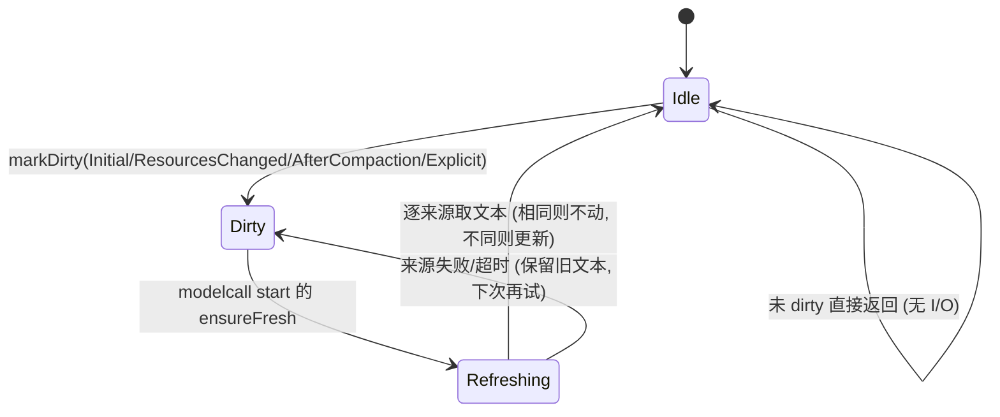

# 系统提示词来源注册与压缩后刷新 — 设计与实施方案

状态: 设计定稿（待实施）
范围: 提示词运行时来源注册表、memory / skill 来源接入、上下文压缩请求的前缀复用、观测与测试
不包含: 插件接口表新增（第二期）、客户端界面改动（第三期可选）

---

## 0. 决策摘要

| # | 决策 | 结论 |
|---|---|---|
| 1 | 静态附加段与运行时文档段是否合并 | **不合并存储，统一模型与枚举入口**。静态段留在 `AgentPrompt`（配置作用域），运行时文档段移入新的来源注册表（会话作用域）；两者共用 `PromptSection` 视图与统一的排序列 |
| 2 | 是否监听文件变化、变化即刷新 | **不做任何文件监听、不做每轮 stat 后自动刷新**。核查结论：现有实现没有监听（仅首次加载 + 插件资源变更），方案里也不引入；`mtime/size` 只用于"被要求刷新时省去读盘"，不作为刷新触发条件 |
| 3 | 刷新判断放在哪里 | **唯一入口 = model call 的 start 钩子**。首次读取、压缩后刷新、资源变更刷新、将来插件注册点的读写全部集中在这一处；`agentcall start` 不再读写段落 |
| 4 | `refresh_after_compaction` 开关 | **不加开关，功能常开** |
| 5 | memory 文件跨会话缓存串台 | **本次一并修复**（按解析后的路径集合缓存内容） |
| 6 | 插件相关（通知钩子、会话级推送接口） | **第二期**，本期只在设计上留出位置 |
| 7 | 压缩请求是否命中缓存 | **实测确认 + 修复 + 保留为回归测试**；验收要求：压缩请求必须命中父会话已缓存的前缀 |
| 8 | 压缩子代理的工具策略 | 请求里保留父会话的工具定义（为了前缀一致），但**在本次运行内完全不执行工具**；支持 `tool_choice=none` 的 provider 另行关闭工具选择 |

---

## 1. 目标与验收标准

### 1.1 目标

1. **一个注册点**：运行时提示词来源（记忆文件、技能清单、将来的插件来源）统一向一个组件注册"我是谁、什么时候需要文本、文本怎么取"，组件负责取文本、比较变化、提供给请求加载。
2. **一个刷新入口**：只在 model call 开始时判断"要不要刷新"，涵盖首次读取、压缩完成、资源变更、显式请求四种原因。
3. **刷新不影响缓存命中率**：内容没有变化时**不产生任何提示词变化**；变化只发生在压缩完成之后（该时刻 system 前缀本来就要付出一次重建，代价被压缩本身摊薄）。
4. **不引入文件监听/轮询**：进程运行期间不因为磁盘文件变化而自动改写系统提示词。
5. **压缩请求命中父会话缓存**：压缩子代理发出的请求，其可缓存前缀（system 消息 + 工具定义 + 消息前缀）与父会话上一次请求逐字节一致，工具在本次运行内不可执行。
6. **可观测**：来源状态、刷新次数、失败次数、字符数、前缀变化次数都能从加载快照与诊断包读到；压缩命中率可测量。

### 1.2 验收标准（可测）

| 编号 | 验收内容 | 判定方式 |
|---|---|---|
| A1 | 同一会话内不重复读盘：一轮里多次 model call，来源只构建一次 | 计数来源（测试用假来源）断言 build 次数 == 期望 |
| A2 | 内容未变化时压缩后刷新不改变系统提示词 | 压缩前后 `buildSystemPromptStable` 逐字节相同，`stablePrefixChanges` 不增长 |
| A3 | 内容变化时压缩后刷新在**下一次请求**生效 | 压缩后下一次请求的 system 含新内容，`stablePrefixChanges` 恰好 +1 |
| A4 | 文件被外部修改但未发生压缩/资源变更时不刷新 | 改 mtime 后连续两轮请求 system 完全相同（证明没有监听与轮询） |
| A5 | 压缩请求命中父会话缓存 | 压缩请求的 system 文本、工具定义 JSON 与父会话上一次请求逐字节相同；messages 前缀一致；模拟缓存报告 cached/prompt ≥ 0.9（长历史场景） |
| A6 | 压缩子代理不执行任何工具 | 子代理会话内没有 tool 结果消息；摘要非空且被写回父会话 |
| A7 | 跨会话内容隔离 | 两个不同工作目录的会话各自注入自己的记忆文件内容 |
| A8 | 会话回收 | `cleanupSession` 后注册表内该会话数据被释放 |

---

## 2. 现状（代码事实）

### 2.1 注入链路（四层）

| 层 | 位置 | 内容 | 变更时机 |
|---|---|---|---|
| 主 prompt | `AgentPrompt::systemPrompt` | 出厂 / 配置正文 | 启动期 |
| 静态附加段 | `AgentPrompt::appendSystemPrompts` + `appendSystemPromptMeta`（键 / order / source；`agent/lib/include/agentxx/agent/prompt.h`） | 内置功能段与插件段；插件经 `agentxx.agent.prompt` 接口表写入，带 owner 记账、按 sequence 重合成、禁用/卸载回退（`plugin_manager.h:818-830`） | 配置装载、插件加载/禁用/卸载 |
| 运行时稳定段 | `MiddlewareContext::graphDataKey_appendSystemMessageStable`（`middlewares/middleware.h:460`，值类型 `map<string,string>`） | 记忆文件内容、技能清单 | 每轮由中间件覆盖写入 |
| 动态段 | `graphDataKey_appendSystemMessage`（`middleware.h:464`） | 当前无写入方 | — |

组装与使用：

- `AgentContext::buildSystemPromptStable`（`agent/src/agent/context.cpp:779-796`）= 主 prompt + 静态附加段（按 order、同 order 按 key）+ 运行时稳定段（`collectAppendSections` 按来源键名升序，`context.cpp:118-139`），最后统一做会话级占位符替换。
- `buildSystemPrompt`（`context.cpp:798-816`）额外拼上动态段，供界面查看上下文用。
- `graphData[thread_id]` 在**每轮开始时清空**（`nodes/agentcall.cpp:21`），所以段落是每轮临时数据；来源内容缓存活在中间件成员里。
- 请求加载时 **每次重建 system 消息**：`ModelCallWrapNode::baseRun` 开头把会话首条 system 消息内容改为 `buildSystemPromptStable(thread_id)`（`nodes/modelcall.cpp:886-905`）。
- 稳定前缀指纹：`build_params` 把 system 文本 + 工具定义做 `fnv1a64`，变化时计数并落日志（`modelcall.cpp:378-399`）→ `Session::noteStablePrefixHash/stablePrefixChanges`（`agent/context.h:390-418`）。**这是量化"刷新代价"的现成手段。**

### 2.2 一轮里的钩子顺序（已核对）

```
AgentStartCall 节点 onNodeStart:  graphData[会话].clear()            (agentcall.cpp:21)
   └─ 各 handle onAgentcallStartFunc                                 (memory/skill 在这里读文件并写稳定段)
modelcall 节点:
   ├─ 各 handle onModelcallStartFunc            ← 本方案唯一的刷新入口落点
   ├─ baseRun: 重建 system 消息 (buildSystemPromptStable)            (modelcall.cpp:886-905)
   │    └─ 重试循环内: 各 handle onModelcallRunFunc                  (summarization 压缩检查在 modelcall.cpp:956)
   │         └─ repairMessages → 组装参数 → 发请求                   (modelcall.cpp:959 起)
```

### 2.3 现在的失效条件（只有两种）

- 首次加载（`haveLoaded == false`）。
- 资源纪元变化：插件经 `agentxx.agent.resources` 接口表增删 skill 目录 / memory 文件 → `AgentResourceApplier` → `addMemoryFiles/addSkillDirs` 等 → 置重载标记 + 递增 `resourceEpoch`（`middlewares/memory_file.cpp:192-215`、`middlewares/skill.cpp:318-372`）。

核查结论：**没有文件监听、没有按 mtime 的自动刷新**。全仓检索 `inotify` / `ReadDirectoryChangesW` / `file_time_type` / `last_write_time`，命中只有会话列表排序（`session_store.cpp:775-786`）与 codegraph 插件自身的索引逻辑，与提示词无关。

### 2.4 压缩路径

- `SummarizationMiddlewareHandle::onModelcallRunFunc`（`middlewares/summarization.cpp:847`）在 `onModelcallRunFunc` 钩子里执行：判定 token 占用 ≥ 75% → 发提示消息 → 确定性清理 → 经功能点 `agentxx.context.summarize` 派生"同上下文"压缩子代理 → 写回 `[system] | user(压缩指令) | assistant(摘要)`（`:1108-1111`，`persistNow("compaction")`）。
- 手动压缩：`compactSessionContext`（`:1186`，写回在 `:1294-1296`）。
- `KeyMetrics::noteCompaction` 有定义、有测试，但**主程序从未调用**（`util/observability.h:66-69`）。

### 2.5 现状缺陷：压缩请求实际上命中不了缓存

1. **system 不一致**：同上下文子代理是独立 agent 实例，`AgentHost::makeSubagentConfig` 把 `skillDirPaths` / `memoryFilePaths` 清空（`agent/agent_host.cpp:248-266`）。子代理的 `buildSystemPromptStable(父会话 id)` = 主 prompt + 静态附加段，**缺运行时稳定段**；而稳定段拼在 system 末尾 → 请求前缀在 system 内部就分叉，后面整段对话都无法命中。
2. **工具定义不一致**：压缩子代理 `tools=[]`（`AgentHost` 解析为"无工具白名单"，`agent_host.cpp:386-422`），请求里没有工具定义；父会话请求带全部工具定义。按 provider 的渲染顺序（工具 → system → messages），前言部分就对不上。
3. 注释里"同上下文 → 命中 KV cache"的预期因此不成立；压缩是一次全价请求。

### 2.6 现状缺陷：记忆文件内容跨会话串台

`MemoryFileMiddlewareHandle::fileContents` 是句柄级缓存（全体会话共享），但路径按**会话工作目录**解析（`memory_file.cpp:117-124`，`AgentContext::getSessionWorkDir`）。两个会话工作目录不同时，后启动的会话会拿到先启动会话读到的内容。

---

## 3. 设计

### 3.1 分层与作用域（回答"静态段要不要和运行时段合并"）

**结论：统一模型，不合并存储。**

| 维度 | 静态附加段 | 运行时文档段 |
|---|---|---|
| 作用域 | 配置（全体会话共享） | 会话（按 sessionId） |
| 存储 | `AgentPrompt::appendSystemPrompts` + `appendSystemPromptMeta` | 新增来源注册表（本方案） |
| 生命周期 | 与 `AgentConfig` 同寿命；插件加载/禁用/卸载时增删 | 与 Session 同寿命；会话回收时释放 |
| 变更来源 | 配置装载、插件贡献（owner 记账 / 重合成 / 备份恢复） | 文档来源（记忆文件、技能清单、将来的插件推送） |
| 序列化 | `toJson/fromJson/mergeFromJson/promptHash`（训练、FFI 配置） | 不参与序列化，每次按需产出 |
| 顺序元数据 | `order` + 键名 | `order` + 键名（注册表内） |
| 组装位置 | `systemPrompt` 之后 | 紧随静态段之后（文档跟在指令之后） |

不合并的理由（关键）：

- 静态段是**配置**：要能整体序列化、能算哈希（训练种群去重）、能在会话存在之前就确定。把按会话的数据塞进去，会让配置带上会话数据，破坏训练/FFI 语义。
- 运行时段的文本**每次由代码产出**（异步读盘），与"配置里的一段字符串"不是一类东西；混在一张表里会出现"这张表有时序化、有时没有"的歧义。
- 插件贡献的记账身份目前是"键"，没有会话维度；会话级推送需要以自己的身份（会话 + 键 + owner）记账，放在注册表里更自然。

统一的部位：

- 统一值模型 `PromptSection {key, order, owner, scope, slot, text}`，注册表对外提供 `listSections(sessionId)` 视图，静态段以 `scope = Config` 的形式**只读引用** `AgentPrompt`，运行时段以 `scope = Session` 由注册表持有；加载、加载快照、界面上下文查看、将来的插件读写接口都走这一个视图。

### 3.2 组件：`PromptSourceRegistry`

位置：`agent/lib/include/agentxx/agent/prompt_sources.h` + `agent/lib/src/agent/prompt_sources.cpp`；实例挂在 `AgentContext::promptSources`（`std::shared_ptr`，构造即创建，早于中间件构造与插件加载；与功能点声明时机同构）。

```cpp
namespace agentxx {
namespace agent {

/// 段落作用域
enum class PromptSectionScope {
    Config,   ///< 配置作用域 (AgentPrompt::appendSystemPrompts, 全体会话共享)
    Session,  ///< 会话作用域 (注册表持有, 按 sessionId)
};

/// 段落落点
enum class PromptSectionSlot {
    Stable,   ///< 进 system 消息 (稳定前缀, 上游缓存可命中)
    Dynamic,  ///< 作为请求末尾独立消息 (每轮全额重发, 仅放"确实每次都可能变"的内容)
};

/// 需要重取来源内容的原因
enum class PromptRefreshReason {
    Initial,           ///< 该会话首次取文本
    ResourcesChanged,  ///< 资源变更 (插件增删记忆文件/技能目录、配置重载)
    AfterCompaction,   ///< 上下文压缩完成
    Explicit,          ///< 外部显式请求 (客户端动作 / 插件 / FFI)
};

/// 取文本时的运行信息
struct PromptRefreshContext {
    std::string                            sessionId;
    std::string                            workDir;   ///< 会话工作目录 (相对路径基准; 取不到为空)
    PromptRefreshReason                    reason = PromptRefreshReason::Initial;
    bool                                   first  = false; ///< 该会话首次
    std::shared_ptr<neograph::graph::CancelToken> cancelToken; ///< 轮次取消令牌 (可空)
    std::chrono::steady_clock::time_point  deadline{}; ///< 超时上限
};

/// 一个运行时提示词来源
struct PromptSource {
    std::string       key;                 ///< 段落键 (全局唯一, 如 "memory" / "skills")
    std::string       owner;               ///< 归属 (如 "core:memory"), 撤销与诊断用
    int               order = 0;           ///< 段内顺序 (小者在前; 同 order 按键名)
    PromptSectionSlot slot  = PromptSectionSlot::Stable;
    bool              perSession = false;  ///< 文本随会话变化 → 按会话各存一份; false → 全体共享一份
    bool              refreshOnCompaction = true;
    std::chrono::milliseconds timeout{3000};
    /// 取文本; 返回 nullopt = 本次没有意见 (保留上次文本, 不算失败)
    std::function<asio::awaitable<std::optional<std::string>>(const PromptRefreshContext&)> build;
};

/// 段落只读视图 (加载 / 快照 / 界面 / 将来的插件读写都走它)
struct PromptSectionView {
    std::string_view  key;
    std::string_view  text;
    int               order = 0;
    std::string_view  owner;
    PromptSectionScope scope = PromptSectionScope::Session;
    PromptSectionSlot  slot  = PromptSectionSlot::Stable;
};

class PromptSourceRegistry {
public:

    /// 登记来源 (同 key 覆盖并记警告; owner 不同 = 冲突)
    void registerSource(PromptSource src);

    /// 删除来源 (owner 必须匹配; 插件禁用/卸载时按 owner 撤销)
    void removeSource(std::string_view key, std::string_view owner = {});

    /// 标记某会话需要刷新 (纯同步, 可在压缩路径安全调用; 不立即读盘)
    void markDirty(std::string_view sessionId, PromptRefreshReason reason);

    /// 标记全体会话需要刷新 (资源变更; 只置位, 实际读盘在各自的请求加载前)
    void markAllDirty(PromptRefreshReason reason);

    /// 刷新 (唯一读盘入口)
    /// - 未标记 dirty 且已初始化时直接返回 (一次布尔判断)
    /// - 逐来源取文本: 成功且与上次不同 → 更新; 相同 → 不动 (不制造前缀变化);
    ///   nullopt / 空 / 超时 / 失败 → 保留上次文本
    asio::awaitable<void>
        ensureFresh(std::string_view sessionId, const PromptRefreshContext& ctx, bool force = false);

    /// 段落视图 (稳定段: Config 段 + 本会话稳定段, 按 (order, key) 排序)
    std::vector<PromptSectionView> stableSections(std::string_view sessionId) const;
    /// 段落视图 (动态段)
    std::vector<PromptSectionView> dynamicSections(std::string_view sessionId) const;

    /// 会话回收 (由中间件上下文清理路径调用, 防止按会话累积)
    void dropSession(std::string_view sessionId);

    /// 诊断快照: 每来源 key/owner/order/slot/perSession/lastReason/lastMs/chars/refreshes/
    /// failures/lastError, 以及会话数、总字符数 (不含正文)
    utilxx_base::Json snapshot() const;
};

} // namespace agent
} // namespace agentxx
```

内部状态（仅 io 线程访问）：

```
sources_   : key → { PromptSource, 状态{lastText, lastReason, lastMs, chars, refreshes,
                                       changedCount, failures, lastError} }
sessions_  : sessionId → { dirtyReasons(位集), initialized, 各来源文本(仅 perSession 来源),
                           来源文本版本(用于变化比较) }
sharedText : key → text   (perSession = false 的来源只存一份, 全体会话共用)
```

### 3.3 唯一刷新入口：model call 的 start 钩子

新增一个核心中间件 `PromptSourceRefreshHandle`（`agent/lib/src/middlewares/prompt_source_refresh.{h,cpp}`，在 `BaseAgent::initMiddleware` 里**最先**加入 handles）：

```cpp
asio::awaitable<void> PromptSourceRefreshHandle::onModelcallStartFunc(neograph::graph::NodeInput& in) {
    auto ctx = agentContext.lock();
    if (!ctx || !ctx->promptSources) {
        co_return;
    }
    PromptRefreshContext rc;
    rc.sessionId   = in.ctx.thread_id;
    rc.workDir     = ctx->getSessionWorkDir(in.ctx.thread_id);
    rc.cancelToken = in.ctx.cancel_token;
    // 原因由注册表按会话内的标记决定 (Initial / ResourcesChanged / AfterCompaction / Explicit)
    co_await ctx->promptSources->ensureFresh(rc.sessionId, rc);
    co_return;
}
```

要点：

- **首次读取、压缩后刷新、资源变更刷新、显式刷新全部在这里**；`agentcall start` 不再读写段落（memory/skill 中间件的 `onAgentcallStartFunc` 变为空实现）。
- 未 dirty 且已初始化时只有一次布尔判断，不产生 I/O。
- 该钩子同时是**将来插件读写提示词相关信息的统一位置**（第二期在此处暴露注册/推送/查询）。
- 工具执行的同一位置约定：`ensureFresh` 必须尊重取消令牌，取消时立即返回（保留旧文本）。

### 3.4 刷新原因与规则



| 原因 | 触发点 | 说明 |
|---|---|---|
| `Initial` | 该会话第一次 `ensureFresh` | 首次读取记忆文件 / 扫技能目录 |
| `ResourcesChanged` | `AgentResourceApplier` 增删 memory 文件 / skill 目录、显式资源重载 | **显式程序动作**，不是文件变化检测；只标记，实际读盘在下一个请求加载前 |
| `AfterCompaction` | 压缩写回完成（自动 / 手动 / 硬截断兜底三条路径） | 见 §3.6 |
| `Explicit` | 客户端动作、插件调用、FFI | 立即生效（同一 model call 前） |

**明确禁止项**（写进代码注释与文档，避免后来者加回来）：

1. 不引入 inotify / ReadDirectoryChangesW / 定时轮询等文件监听。
2. 不在每轮或每次请求做"stat 对比后自动刷新"——每次内容变化都会让 system 前缀失效一次，代价必须由明确的时机（压缩完成）支付。
3. 来源内部的 `mtime/size` 快照只用于**被要求刷新时省去读盘**（内容未变直接返回上次文本），不作为刷新触发条件。

### 3.5 来源实现

#### 3.5.1 `memory`（记忆文件）

- 中间件保留：文件列表、`addMemoryFiles/removeMemoryFiles`、`oversizeMemoryFiles()` 诊断、加载日志。
- 构造函数登记来源：

```cpp
// 记忆文件: 段落键 "memory"
promptSourceRegistry->registerSource(PromptSource{
    .key        = "memory",
    .owner      = "core:memory",
    .order      = 100,
    .slot       = PromptSectionSlot::Stable,
    .perSession = true,   // 相对路径按会话工作目录解析 → 文本随会话变化
    .timeout    = std::chrono::milliseconds{3000},
    .build      = [weak = weak_from_this()](const PromptRefreshContext& rc)
        -> asio::awaitable<std::optional<std::string>> { ... }
});
```

- `build` 逻辑：
  1. 把配置路径按 `rc.workDir` 解析为绝对路径（复用 `utilxx_base::toCurrentSystemAbsolutePath`）。
  2. **按"解析后的路径集合"取缓存内容**（`pathSetDigest → 内容`）：同一批路径只存一份内容，不同工作目录的会话各取各的（修复 §2.6 串台），也不按会话翻倍内存。
  3. 每个文件记录 `(mtime, size)` 快照：被要求刷新时先比较，全部未变 → 直接返回上次文本（省 I/O，且不会产生无意义变化）。
  4. 单文件读失败 → 保留该文件上次内容并记日志；全部失败 → 返回 `nullopt`（保留整段）。
- 移除的成员：`fileContents`、`haveLoaded`、`needReloadMemoryFiles`、`resourceEpoch`、`MemoryFileMiddlewareState`（改为注册表持有文本；中间件的 state 不再需要）。

#### 3.5.2 `skills`（技能清单）

- 中间件保留：目录列表（含优先级/来源）、同名裁决与 `shadowedSkills()`、`skillDirPathList()`、加载日志、`addSkillDirs/removeSkillDirs`。
- 来源：`key = "skills"`、`owner = "core:skills"`、`perSession = false`（清单与会话无关，全体共享一份文本）、`order = 200`。
- `build` 逻辑：
  1. 收集候选目录 → 逐目录找 `SKILL.md` → 解析 front matter（沿用现有实现与错误收集）。
  2. 用 `(路径, mtime, size)` 快照比较：结构未变 → 直接返回上次清单文本，不重读 `SKILL.md`。
  3. 同名裁决后生成清单文本（`## Skills System ...`）。
- 日志：只在"首次 / 清单内容变化 / 有失败项"时输出加载块，避免每轮刷。
- 移除的成员：`haveLoadSkillMetadata`、`needReloadSkillMetadata`、`resourceEpoch`、`cacheFormatSkillPrompt`、`cachedResourceEpoch`（改为注册表持有）。

### 3.6 压缩完成后的刷新时机

在三条压缩写回路径后各加一句（同步、无 I/O）：

```cpp
// 压缩完成: 本次请求的 system 前缀与后续请求的上下文都已经改变,
// 是唯一值得改写注入内容的时机 (改动只影响后续请求, 不影响本次已加载的请求)
agentContext->promptSources->markDirty(in.ctx.thread_id, PromptRefreshReason::AfterCompaction);
if (agentContext->metrics) {
    agentContext->metrics->noteCompaction(static_cast<int64_t>(oldTokens),
                                          static_cast<int64_t>(newTokens));
}
```

- 自动压缩：`onModelcallRunFunc` 写回 + `persistNow("compaction")` 之后（`summarization.cpp:1108-1111`）。
- 手动压缩：`compactSessionContext` 写回 + `persistNow("manual-compaction")` 之后（`:1294-1296`）。
- 硬截断兜底：同样标记（它也改变了上下文）。

时序（为什么是"标记 + 下一个 model call 刷新"，而不是"当场读盘"）：

```
轮次开始: graphData 清空 (段落不再放 graphData, 不影响)
modelcall #N
  ├ start 钩子: ensureFresh — 未 dirty → 无 I/O
  ├ baseRun: 重建 system 消息 (文本 A)
  │    └ run 钩子: 压缩检查 → 触发压缩
  │         ├ 压缩子代理请求: 复用的前缀 = 上一次请求 (system A + 工具 T + 历史)
  │         ├ 写回 system|user(压缩指令)|assistant(摘要) + persistNow
  │         └ markDirty(AfterCompaction)          ← 只置位, 不读盘
  └ 发出 #N 请求: system A + 压缩后上下文 (system 前缀仍命中)
工具执行 …
modelcall #N+1
  └ start 钩子: ensureFresh — dirty → 读盘 → 内容有变则更新段落 (文本 B)
       └ baseRun: 重建 system 消息 (B) → 请求: system B
            ← 只付一次 system 前缀重建; 因为压缩后上下文已经很短, 这是最便宜的时机
```

代价说明（写进文档，避免误解）：压缩之后，父会话下一条请求的可缓存前缀只剩 system 部分（消息体已经被摘要替换），所以"压缩后刷新注入段"的代价精确等于**一次 system 前缀重建**，没有额外损失；反之，内容未变时完全不动段落，代价为零（由 A2 验收）。

已知边界（罕见，不影响正确性）：如果同一次 model call 里既发生了资源变更刷新（system 文本变新）又触发了压缩，那么压缩请求会带上新的 system 文本，而 provider 缓存里是旧文本 → 这次压缩请求命中不了 system 前缀。两者同时发生需要"插件在这一刻增删了记忆文件/技能目录"且"上下文刚好超限"；此时以 token 统计正确为先（刷新在前，压缩判定用的是刷新后的提示词规模），不为此调整顺序。

### 3.7 压缩请求的前缀复用（修复缓存命中 + 限制工具）

#### 3.7.1 三个不一致点与对策

| 不一致点 | 现状 | 对策 |
|---|---|---|
| system 文本 | 子代理按自己的配置重建（缺运行时稳定段） | 同上下文运行**保留调用方给的首条 system 消息**，不重建 |
| 工具定义 | 子代理 `tools=[]` | 同上下文运行**继承父会话上一次请求的工具定义** |
| 工具执行 | 子代理有自己的一套工具（或没有） | 本次运行**完全不执行工具**（工具定义只用于对齐前缀） |

#### 3.7.2 数据流

1. **捕获父会话上一次请求的工具定义**（agent 级，一份）：
   在 `ModelCallWrapNode::build_params` 里，参数加载完成后写入
   `AgentContext::lastRequestTools = std::make_shared<const std::vector<neograph::ChatTool>>(params.tools)`
   （工具定义与 agent 配置相关、与会话无关，因此一份即可；`std::shared_ptr` 共享给子代理，零拷贝）。
2. **system 文本**：压缩时直接取会话首条消息的正文（本次 model call 开头刚重建过，等于上一次请求发出的文本），随 `messages` 一并透传；子代理保留它、不重建。
3. **`SubagentBatchItem` 新增字段**（内部事件结构，不是插件 ABI）：

```cpp
/// 同上下文运行: 保留调用方给出的 system 消息 (不按子代理自身配置重建)
/// - 用于"复用父会话可缓存前缀"的场景 (上下文压缩)
bool keepProvidedSystemMessage = false;
/// 同上下文运行: 继承父会话上一次请求的工具定义 (只用于对齐请求前缀)
bool inheritRequestTools = false;
/// 本次运行不执行工具: 模型若仍返回 tool_calls, 忽略它们并结束本轮
/// - 工具定义仍在请求里 (前缀一致), 但不会调用任何工具
bool toolExecutionDisabled = false;
```

4. **`AgentHost::spawnOneTask`** 在 `sameContext` 时把它们写到子配置：
   `subCfg->keepProvidedSystemMessage / subCfg->requestToolsOverride = rootAgent 的 lastRequestTools / subCfg->toolExecutionDisabled`。
5. **`ModelCallWrapNode`**：
   - `baseRun` 开头：`keepProvidedSystemMessage == true` 且首条是 system → 跳过重建（保留透传文本）。
   - `build_params`：`requestToolsOverride` 非空 → 用它替换节点自身的工具列表。
   - `callLLM` / `autoRoute_`：`toolExecutionDisabled == true` → 忽略 `tool_calls` 的路由（直接走 `agent_end`），因此不会进入 tools 节点；响应里的正文就是摘要。
6. **provider 层的额外保险**（可选，能力门控）：压缩请求经 `CompletionParams::extra_fields` 设 `tool_choice = "none"`（该机制已存在，见 `neograph/provider.h` 的 `extra_fields`；三个 provider 都会把它写进请求体，`openai_provider.cpp:735-745`、`:805-812`、`anthropic_provider.cpp:474-481`；内部保留键见 `protocol/provider_common.h:104-106`）。
   - `tool_choice` 不参与提示词前缀，因此加它不影响缓存对齐。
   - 支持性：模型配置新增一个开关（默认真，未知/自建后端可关）；不支持时不加该字段，靠第 5 步的"忽略 tool_calls"兜底。
   - 若上游因该字段返回 400，走现有 LLM 错误分类路径，必要时可加"去掉该字段重试一次"。

#### 3.7.3 摘要失败的处理

若模型只返回 tool_calls 而无正文 → 摘要为空 → 走现有失败路径（失败计数 → 重试 → 硬截断兜底）。压缩指令中已明确"不要调用工具，直接输出摘要文本"，`tool_choice=none` 可用时不会出现该情况。

### 3.8 组装改动

- `AgentContext::buildStableContextSections(sessionId)` / `buildDynamicContextSections(sessionId)` 改为读 `promptSources` 的段落视图（保留原来的返回类型 `vector<pair<source, text>>`，顺序按 `(order, key)`）。
- `collectAppendSections` 与两个通道键常量 `graphDataKey_appendSystemMessageStable` / `graphDataKey_appendSystemMessage`（`middleware.h:446-464`）**退役**：运行时段不再经过 graphData（段落由注册表持有，graphData 的每轮清空语义不再需要为段落服务）。
- 组装顺序保持：主 prompt → 静态段（order, key）→ 会话稳定段（order, key）；动态段仍作为请求末尾独立消息（`modelcall.cpp:320-351` 的告警逻辑不变）。
- 占位符替换仍在组装末尾统一做（会话段落文本里可写 `${work_dir}` 等）。
- 界面侧：`WireGetContext` / `buildSystemPrompt` 自动跟随（读同一份视图）。已知影响：全新会话在第一次 model call 之前，界面上下文视图里看不到运行时段（此前在轮次开始时就有）——差异在毫秒级，接受并在文档中说明。

### 3.9 观测与诊断

- `KeyMetrics`：新增 `promptRefreshes` / `promptRefreshFailures` / `promptChangedSections` / `promptRefreshMs` / `promptSectionChars`（总量）；补上 `noteCompaction` 的调用。
- 加载快照（`agent/src/agent/assembly_snapshot.cpp`）：新增 `prompt_sources` 段（每来源的 key/owner/order/slot/per_session/last_reason/last_ms/chars/refreshes/failures/last_error + 会话数 + 总字符数），`--dump-diagnostics` 出一行汇总（不含正文）。
- 日志：
  - 刷新导致段落变化 → `XX_LOGI`（含 sessionId、原因、来源、字符数变化）；与现有 `stable prompt prefix changed` 日志配套，能直接看出"前缀为什么变了"。
  - 来源失败/超时 → `XX_LOGW`（按原因去重，不刷屏）。
- `Session::stablePrefixChanges` 语义写进文档：**压缩后内容确实变化时 +1 是预期行为**，不要当成异常。

### 3.10 线程、生命周期与内存约定

- 注册表状态仅 io 线程访问（与段落进入请求加载同线程）；`ensureFresh` 在同一 io 线程串行执行，`busy` 标记避免重入（重入时只保留 dirty）。
- `perSession = false` 的来源只存一份文本（全体会话共享）；`perSession = true` 的来源按会话存，并由 `MiddlewareContext::cleanupSession`（`middlewares/middleware.cpp:383-390`）调用 `promptSources->dropSession()` 释放。
- 单来源超时（默认 3s）、单次刷新总预算（默认 5s）都记日志并保留旧文本；失败次数计入快照。
- 字符数上限沿用记忆文件现有告警阈值（8000 字符/文件），另在快照里给出总量；**只告警不截断**。

---

## 4. 压缩命中缓存的实测与回归测试

### 4.1 测试内的模拟前缀缓存（mock provider）

在 `agent/test/core/test_agent.cpp` 的本地模拟服务（`startDaSimServer`）里增加一个"模拟前缀缓存"：

- 保存上一次请求的 `{system 文本, 工具定义 JSON, messages 数组}`。
- 本次请求到达时，逐段比较：
  1. 工具定义 JSON 是否逐字节相同；
  2. system 文本是否逐字节相同；
  3. messages 数组的前缀逐元素（JSON 逐字节）相同的条数。
- 命中前缀的 token 估算 = 工具定义 + system + 相同前缀消息（用与主程序同一套 `TokenEstimator`，或按字符数折算），写入响应的
  `usage.prompt_tokens_details.cached_tokens`（新增 `g_da_sim_cached_tokens` / `g_da_sim_prev_request` 一类的测试钩子）。
- 主程序侧已有的缓存用量解析（`openai_provider.cpp` 的 `parseCachedUsage`）会把该值记入用量台账与 `KeyMetrics`，测试据此断言。

### 4.2 断言清单（新增/扩展测试）

| 断言 | 位置 |
|---|---|
| 压缩请求的 system 文本 == 父会话上一次请求的 system 文本（逐字节） | `summarization` 或新增 `prompt_cache_prefix` 模块 |
| 压缩请求的工具定义 JSON == 父会话上一次请求（数量、顺序、内容逐字节） | 同上 |
| 压缩请求的 messages == 父会话消息前缀 + 末尾压缩指令 | 同上 |
| 模拟缓存报告 cached / prompt ≥ 0.9（长历史） | 同上 |
| 压缩子代理没有执行任何工具（子代理会话内无 tool 结果消息）、摘要非空并写回 | 同上 |
| 压缩完成后父会话下一条请求的 system 前缀仍命中（与压缩请求 system 相同） | 同上 |
| 内容未变时压缩后 `stablePrefixChanges` 不增长；内容变化时恰好 +1 | `prompt_stability` 扩展 |
| 文件外部变化但无压缩/资源变更时 system 不变 | `prompt_stability` 扩展 |
| 每轮不重复读盘（来源 build 次数） | 新增 `prompt_sources` 模块 |
| 不同工作目录会话内容隔离、会话回收 | 新增 `prompt_sources` 模块 |

### 4.3 真实 provider 实测（记录在案）

步骤（在 `benchmark.md` 或本文件"实测记录"小节追加）：

1. 选一个会回报 `cached_tokens` 的 provider（OpenAI 兼容或 Anthropic），打开 `cache_control`（Anthropic）。
2. 跑一个会话直到自动压缩；从用量台账/诊断包读取三条请求的 `cachedTokens / promptTokens`：
   (a) 普通轮次请求、(b) 压缩子代理请求、(c) 压缩后的父请求。
3. 预期结果：(b) ≥ 0.8（长历史时更高），(a) 视 provider 而定，(c) 只命中 system 部分（符合 §3.6 的代价说明）。
4. 把数字与结论写入文档；若某 provider 的实际命中明显低于预期，记录原因（例如缓存块对齐粒度、最小可缓存长度）并单独评估，不改动本方案的前缀对齐规则。

---

## 5. 影响面清单（文件级）

### 5.1 新增

| 文件 | 内容 |
|---|---|
| `agent/lib/include/agentxx/agent/prompt_sources.h` | 注册表与段落模型声明 |
| `agent/lib/src/agent/prompt_sources.cpp` | 注册表实现（刷新、变化比较、超时、取消、快照） |
| `agent/lib/include/agentxx/middlewares/prompt_source_refresh.h` | 刷新入口中间件声明 |
| `agent/lib/src/middlewares/prompt_source_refresh.cpp` | `onModelcallStartFunc` → `ensureFresh` |
| `agent/test/include/agentxx-test/core/test_prompt_sources.h` + `agent/test/core/test_prompt_sources.cpp` | 注册表/来源行为测试模块 |
| `agent/test/include/agentxx-test/core/test_prompt_cache_prefix.h` + `.cpp` | 压缩请求前缀对齐与模拟缓存命中测试模块 |

### 5.2 修改

| 文件 | 改动 |
|---|---|
| `agent/lib/include/agentxx/agent/context.h` / `src/agent/context.cpp` | 新增 `promptSources` 与 `lastRequestTools` 成员；`buildStableContextSections` / `buildDynamicContextSections` 改读注册表 |
| `agent/lib/include/agentxx/middlewares/middleware.h` | 删除两个段落通道键常量；`cleanupSession` 增加 `dropSession` 调用（或由调用方调用） |
| `agent/lib/include/agentxx/middlewares/memory_file.h` / `agent/lib/src/middlewares/memory_file.cpp` | 改为登记来源；按路径集合缓存内容（修复串台）；删除每轮读取路径 |
| `agent/lib/include/agentxx/middlewares/skill.h` / `agent/lib/src/middlewares/skill.cpp` | 同上（清单文本共享一份；快照比较省 I/O） |
| `agent/lib/src/middlewares/summarization.cpp` | 写回后 `markDirty(AfterCompaction)` + `noteCompaction`；压缩任务填 `keepProvidedSystemMessage` / `inheritRequestTools` / `toolExecutionDisabled` |
| `agent/lib/src/agent/agent_host.cpp` | `spawnOneTask` 传递上述三个开关与工具覆盖 |
| `agent/lib/include/agentxx/agent/config.h` | 新增子代理专用瞬时字段：`keepProvidedSystemMessage`、`requestToolsOverride`、`toolExecutionDisabled`、`toolChoiceNoneSupported` |
| `agent/lib/src/nodes/modelcall.cpp` | `build_params` 保留 system 消息 / 使用工具覆盖 / 捕获 `lastRequestTools` / 追加 `tool_choice`；`toolExecutionDisabled` 时忽略 tool_calls 路由 |
| `agent/lib/src/agent/base_agent.cpp` | 加载 `PromptSourceRefreshHandle`（最先） |
| `agent/lib/src/agent/code_agent.cpp` | 不再依赖 memory/skill 中间件的轮次钩子（构造函数登记来源） |
| `agent/lib/src/agent/assembly_snapshot.cpp` | 增加 `prompt_sources` 段 |
| `agent/lib/include/agentxx/util/observability.h` / `src/util/observability.cpp` | 新增提示词相关指标 |
| `agent/lib/src/agent/resource_applier.cpp` | 资源变更改为 `markDirty(ResourcesChanged)`（不再走每轮重读标记） |
| 测试：`test_graph_data.cpp`、`test_plugin_resources.cpp`、`test_prompt_stability.cpp`、`test_summarization.cpp`、`test_agent.cpp`（mock 缓存）、`test/test.cpp`（模块注册） | 按新段落来源改写断言；新增模块注册 |
| 文档：`docs/zh-cn/design/index.md`（提示词加载与压缩两段）、`docs/zh-cn/design/plugins.md`（第二期留位）、`docs/zh-cn/design/benchmark.md`（实测数字） | 与实现一致 |

### 5.3 不修改

- `agent/third_party/**`：`tool_choice` 走已有的 `extra_fields` 机制，neograph 与各 provider 都不需要改。
- 插件 ABI：本期不新增接口表成员（第二期做 `agentxx.agent.prompt` 表尾追加与钩子点）。

---

## 6. 实施步骤（每步可独立验收）

| 步骤 | 内容 | 验收 |
|---|---|---|
| S1 | 新增注册表与段落模型（`prompt_sources.{h,cpp}`），挂到 `AgentContext`；暂不改现有行为 | 现有测试全绿；新增模块的单测（注册/排序/撤销/快照） |
| S2 | memory / skill 改为登记来源；删除每轮读写与纪元字段；按路径集合缓存内容（修串台） | A1 / A7；`prompt_stability` 的既有断言仍成立 |
| S3 | 组装改读注册表；退役两个通道键；更新受影响测试 | `prompt_stability`、`graph_data`、`plugin_resources` 全绿 |
| S4 | 新增刷新入口中间件（model call start）；接入取消与超时 | A1 / A2 / A4 |
| S5 | 压缩写回后标记 dirty；三条路径（自动/手动/硬截断） | A3；`summarization` 测试扩展 |
| S6 | 资源变更改标记；`cleanupSession` 释放会话文本 | A8；`plugin_resources` 扩展 |
| S7 | 压缩请求前缀复用（system 保留 / 工具覆盖 / 工具不执行 / `tool_choice`） | A5 / A6；新增前缀测试模块 |
| S8 | 指标、加载快照、诊断包、日志 | 快照与诊断包字段测试 |
| S9 | 文档更新 + 真实 provider 实测记录 | 文档与实现一致；实测数字入档 |

回退方式：S1–S4 与 S5–S9 之间是弱耦合，前缀复用（S7）可单独回退到"子代理无工具 + 自己重建 system"的旧行为（缓存命中预期随之取消）。

---

## 7. 风险与边界

| 风险 | 说明 | 处理 |
|---|---|---|
| 压缩请求仍不命中的 provider 差异 | 缓存块对齐粒度、最小可缓存长度（如 1024 token）、服务端实现差异 | 用模拟缓存 + 真实实测双重验证；效果不达标时记录原因，不回退前缀对齐规则 |
| `tool_choice` 兼容性 | 个别自建后端可能拒绝未知字段 | 能力开关（默认开、可关）；关闭时靠"忽略 tool_calls"兜底；必要时加"去掉字段重试" |
| 前缀复用引入的耦合 | 子代理请求依赖父会话"上一次请求的工具定义" | 工具定义捕获为空（进程刚启动、无历史请求）时退回"不覆盖工具"的旧行为，且不承诺命中 |
| 刷新带来的 system 前缀重建 | 内容变化时后续请求需重建 system 前缀 | 只在压缩后 + 内容真实变化时发生；A2 断言"不变不动"；指标可观测 |
| 刷新发生在请求前的关键路径 | 首次请求 / 压缩后的下一次请求会读盘 | 只 stat 未变则跳过读取；异步文件 I/O 或线程池；超时与取消保护 |
| 会话态内存 | 按会话缓存文本 | 共享来源一份；`dropSession` 回收；快照可见字符数 |
| 界面一致性 | 会话首条 system 消息是派生值，可能与"正在发送的请求"短暂不同（现状即如此） | 界面用 `buildSystemPrompt`；文档写清 |
| 手动压缩时的工具定义缺失 | 空闲触发、进程重启后无"上一次请求" | 回退旧行为；不承诺命中（文档说明） |

明确不做的事：

- 不做文件监听 / 轮询 / 变化即刷新。
- 不把运行时段并入配置作用域（不合并存储）。
- 不改插件 ABI（第二期再做通知钩子与会话级推送接口）。
- 不动 `agent/third_party/**`。

---

## 8. 第二期（插件面，位置先留出）

1. **通知**：新增钩子点 `AGENTXX_PLUGIN_HOOK_CONTEXT_COMPACTED`（追加在 `AGENTXX_PLUGIN_HOOK_COUNT` 之前），载荷
   `{sessionId, before_tokens, after_tokens, max_tokens, action: compact|hard_truncate|none, manual}`；主程序侧新增 `PluginManager::dispatchHookJson(point, json)`，由压缩中间件在写回后调用（钩子派发仍在 io 线程、按现有优先级规则）。
2. **推送**：`agentxx.agent.prompt` 表尾追加 `set_session_section` / `remove_session_section` / `request_refresh`：
   - 身份 = `(sessionId, key, owner)`，由注册表记账（禁用摘生效、卸载按 owner 撤销）。
   - 推送不立即触发读盘；文本进入会话段落，下一个请求生效。
3. **第三条可选**：客户端"重新读取记忆/技能"动作（复用现有 wire 消息模式，如 `WireCompactContext`），走 `Explicit` 原因。
4. 注意：插件事件表的 topic 会被强制加 `plugin.` 前缀（`plugin_manager_domain_hooks.cpp:110-116`），内部主题与插件主题互不可见，所以"必须生效"的通知走钩子而不是事件总线。

---

## 9. 附录

### 9.1 关键代码位置索引

| 主题 | 位置 |
|---|---|
| 静态附加段与元数据 | `agent/lib/include/agentxx/agent/prompt.h` |
| 段落通道键（将退役） | `agent/lib/include/agentxx/middlewares/middleware.h:446-464` |
| 段落收集与组装 | `agent/lib/src/agent/context.cpp:118-139`（收集）、`:779-796`（稳定段）、`:798-816`（含动态段） |
| 每轮清空 graphData | `agent/lib/src/nodes/agentcall.cpp:21` |
| system 消息重建 / 前缀指纹 | `agent/lib/src/nodes/modelcall.cpp:886-905`、`:378-399` |
| 压缩主流程 / 写回 | `agent/lib/src/middlewares/summarization.cpp:847`、`:1108-1111`、`:1186`、`:1294-1296` |
| 记忆文件读写 | `agent/lib/src/middlewares/memory_file.cpp:106-215` |
| 技能扫描 | `agent/lib/src/middlewares/skill.cpp:230-372` |
| 子代理配置（清空 skill/memory） | `agent/lib/src/agent/agent_host.cpp:248-266` |
| 子代理工具策略 | `agent/lib/src/agent/agent_host.cpp:386-422` |
| 同上下文模式 | `agent/lib/src/agent/agent_host.cpp:456-478`、`:522-528`、`:604-618` |
| 插件资源应用器 | `agent/lib/include/agentxx/agent/resource_applier.h` |
| 稳定前缀指纹 API | `agent/lib/include/agentxx/agent/context.h:390-418` |
| 请求体透传字段机制 | `agent/third_party/neograph/include/neograph/provider.h`（`extra_fields`）；`agent/lib/src/protocol/openai_provider.cpp:735-745`、`:805-812`；`anthropic_provider.cpp:474-481` |
| 压缩指标（已有定义未调用） | `agent/lib/include/agentxx/util/observability.h:66-69` |
| 测试模拟服务 | `agent/test/core/test_agent.cpp`（`startDaSimServer`，usage 已支持 `prompt_tokens/completion_tokens`） |
| 提示词稳定性测试 | `agent/test/core/test_prompt_stability.cpp` |

### 9.2 名词

| 名词 | 含义 |
|---|---|
| 可缓存前缀 | 请求里位于最前面、连续不变的部分（工具定义 + system 消息 + 消息前缀），provider 的前缀缓存按它命中 |
| 前缀重建 | 前缀中任一字节变化导致 provider 需要重新计算这部分 token（账单与延迟都体现出来） |
| 段落 | 拼进系统提示词或请求末尾的一段文本，带键、顺序、归属 |
| 来源 | 一段文本的生产者（记忆文件、技能清单、将来的插件来源） |
| 刷新 | 让来源重新产出文本并更新段落的过程（只在 model call 开始时发生） |

### 9.3 实测记录（实施后填写）

| 日期 | provider / 模型 | 普通请求 cached/prompt | 压缩请求 cached/prompt | 压缩后请求 cached/prompt | 备注 |
|---|---|---|---|---|---|
| 待填 | | | | | |
