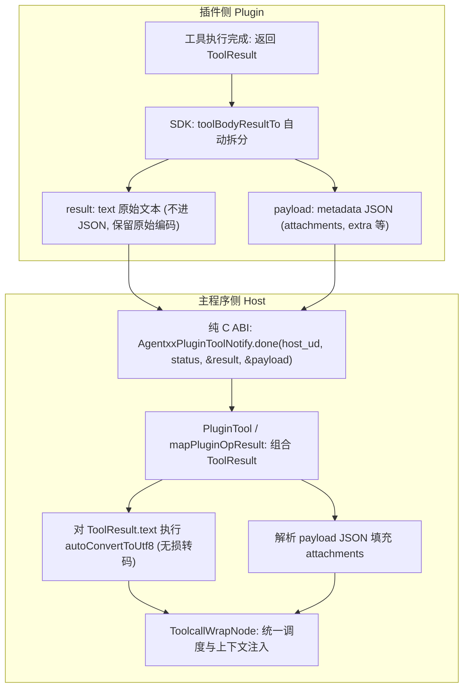

# 设计方案: 插件 Tool API 重构与模型多模态附件读取 (tool-media-attachment)

## 1. 背景与重构动因

在实现模型通过文件路径读取多模态附件的过程中，最初设计采用了单字符串信封包裹协议（`packEnvelope` / `unpackEnvelope`）。经过深度审视与实际工业级场景考量，发现该模式存在根本性缺陷：

1. **字符编码破坏问题（核心痛点）**：
   - 很多工具（如 Windows 命令行执行 `agentxx_execute_command`、本地日志扫描、跨平台文件读取等）返回的原始文本可能是本地代码页（如 GBK / CP936 / Shift-JIS）或包含非标准 UTF-8 字节。
   - agentxx 主程序拥有成熟的自动字符集检测与转码机制（`utilxx_base::autoConvertToUtf8`）。
   - **如果强制将工具输出的文本放入 JSON 序列化**，JSON 规范严格要求必须为合法 UTF-8。序列化库（如 simdjson / nlohmann）在遇到非 UTF-8 字节时，要么直接抛出解析异常，要么将其强制替换为固定占位符 `U+FFFD`。这会导致原始字节流信息被永久破坏，传回主程序后将再也无法进行有效检测和无损转码！
2. **内存与性能开销**：
   - 大文本输出（几百 KB 到数 MB 的代码、日志、命令输出）如果在 C ABI 边界进一次 JSON dump/parse，其中的每个引号、换行、反斜杠都要进行转义与反转义，造成双倍的内存开销与 CPU 损耗。
3. **消除历史兼容包袱**：
   - 本项目最近已提升了最低兼容版本代次，且当前版本尚未正式发布，无旧版本兼容包袱。因此应彻底剔除临时性的 `__agentxx_tool_media__` 信封逻辑，以工业级规范重构插件 Tool C API。

---

## 2. 总体架构设计：双参数分离返回 (`result` + `payload`)

在插件工具执行完成通知的纯 C ABI 层面，将结果解耦为两个独立变量：
- **`result` (`string / PluginxxStringView`)**：代表 `ToolResult.text`，即面向 LLM 和用户阅读的**原始文本**。原样二进制字节传输，绝对不经过 JSON 序列化或转义，保留最原始的字符编码，以便主程序接收后能够无损执行 `autoConvertToUtf8`。
- **`payload` (`string / PluginxxStringView`)**：代表 `ToolResult` 除了 `text` 以外的所有**结构化元数据**（JSON 序列化），包括多模态附件列表 `attachments`，以及未来可能扩展的字段（如 diff、extra 等）。无额外元数据时传空或 `{}`，开销为零。



---

## 3. 详细设计与重构方案

### 3.1 纯 C ABI 契约层重构 (`agentxx/plugin/api/plugin_api.h`)

在 `plugin_api.h` 中专门针对 Tool 异步执行定义双参数完成通知器与回调：

```c
/// 工具执行完成通知器 (主程序在 execute_start 时下发给插件)
typedef struct AgentxxPluginToolNotify {
    void(PLUGINXX_CALL* done)(
        void*                     host_ud,
        int32_t                   status,   ///< 操作终态 (PLUGINXX_OPERATOR_OK / FAILED / CANCELED)
        const PluginxxStringView* result,   ///< 工具文本结果 (原样文本, 允许非 UTF-8, 绝不经过 JSON 转义)
        const PluginxxStringView* payload   ///< 结构化元数据 JSON (ToolResult 除 text 以外的结构化数据, 如 attachments; 可空)
    );
    void* host_ud;
} AgentxxPluginToolNotify;

/// 工具异步调用完成回调 (插件间互调 call_tool_async 使用)
typedef void(PLUGINXX_CALL* AgentxxPluginToolCallback)(
    void*                     ud,
    int32_t                   status,
    const PluginxxStringView* result,
    const PluginxxStringView* payload
);
```

更新 `AgentxxPluginToolSpec` 与 `AgentxxPluginToolsIface`：
1. `AgentxxPluginToolSpec::execute_start` 签名改为接收 `const AgentxxPluginToolNotify* notify`；
2. `AgentxxPluginToolsIface::call_tool_async` 回调签名改为 `AgentxxPluginToolCallback cb`；
3. 保持 8 字节对齐与定长类型规则，清理过时定义。

---

### 3.2 核心数据结构 `ToolResult` 重构 (`agentxx/util/tool_result.h`)

1. **清理过时代码**：
   - 彻底删除 `kToolMediaEnvelopeKey`；
   - 彻底删除 `packEnvelope()` 与 `unpackEnvelope(...)`。
2. **新增元数据拆解与组装接口**：
   ```cpp
   struct ToolResult {
       std::string text;
       ToolStatus  status = ToolStatus::Ok;
       std::vector<agentxx::agent::MediaAttachment> attachments;

       /// 成功结果
       static ToolResult ok(std::string text) {
           return ToolResult{std::move(text), ToolStatus::Ok, {}};
       }
       static ToolResult ok(std::string text, std::vector<agentxx::agent::MediaAttachment> atts) {
           return ToolResult{std::move(text), ToolStatus::Ok, std::move(atts)};
       }
       static ToolResult withAttachments(std::string text, std::vector<agentxx::agent::MediaAttachment> atts) {
           return ToolResult{std::move(text), ToolStatus::Ok, std::move(atts)};
       }
       static ToolResult fail(std::string errorText) {
           return ToolResult{std::move(errorText), ToolStatus::Failed, {}};
       }

       /// 仅将除 text 以外的元数据序列化为 JSON 字符串 (无附件时返回空串)
       std::string metadataPayloadJson() const;

       /// 将元数据 JSON 反序列化并填充至当前对象 (恢复 attachments)
       void loadMetadataPayloadJson(std::string_view payloadJson);

       /// 从 result(text), status 和 payload(metadata JSON) 组装出完整 ToolResult
       static ToolResult fromParts(
           std::string      resultText,
           ToolStatus       st          = ToolStatus::Ok,
           std::string_view payloadJson = {}
       );
   };
   ```

---

### 3.3 插件 SDK 层改造 (`agentxx/plugin/api/plugin_kit.h`)

1. **重构 `detail::toolBodyResultTo`**：
   统一将插件函数返回值拆解为 `result`（正文）与 `payload`（元数据）：
   ```cpp
   template<typename T>
   inline void toolBodyResultTo(
       T&&          value,
       std::string& outResult,
       std::string& outPayload,
       ToolStatus&  outStatus
   ) {
       if constexpr (std::is_same_v<std::decay_t<T>, ToolResult>) {
           outStatus  = value.status;
           outResult  = std::move(value.text);
           outPayload = value.metadataPayloadJson();
       } else {
           outStatus  = ToolStatus::Ok;
           outResult  = std::string(std::forward<T>(value));
           outPayload.clear();
       }
   }
   ```
2. **适配各类工具注册器**（`fast_tool`, `blocking_tool`, `polled_tool`, `tool`）：
   - `execute_start` 接收 `const AgentxxPluginToolNotify* notify`；
   - 在上报结果时，同时传入 `&resultSv` 与 `&payloadSv`：
     `notify->done(notify->host_ud, toolStatusOfOperator(status), &resultSv, &payloadSv);`
3. **适配 `call_tool`**：
   - 互调回调接收 `(status, result, payload)`，直接通过 `ToolResult::fromParts` 恢复。

---

### 3.4 主程序接收层与适配器 (`plugin_manager_adapters.cpp` 等)

1. 在 `PluginTool::execute_async` 中：
   - 创建专用的 `AgentxxPluginToolNotify` 实例，提供双参数 done 回调；
   - 在收到 `result` 和 `payload` 后：
     ```cpp
     ToolResult toolResult = ToolResult::fromParts(
         std::move(rawResultText),
         statusFromOperator(status),
         rawPayloadText
     );
     // 无损自动转码: 原始字节流未受任何 JSON 破坏, 此处可安全进行 UTF-8 校正
     utilxx_base::autoConvertToUtf8(toolResult.text);
     co_return toolResult;
     ```
2. 在 `plugin_manager_capability.cpp` 中同步更新 `callToolAsync` 实现。

---

### 3.5 JS 插件引擎对齐 (`agentxx_javascript_engine.cpp`)

1. 更新 `toolExecuteStart`，适配 `const AgentxxPluginToolNotify* notify`；
2. 在 `applyValueOutcome` 中：
   - 若 JS 函数返回对象含 `{ text, attachments, status }`：
     正文放入 `req->result`；
     `attachments` 放入 `req->payload`（JSON 字符串）；
   - 若返回纯字符串/数字：
     直接放入 `req->result`，`req->payload` 留空；
3. 在终态完成时，以 `notify->done(host_ud, status, &resultSv, &payloadSv)` 报告主程序。

---

### 3.6 文件系统插件 `agentxx_filesystem_read_media`

保持现有高质实现：
- 工具入参：`path`；
- 校验文件存在性、非目录、常规文件属性；
- 后缀白名单校验（图片/音频/视频）与 MIME 解析；
- 配额大小检查（10MB / 25MB / 50MB）；
- 返回 `ToolResult::withAttachments(infoText, {att})`：
  正文 `infoText` 自然落入 `result`，附件元数据自然落入 `payload`，零信封、零 hack！

---

## 4. 边界、异常与数据兼容

1. **编码安全性**：
   - 即使工具输出了非 UTF-8 的二进制文本（如原生命令工具输出），`result` 以裸字节视图直传主程序，绝不触发 JSON 解析异常。
2. **空元数据零开销**：
   - 99% 的普通文本工具无附件，`payload` 传空指针或空视图，主程序直接跳过元数据解析。
3. **彻底清理过时代码**：
   - 全库检索并移除所有 `__agentxx_tool_media__` 字符与 envelope 打包/解包代码。

---

## 5. 分步实施计划

1. **步骤 1**：在 `plugin_api.h` 定义 `AgentxxPluginToolNotify` 和 `AgentxxPluginToolCallback`，更新 `AgentxxPluginToolSpec` 和 `AgentxxPluginToolsIface`；
2. **步骤 2**：重构 `agentxx/util/tool_result.h`，删除 `packEnvelope`/`unpackEnvelope`，新增 `metadataPayloadJson()` 和 `fromParts()`；
3. **步骤 3**：重构 `agentxx/plugin/api/plugin_kit.h` 中的 `toolBodyResultTo` 与 `fast_tool/blocking_tool/polled_tool/tool/call_tool`；
4. **步骤 4**：重构主程序侧 `plugin_manager_adapters.cpp` 与 `plugin_manager_capability.cpp`；
5. **步骤 5**：重构 JS 插件引擎 `agentxx_javascript_engine.cpp`；
6. **步骤 6**：更新单测 `test_filesystem_tools.cpp`，执行编译与完整测试套件验证；
7. **步骤 7**：更新 `work.md` 与总结。
